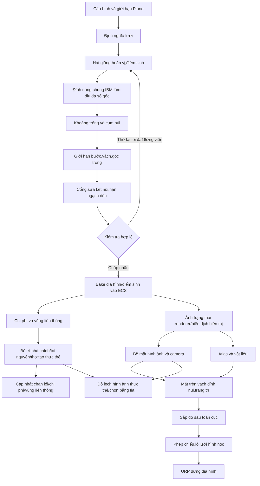

# Bằng chứng và quyết định lịch sử

Các báo cáo dưới đây được hợp nhất để chỉ còn một bộ docs. Nội dung thuộc source và lượt chạy tại thời điểm ghi nhận, có thể mô tả tool/asset nay đã xóa. Không dùng menu hoặc lệnh trong lịch sử như hướng dẫn hiện hành. Trạng thái mới nhất nằm ở [CurrentState](CurrentState.md); thao tác import/design nằm trong [cổng tài liệu](../README.md). Artifact không còn trên đĩa được ghi rõ.


<details>
<summary>ArchitectureDesignQuestions_2026-10-12.md</summary>

# Câu hỏi chốt thiết kế và kiến trúc — 2026-10-12

## Quyết định đã được người dùng xác nhận

| # | Quy tắc đã chốt |
|---|---|
| 1 | Địa hình cố định suốt trận. Xây/hủy nhà và tài nguyên cạn vẫn thay đổi ô bị chặn. |
| 2 | Chỉ xây nhà trên nền phẳng cùng cao độ, không ramp/cliff/mountain. |
| 3 | Được phép xây nhà chặn hoàn toàn lối đi. |
| 4 | Đổi loại khai thác bỏ hàng cũ ngay; Move/Build giữ hàng. |
| 5 | Chỉ chủ sở hữu được điều khiển thực thể. Team không cấp quyền điều khiển chéo người chơi. |
| 6 | Giữ bộ quy tắc hoàn tiền hiện hành; nếu tìm lỗ hổng cần kiểm chứng và hỏi thêm khi chính sách chưa đủ rõ. |
| 7 | lối chơi chạy trên XZ; Y phục vụ trình bày. Collider/projectile hiện hành cần đối chiếu khi tách máy chủ. |
| 8 | Flat experiment chỉ từng để đánh giá hình ảnh, đã từ bỏ và yêu cầu xóa. |
| 9 | chơi nhiều người là mục tiêu từ đầu; cần chuẩn bị các môi trường phù hợp. Mô hình chưa chọn, người dùng giao tác nhân chọn dựa trên tải đã chốt. |
| 10 | Gói tài nguyên khởi đầu phải đủ; cụm phụ có thể thiếu. |
| 11 | Đến vị trí hợp lệ gần nhất rồi dừng. Không triển khai đội hình; thử trước tạo nhiều target/field gây overwhelm. |
| 12 | Unit đuổi theo mục tiêu; Move tắt bắn. Đồng minh, gồm người chơi khác cùng đội, không chịu AOE. |
| 13 | xử lý logic khoảng 20 tick/s; tối đa 2.000 lính tổng toàn trận, bản đồ 512 ×512, 2–10 người chơi. Camera thu phóng, không xoay; che khuất tự nhiên. |

20 tick/s là mục tiêu mô phỏng, không phải 20 FPS dựng hình. Chưa chốt phần cứng máy chủ, ngưỡng latency/bandwidth hoặc FPS máy khách trong lượt này. Không dùng những tiêu chí chưa chốt để tuyên bố đạt hiệu năng.

Lựa chọn của tác nhân: [máy chủ quyết định trạng thái, nội suy phía máy khách và các môi trường kiểm thử](../Multiplayer/ArchitectureChoice_2026-10-12.md). Đây là đề xuất kiến trúc theo ủy quyền; chưa cài package/transport hoặc triển khai máy chủ bản dựng.


</details>


<details>
<summary>ArchitectureDesignReview_2026-10-12.md</summary>

# Rà soát thiết kế và kiến trúc xử lý logic — 2026-10-12

> rà soát lịch sử ngày12/10. Ownership/payment đã được sửa ở các phiên sau; không coi hai finding đó là lỗi còn mở. [Trạng thái hiện tại](CurrentState.md) quyết định việc tiếp tục.

## Kết luận

Đã rà soát các đường xử lý chính của Map/Terrain, chuyển động, Combat, Construction/Production, Economy, người chơi khởi tạo, Input/UI và GameData/Tech Tree. Đây là rà soát mã nguồn kết hợp kiểm thử Unity có chọn lọc, không phải chứng nhận mọi hành vi lối chơi.

Hai lỗi xử lý logic được tái hiện trực tiếp trong Unity: lệnh nhận lệnh từ người chơi khác chủ sở hữu; thanh toán xây dựng cho phép tài nguyên âm khi có chi phí trùng loại. Ưu tiên sửa hai điểm này trước khi mở rộng lối chơi.

địa hình hiện vượt qua kiểm tra luồng xử lý, dựng hình bộ giao diện JadeSlate và Main độ cao kiểm tra nhanh. Chưa đủ bằng chứng để kết luận che khuất lính, chất lượng hình ảnh cận cảnh, UI thực tế hoặc FPS standalone đúng yêu cầu.

Áp dụng mục tiêu kiểm tra → bằng chứng → kiểm chứng của thiết kế-rà soát cho Unity theo phạm vi người dùng đã chọn: kiến trúc xử lý logic, và cả logic/hiển thị riêng cho địa hình. Không áp dụng điểm số web, CSS hoặc kiểm thử trình duyệt cho trò chơi Unity.

## Phạm vi và ranh giới hệ thống

Quyết định đã chốt sau rà soát: địa hình không đổi trong trận; xây/hủy nhà và tài nguyên cạn vẫn thay đổi blockage/cost. Vì vậy kiểm thử cập nhật vật cản khi lính đang đi vẫn cần, nhưng không yêu cầu sinh lại địa hình. Nhà chỉ xây trên nền phẳng, được chặn lối đi. lối chơi dùng XZ; flat experiment đã từ bỏ và được xóa. Xem [quy tắc đã chốt](VerificationHistory.md) và [lựa chọn chơi nhiều người](../Multiplayer/ArchitectureChoice_2026-10-12.md).

| Hệ thống | Thiết kế đang có | Điểm cần ưu tiên |
|---|---|---|
| Map/Terrain | Recipe giá trị → sinh dữ liệu → điều hướng → khởi tạo; hiển thị có trạng thái riêng | Height mô phỏng còn lấy dữ liệu từ hiển thị; thiếu điều kiện thông qua chất lượng ảnh |
| chuyển động | Command/API → request/assignment → integration/direction → targeting/ORCA → actuation → độ cao | Địa hình cố định; vẫn kiểm thử động chặn lối; không thêm đội hình hoặc mục tiêu riêng mỗi lính |
| Combat | Spatial ngăn → acquisition → chase/shoot → projectile → health/destruction | Cần kiểm tra hồi quy đổi mục tiêu, death/linked group, AOE và thứ tự cập nhật thực tế |
| Construction | Request → kiểm tra/thu tiền → instantiate/reserve → builder → completion/cancel | Thanh toán trùng loại; đặt nhà chỉ xét chi phí, không xét bề mặt như khởi tạo |
| Production/Tech | Offer/blob → queue/payment sổ theo dõi → đang chờ tech → completion/refund | Ledger và đang chờ tech là nền tốt; caller identity chưa thống nhất với lệnh |
| Economy | thợ trạng thái machine, depot/node bộ nhớ đệm, giao hàng vào PlayerContext | Đổi loại tài nguyên bỏ hàng là chủ ý; Move/Build phải giữ hàng; bộ nhớ đệm tạo lại mỗi update |
| người chơi khởi tạo | Lập toàn bộ đặt nhà trước ECB; Finalizing → Ready | Main đạt nhưng một khai báo trước bước cố định group bị bỏ qua; tùy chọn tài nguyên thiếu hạn ngạch |
| Input/UI | lựa chọn lọc cục bộ người chơi; UI gọi helper/command | Quyền sở hữu phải kiểm tra ở mô phỏng, không chỉ lựa chọn; chưa kiểm thử bằng thao tác thật UI |
| GameData | SO → kiểm tra hợp lệ → registry/blob; tech tree có kiểm tra cycle | bộ kiểm tra hợp lệ cảnh báo trùng lặp chi phí, nhưng nhà thanh toán chưa cộng tổng |

Luồng chính:

```text
Recipe -> GridTerrain + Spawn + Hash -> Cost/Island -> Bootstrap -> GameplayReady
             |                            |
             +-> Compile/Renderer         +-> Command -> Move/Build/Production
                       |                                      |
                       +-> TerrainVisualSurface -> Height jobs -+
```

Nhánh TerrainVisualSurface → Height jobs là phụ thuộc ngược cần xem lại nếu mô phỏng chạy trên máy chủ.

## Findings ưu tiên

### F1 — P1: lệnh không kiểm tra người chơi phát lệnh với chủ sở hữu mã nguồn

Bằng chứng khi chạy: thế giới ECS riêng, lính có EntityOwner.PlayerID=2; lệnh Move có PlayerId=1. Sau cập nhật CommandQueue, MoveOverride được bật và mục tiêu đổi thành (3,0,4). `foreign-owner move accepted=True`.

[CommandQueue.cs](../../Assets/_Project/Scripts/Runtime/Simulation/Commands/CommandQueue.cs): ProcessCommand/IsValidSourceEntity kiểm tra khả năng nhưng không kiểm tra quyền sở hữu. Progression đi vào helper trước bước IsValidSourceEntity; ProductionJobs lấy chủ sở hữu từ bên sản xuất, không nhận người chơi phát lệnh. EntityCapabilities.CanBuild kiểm tra builder/site cùng chủ sở hữu, chưa kiểm tra người phát lệnh.

Ảnh hưởng: mã nguồn thực thể hợp lệ nhưng thuộc người chơi khác vẫn có thể bị điều khiển qua hàng đợi. Đã chứng minh lỗi ở mô phỏng; chưa chứng minh người dùng có thể khai thác qua UI hiện hành hay lớp truyền dữ liệu, vì chưa có lớp truyền dữ liệu.

Đề xuất: kiểm tra Exists, EntityOwner và người phát lệnh ở cửa nhận lệnh trước mọi thay đổi trạng thái; chỉ bỏ qua quyền sở hữu qua một API nội bộ có hợp đồng rõ ràng. Test người chơi đúng/sai, mã nguồn đã chết/destroyed, Move/TargetTo/Build/Progression; từ chối phải giữ nguyên khả năng, hàng đợi và tài nguyên.

### F2 — P1: Xây dựng thanh toán từng dòng thay vì tổng theo tài nguyên kiểu

Bằng chứng khi chạy: người chơi có 100; EntityResourceCost gồm 60+60 cùng loại. CanAfford trả true; DeductCost ghi tài nguyên còn -20. Probe gọi đúng hai hàm private sản xuất bằng reflection, chưa đi qua toàn bộ placement/repair.

[BuildingPlacementSystem.cs](../../Assets/_Project/Scripts/Runtime/Simulation/Construction/BuildingPlacementSystem.cs): CanAfford và DeductCost. [BuildingAuthoring.cs](../../Assets/_Project/Scripts/Runtime/Simulation/Authoring/Building/BuildingAuthoring.cs) chuyển dữ liệu sang ECS từng dòng không tổng hợp. DefinitionValidator chỉ cảnh báo trùng loại và yêu cầu thanh toán cộng tổng. ProductionJobs đã tổng hợp chi phí, chứng minh quy tắc hiện chưa nhất quán. BuilderSystem sửa cũng kiểm tra từng dòng nên cần kiểm tra hồi quy tương tự; chưa tái hiện sửa trong lượt này.

Đề xuất: dùng cùng một quy tắc tổng hợp/validate trước thu tiền cho đặt nhà, sửa, sản xuất và xem trước. Test trùng loại, đủ/thiếu tài nguyên, NaN/âm/overflow, từ chối không trừ tiền và hủy không hoàn hai lần. Không clamp về 0 để che lỗi thiếu tiền.

### F3 — P2: Khai báo thứ tự ECS không tương đương thứ tự thực thi

Bằng chứng nhật ký Unity mới: `UpdateAfter/UpdateBefore` bị bỏ qua trên GridSnapperSystem → MapTerrainGenerationSystem; SetupUnitMoverDefaultPositionSystem → MovementAgentPathRequestSystem/FlowFieldAssignmentSystem; SelectableSpatialSystem → SelectSystem; ShootAttackSystem → HealthDeadTestSystem; FlowFieldCleanupSystem → MovementAgentActuatorSystem; PlayerContextSyncSystem → PlayerContextCacheInitSystem. PlayerBootstrapSystem trước FixedStepSimulationSystemGroup còn bị bỏ qua do OrderFirst/OrderLast.

Không phải tất cả tạo lỗi hành vi: LateSimulation vốn chạy sau bước cố định group, nên một số attribute chỉ thừa. Nhưng việc diễn giải phụ thuộc dựa trên các attribute này không an toàn.

Đề xuất: ghi thứ tự theo group thực tế; bỏ attribute thừa, và biểu diễn phụ thuộc cần thiết bằng group thứ tự hoặc trạng thái điều kiện thông qua. Có kiểm tra hồi quy cho spawn/setup/request, khởi tạo điều hướng, đặt nhà và tài nguyên bộ nhớ đệm initialization. Không yêu cầu địa hình đổi kết nối lưới giữa trận. Không gán mọi cảnh báo từ dữ liệu kiểm thử tự tạo là lỗi Main; nhật ký này phân biệt cảnh báo ở RunRegression với cảnh báo ở mặc định thế giới ECS của Main.

### F4 — P2: Quy tắc nền xây nhà giữa khởi tạo và lối chơi không thống nhất

Bằng chứng mã nguồn: PlayerSpawnPlacement.TryBuilding loại dốc nối tầng, RampInfluence, cliff/mountain, khác heightLevel và yêu cầu mã thoát ring. BuildingPlacementSystem.IsAreaFree và BuildingPlacer.CanPlace chỉ xét vùng chiếm chỗ, nút chi phí=1 và lính ngăn; không đọc GridTerrain.

Ảnh hưởng cần kiểm chứng: có thể đặt vùng chiếm chỗ trên dốc nối tầng hoặc chiếm lối đi mà khởi tạo sẽ từ chối. Đây là thiếu hợp đồng đặt nhà chung, chưa phải lỗi hình ảnh đã tái hiện trong Main.

Quy tắc đã xác nhận: chỉ xây nền phẳng cùng cao độ, không ramp/cliff/mountain; được phép chặn lối đi. Dùng bộ kiểm tra hợp lệ bề mặt chung cho preview/simulation; mã thoát ring của khởi tạo không áp làm điều kiện bắt buộc cho lối chơi. Test từ chối ramp/nền lệch mức, chấp nhận chặn lối đi hợp lệ, hai request cùng vị trí và cancel/rebuild.

### F5 — P2, rủi ro kiến trúc: Độ cao mô phỏng lấy từ bề mặt hiển thị

Bằng chứng mã nguồn: TerrainHeightCacheSystem đọc TerrainVisualSurface.Active, chỉ Ready khi bề mặt tồn tại. ApplyTerrainHeightJob ghi LocalTransform.Y từ dữ liệu đó. MapTerrainPresentationSystem chỉ dành cho local/client thế giới ECS. Chuyển raised/flat chỉ thuộc thử nghiệm cũ; toggle và kiểm thử chuyển mode đã xóa sau khi người dùng bỏ ý định ép phẳng.

Main cục bộ đang đạt. Chưa chạy máy chủ thế giới ECS và chưa có chơi nhiều người lớp truyền dữ liệu; không kết luận máy chủ khi chạy đang lỗi.

Quy tắc đã xác nhận: lối chơi dùng XZ, Y phục vụ trình bày. Trước chơi nhiều người cần tách rõ dữ liệu hình ảnh khỏi máy chủ; current gốc collider/projectile vẫn sử dụng Y nên chưa coi việc xác nhận quy tắc là đã hoàn thành refactor. Test máy chủ không hiển thị, máy khách cùng ảnh trạng thái và thay bộ giao diện không đổi XZ navigation/range.

### F6 — Đã đóng về thiết kế: Đổi loại tài nguyên xóa hàng đang mang là chủ ý

Bằng chứng mã nguồn: CommandQueue.HandleGather đặt CarryAmount=0 khi CurrentResourceType khác nút mới. Lệnh đổi tài nguyên vì vậy loại bỏ số hàng chưa giao, không có bước hoàn trả hoặc giao kho. Chưa chạy tình huống lối chơi này.

Người dùng chọn bỏ hàng ngay khi đổi loại khai thác, nhưng Move/Build giữ hàng. Không sửa CarryAmount=0 trong nhánh đổi loại tài nguyên. kiểm tra hồi quy phải phân biệt hai hành vi này; giữ kiểm thử nút depleted/depot chết/mất đường. Phản hồi UI về việc bỏ hàng là đề xuất, chưa triển khai.

### F7 — P2, khoảng trống kiểm thử: Render đạt chưa xác nhận chất lượng hình ảnh

CanonicalTerrainValidation kiểm tra vật liệu, đỉnh, thứ tự vẽ lô, picks, vòng đời và số pixel xanh; không có golden image, close-up hoặc unit/cliff che khuất. TerrainPresentationValidation còn kiểm tra cơ chế độ lệch legacy, nên ĐẠT của nó không thay thế Main độ cao kiểm tra nhanh hiện hành.

Ảnh JadeSlate trong lượt này có terrain/cliff/ramp/mountain và không trắng. Ở overview 512 ×512, ảnh vật liệu khá dày, các dốc nối tầng nhỏ và đường cao độ khó đánh giá. Đây là nhận xét ảnh dữ liệu kiểm thử, không phải kết luận về Game View ở mọi thu phóng.

Đề xuất: cố định seed/config, camera, bộ giao diện, độ phân giải và graphics thiết lập; dựng hình overview/cận cảnh, lính trước/sau vách, đường lên dốc nối tầng, chọn bằng tia ở biên. So ảnh với mốc so sánh được duyệt và kiểm tra vùng quan trọng, không dùng một ngưỡng MAE toàn ảnh làm tiêu chí duy nhất.

## Kiểm thử mới đã chạy

Các kết quả raised/flat/raised bên dưới là lịch sử trước dọn dẹp. Lượt xóa flat mode được ghi riêng cuối trang; Main kiểm tra nhanh hiện chỉ kiểm tra địa hình raised ổn định, không còn tùy chọn chuyển mode.

Unity 6000.3.13f1, Windows, batchmode có graphics Direct3D11. Không dùng -nographics cho dựng hình. Ba lượt chạy trên checkout hiện hành:

| Entry point | Kết quả mới | Giới hạn |
|---|---|---|
| CanonicalTerrainValidation.RunCleanupSuite | Marker ĐẠT; độ lệch nạp lại, núi integration Main config512, tài nguyên bộ lập kế hoạch dữ liệu kiểm thử, bộ mẫu cũ tham chiếu dựng hình | bộ giao diện tham chiếu, không phải JadeSlate; không phải full lối chơi |
| `ArchitectureReviewValidation.Run` | Process mã thoát 0; MapRuntimePipelineValidation ĐẠT; JadeSlate dựng hình ĐẠT; F1/F2 được tái hiện | Probes báo hành vi hiện tại, không phải kiểm tra hồi quy suite đạt cho hợp đồng ownership/payment |
| `TerrainHeightMainSmoke.Run` | Process mã thoát 0; độ cao kiểm tra hồi quy, trường hướng lấy mẫu, obstacle né vật cản và Main kiểm tra nhanh ĐẠT | 90 khung hình, không phải kiểm tra chạy dài, FPS hoặc kiểm tra toàn bộ UI/combat/economy |

Main: 1.960 tĩnh gốc, 40 agents; bán kính=0,732422 thế giới ECS lính, radiusCells=0,375; raised/flat/raised mỗi pha 30 khung hình. khởi tạo Ready. tài nguyên bộ lập kế hoạch đặt 661/904 cụm, 1.952 nút; thiếu 243 cụm. Không suy ra thiếu guaranteed package: cần đọc báo cáo theo role/player để đánh giá fairness.

JadeSlate dữ liệu kiểm thử: 20.336 đỉnh Y0 của địa hình bộ dựng hình, 3 lô theo thứ tự vẽ thứ tự, 1.948 wall đỉnh, 268 dốc nối tầng đỉnh và 499 núi ô. Điều này không có nghĩa gốc lính Y0: độ cao kiểm tra nhanh kiểm tra gốc theo height/pivot thực tế.

Log Main còn có SerializationException của metadata hình ảnh Scripting cho kiểu đã mất (NonDragSelectable, Readme…) và cảnh báo hai xem trước cảnh chưa đóng lúc shutdown. Chưa truy nguyên nguồn; không gán các lỗi Editor này cho lối chơi hay tự xóa bộ nhớ đệm để làm nhật ký sạch.

## Chạy lại và bằng chứng

bộ kiểm thử ArchitectureReviewValidation.cs (nguồn lịch sử hiện không còn trên đĩa) giữ lại để lặp pipeline/current-bộ giao diện dựng hình và hai probe. Probe không dùng xác nhận điều kiện từ chối: mã thoát 0 nghĩa phép đo hoàn tất, không có nghĩa F1/F2 đã sửa. Sau khi sửa khi chạy, cần đổi thành kiểm tra hồi quy xác nhận điều kiện rejection/non-negative số dư.

```powershell
# Trong PowerShell, dùng đường dẫn Unity Editor được cài trên máy.
& 'C:/Program Files/Unity/Hub/Editor/6000.3.13f1/Editor/Unity.exe' -batchmode -projectPath 'D:/Unity/TechTextAndChosingForRTS sample' -executeMethod ArchitectureReviewValidation.Run -quit -logFile 'Artifacts/design-review-architecture.log'
# Smoke tự thoát sau hoàn tất; không thêm -quit vào lượt Play Mode này.
& 'C:/Program Files/Unity/Hub/Editor/6000.3.13f1/Editor/Unity.exe' -batchmode -projectPath 'D:/Unity/TechTextAndChosingForRTS sample' -executeMethod TerrainHeightMainSmoke.Run -logFile 'Artifacts/design-review-main-smoke.log'
```

- Probe observations (nguồn lịch sử hiện không còn trên đĩa).
- JadeSlate chụp (nguồn lịch sử hiện không còn trên đĩa), atlas (nguồn lịch sử hiện không còn trên đĩa), dựng hình kiểm tra (nguồn lịch sử hiện không còn trên đĩa).
- dọn dẹp suite nhật ký (nguồn lịch sử hiện không còn trên đĩa), architecture/current-bộ giao diện nhật ký (nguồn lịch sử hiện không còn trên đĩa), Main kiểm tra nhanh nhật ký (nguồn lịch sử hiện không còn trên đĩa).
- Main độ cao result (nguồn lịch sử hiện không còn trên đĩa).

## Thứ tự xử lý đề xuất

1. Sửa F1/F2 và kiểm tra hồi quy đúng/sai quyền sở hữu, atomic thanh toán, repair/refund.
2. Áp dụng đặt nhà nền phẳng/chặn lối đi hợp lệ, tài nguyên discard/retain đã chốt và thứ tự group; kiểm thử các chuyển trạng thái, gồm động chặn lối.
3. Bổ sung hình ảnh mốc so sánh địa hình và dữ liệu kiểm thử unit/cliff/ramp, kiểm tra Game View tại nhiều thu phóng.
4. Trước chơi nhiều người: tách authoritative độ cao khỏi hiển thị và chạy máy chủ thế giới ECS không graphics.
5. Profiling Economy/ResourcePlanner theo scenario riêng; không chọn tối ưu từ số lượng cấp phát mã nguồn hoặc số đo batchmode như thể đó là FPS bản dựng.

Lượt rà soát ban đầu chỉ thêm harness/báo cáo. Lượt cập nhật sau đã xóa flat experiment theo yêu cầu, gồm nhánh chuyển dữ liệu sang ECS bộ dựng hình, flag độ cao, cảnh trường và kiểm thử riêng; giữ địa hình hiện hành và artifact lịch sử. Chưa sửa các lỗi ownership/payment/placement hoặc thêm lớp truyền dữ liệu. Các thay đổi giữ chưa commit. Bài học: suite tham chiếu không xác nhận bộ giao diện Main; kiểm tra nhanh tự quản Play Mode không dùng -quit; probe observation không đồng nghĩa kiểm tra hồi quy đạt.

## Khoảng trống bổ sung sau khi chốt quy tắc

- AOE phải bỏ qua cả người chơi khác cùng đội. ArtilleryBulletMoverSystem hiện chỉ so PlayerID; chưa có mô hình Team/Alliance trong khi chạy, nên miễn sát thương cho chủ sở hữu chưa đáp ứng quy tắc đồng minh. Cần relationship dữ liệu ở mô phỏng và kiểm thử cùng owner/cùng team/enemy/neutral; chưa sửa trong dọn dẹp.
- Mục tiêu 20 tick/s, 2.000 lính tổng toàn trận, bản đồ tối đa 512 ×512, 2–10 người chơi. Movement/command/production/combat/economy phải có thời gian authoritative theo bước mô phỏng; SimulationSystemGroup hiện chưa tự trở thành 20 Hz chỉ vì chuyển động nằm trong FixedStep.
- Giữ hoàn tiền hiện tại: Train/Research hủy hoàn toàn bộ thanh toán; Construction hủy hoàn phần chưa làm, nhà hoàn thành không hoàn bản dựng chi phí; bên sản xuất chết có nhánh CancelAll(hoàn tiền=true). Cần kiểm thử damage/destruction diễn ra sau ProductionSystem cùng khung hình: HealthDeadTestSystem có thể xóa producer/queue trước update tiếp, trong khi sổ theo dõi không có dọn dẹp riêng. Đây là rủi ro thứ tự cần tái hiện, chưa kết luận lỗi khi chạy hoặc tự đổi chính sách hoàn tiền.

## Kiểm chứng dọn dẹp flat experiment

Sau xóa flat mode, hai process Unity đều mã thoát 0:

- `ArchitectureReviewValidation.Run`: MAP_RUNTIME_PIPELINE_PASS, dựng hình JadeSlate đạt (20.336 đỉnh, 3 lô, wall/ramp/mountain/picking và Clear/rebuild); ownership/payment probes vẫn ghi lỗi cũ, chưa sửa.
- `TerrainHeightMainSmoke.Run`: độ cao kiểm tra hồi quy gồm replacement/restore bề mặt; Main Ready và 90 khung hình địa hình độ cao ổn định, 1.960 tĩnh gốc/40 agents. Không còn toggle raised/flat.

Log mới: architecture/render (nguồn lịch sử hiện không còn trên đĩa), Main kiểm tra nhanh (nguồn lịch sử hiện không còn trên đĩa). Không còn BakeFlatTexture, Inspector/scene trường, ApplyEntityOffsets hoặc FlatTerrainTextureValidation trong source/scene/prefab. địa hình lấy mẫu ngoài bản đồ trả độ cao 0 vẫn giữ theo quy tắc giới hạn, không phải flat mode. Tests này không đo tải 2.000 lính, bước mô phỏng 20 Hz hay xác nhận natural che khuất đã đạt.


</details>


<details>
<summary>Cleanup_2026-10-12.md</summary>

# Dọn dự án để tiếp tục nghiên cứu chuyển động

Ngày 2026-10-12. Phạm vi: bản thử nghiệm thuật toán, tổ chức test/tool Editor và điểm vào tài liệu. Không thay thuật toán khi chạy trong lượt dọn này.

Cập nhật cuối ngày: theo yêu cầu người dùng, MovementAlgorithmLab đã được loại hoàn toàn cùng bin/obj và artifact riêng. Phần mô tả gom bản thử nghiệm bên dưới là lịch sử bước dọn trước đó. Runtime tối ưu và kiểm tra hồi quy Unity vẫn giữ; các kết quả trước khi xóa tóm tắt ở [MovementOptimization_Results](VerificationHistory.md).

## Đã loại

- Bốn dự án bản thử nghiệm rời FieldBatch/QueueBatch/AdjacencyBatch/SeedBatch, gồm bin/obj của chúng, thay bằng một MovementAlgorithmLab.
- integration_lab.py, build_adjacency_lab.py và script chuyển đổi dùng một lần. Oracle Bellman–Ford được giữ bằng lệnh oracle trong công cụ mới.
- Trang đội hình lỗi thời và meta đi kèm; hướng dẫn chuyển động cũ chuyển thành điểm vào tài liệu hiện hành.
- TerrainTextureBenchmark.cs và MapGenerationStageBenchmark.cs cùng meta: đo hiệu năng một lần phụ thuộc seeds.txt của artifact cũ, không có caller C# hoặc serialized GUID tham chiếu. Kết quả/docs lịch sử vẫn giữ, không còn điểm gọi chạy lại trong mã nguồn.

## Đã tổ chức

- 6 test/harness chuyển động về Tests/Editor/Movement.
- 4 kiểm tra hồi quy địa hình về Tests/Editor/Terrain, giữ flat mode vì bộ dựng hình vẫn có chức năng đó.
- MainRuntimeBenchmark về Tests/Editor/Performance.
- 2 công cụ authoring/import địa hình về Scripts/Editor/Terrain.
- Một bản thử nghiệm .NET với Commands và Common, dữ liệu kiểm thử dùng chung và link helper sản xuất.

26 tệp .cs/.meta di chuyển giữ nguyên SHA256 và GUID. Manifest (nguồn lịch sử hiện không còn trên đĩa) lưu đường dẫn trước/sau và mã băm. Không đổi tên class hoặc Unity trình đơn.

## Giữ cho nghiên cứu tiếp

Giữ Integration bucket/mask/seed hiện tại, chính-luồng marker, Unity kiểm tra hồi quy, soak/profiler và khi chạy evidence. Baseline/source/result riêng của standalone bản thử nghiệm đã loại; giữ tóm tắt kết quả trong tài liệu. Giữ scenes/prefabs/fixtures/artwork/phụ thuộc cùng Unity bộ nhớ đệm đang dùng. Chưa triển khai hierarchy/portal.

## Kiểm chứng

Trước khi loại bản thử nghiệm, bản thống nhất bản dựng ĐẠT; oracle, hạt giống, mặt nạ và hàng đợi đều được chạy lại sau tổ chức. Kết quả chi tiết của bản thử nghiệm đã xóa; [tóm tắt](VerificationHistory.md) vẫn giữ. Chưa chạy Unity/Burst trong lượt dọn; việc chuyển .cs có thể khiến Editor import/recompile. Public điểm gọi và GUID của kiểm thử Unity không đổi.

Oracle: 100 bản đồ nhỏ ĐẠT. hạt giống: 1000 mục tiêu và 8 điều kiện chặn ĐẠT. mặt nạ: 1000 trường ×3 lần, 40 thay đổi blocked/unblocked ĐẠT. Queue: 1000 trường ×3 lần, 0 bestcost khác FIFO. 26 tệp di chuyển được kiểm tra lại mã băm; đường dẫn mã nguồn liên kết và các link ở điểm vào tài liệu đều hợp lệ.

Điểm vào: [ProjectStructure](../ProjectStructure.md), [kiểm thử danh mục](../../Assets/_Project/Tests/README.md), [kết quả đã lưu](VerificationHistory.md), [chuyển động bàn giao](VerificationHistory.md).


</details>


<details>
<summary>DocsCleanup_2026-10-14.md</summary>

# Dọn tài liệu — 14/10/2026

**Mở [trang bắt đầu](../README.md) để dùng bộ tài liệu còn lại.**

Đã loại 64 tệp docs/snapshot theo yêu cầu: redirects/trang nghỉ dùng, labJS đã xóa khỏi mã nguồn, research/plan bộ dựng hình cũ, bàn giao đã được CurrentState thay thế, kế hoạch hoàn thành và Git-status theo phiên. Manifest xóa và nguồn thay thế (nguồn lịch sử hiện không còn trên đĩa) ghi từng tệp, lý do, replacement và SHA256 trước xóa.

Giữ tài liệu algorithm/reference/manual hiện hành và báo cáo có bằng chứng riêng. Giữ toàn bộ logs/receipts/artwork trong Artifacts/ArtSource. Những số đo khối lượng công việc khác nhau không bị gộp thành một kết luận hiệu năng mới.

Docs/README là cửa vào; CurrentState là nguồn trạng thái, lộ trình chỉ ghi việc còn lại. Terrain/GameData/MapGen có mục lục riêng; GianLuoc là cách đọc ngắn, không thêm implementation. Danh mục nguồn đã sinh lại từ tệp thực tế. Không chạy mô phỏng hoặc sửa khi chạy trong lượt dọn này; thay đổi chưa commit.

PrototypeJS và dữ liệu đo còn sót đã chuyển nguyên nội dung sang Artifacts/MapGenPrototypeHistory. Manifest chuyển và mã băm (nguồn lịch sử hiện không còn trên đĩa) ghi 54 tệp; nguồn hình ảnh mỹ thuật Docs/MapGeneration/Art giữ nguyên.

Kiểm chứng cuối: python Tools/CheckDocsLinks.py kiểm tra122Markdown files (Docs/root/Tools/Assets/ArtSource),0broken cục bộ targets. Đối chiếu điểm neo trong Docs/root không tìm fragment mất. rà soát độc lập bắt hai đoạn chơi nhiều người cũ; đã sửa ownership/payment máy chủ-thế giới ECS nghiệm thu, lượt thử nhỏ máy chủ+2client và nhãn link architecture. DesignerSetup/BlobDefinitions đã bỏ ảnh trạng thái cũ nói ID tooling/baker chưa có và tra cứu tuyến tính. Không chạy Unity/test khi chạy.


</details>


<details>
<summary>MovementOptimization_Results.md</summary>

# Kết quả tối ưu chuyển động đã chốt

Ngày 2026-10-12. Người dùng tạm chấp nhận mức tối ưu hiện tại và yêu cầu loại MovementAlgorithmLab. Source bản thử nghiệm, bin/obj và artifact riêng của bản thử nghiệm đã được dọn; trang này giữ tóm tắt các kết quả trước khi xóa. Không còn điểm gọi standalone để chạy lại.

## Runtime giữ lại

- IntegrationBucketQueue: Dial hàng đợi 269 ngăn, bỏ mục chi phí cũ, tái sử dụng vị trí.
- GridNeighborMaskSystem: mặt nạ 8 hướng dùng chung, tính trước Integration, bộ nhớ đệm theo topologyVersion.
- IntegrationSeedUtility: một vùng liên thông có kết nối lưới hiện hành và mục tiêu đi được thì chọn hạt giống trực tiếp; các trường hợp khác giữ full scan.
- Marker Integration.Reset, Integration.Seeds, Integration.Propagate để đọc bộ đo hiệu năng.

Không thêm hierarchy/portal. Test Unity hiện hành vẫn ở Assets/_Project/Tests/Editor/Movement.

## Kiểm tra độc lập đã hoàn tất

| Bộ kiểm tra | Kết quả |
|---|---|
| ngăn + mặt nạ so với Bellman–Ford | 100 bản đồ nhỏ ĐẠT |
| hạt giống shortcut so với full scan | 1000 mục tiêu, 8 điều kiện chặn ĐẠT |
| Queue so với FIFO | 1000 trường 512 ×512 ×3 lần, 0 bestcost khác |
| mặt nạ + ngăn so với FIFO | 1000 trường 512 ×512 ×3 lần, 0 bestcost khác |
| Đóng/mở ô, gồm góc bản đồ | 40 ca mặt nạ khớp kiểm tra độc lập |

Thử nghiệm được quản lý C# cho thấy ngăn có lợi ở bản đồ trọng số cao nhưng FIFO nhanh hơn ở bản đồ trống/cost đồng nhất. mặt nạ giảm phần lan truyền khoảng 6–20% trong các lượt standalone. Các kiểm thử dùng adapter được quản lý cho NativeArray/NativeList, không chứng minh Burst/ECS phụ thuộc hoặc lối chơi khung hình time.

Người dùng báo riêng Integration trong đột biến thời gian giảm khoảng 25 xuống 20 ms sau mặt nạ trên máy mạnh; đột biến thời gian không xảy ra mọi khung hình. Chưa có artifact Profiler cho phản hồi đó hoặc số khi chạy của hạt giống shortcut. Không coi các số standalone là hiệu quả Unity đã đo.

[Handoff](VerificationHistory.md) và [tài liệu Integration](../Architecture/Movement/MovementAgent/Field/IntegrationField/IntegrationFieldSystem.md) vẫn là nơi đọc code/giới hạn hiện tại.


</details>


<details>
<summary>OwnershipFix_2026-10-13.md</summary>

# Sửa quyền điều khiển — 2026-10-13

> Báo cáo kết quả lịch sử. Các bộ kiểm thử gameplay/menu kiểm thử nêu dưới đây đã xóa theo yêu cầu ngày14/10/2026; không chạy lại theo điểm gọi cũ. [Trạng thái hiện tại](CurrentState.md).
Đã sửa quyền sở hữu theo quy tắc: chỉ chủ sở hữu điều khiển thực thể, không dùng đội để cấp quyền điều khiển chéo. Thay đổi chưa commit/stage/push.

## Nguyên nhân và thay đổi

- CommandQueue trước đây chỉ kiểm tra khả năng cho Move/TargetTo; Build/Progression chạy trước kiểm tra hợp lệ. Probe lịch sử `Artifacts/ArchitectureReview/probes.txt` ghi foreign-chủ sở hữu move accepted=True.
- `CommandAuthority.CanControl` kiểm tra người phát lệnh không âm, thực thể nguồn tồn tại, không phải mẫu đối tượng, có EntityOwner và PlayerID khớp. Gate chạy trong bên xử lý trước mọi nhánh lệnh và thay đổi trạng thái.
- Source khả năng kiểm tra hợp lệ chuyển lên trước Build/Progression. TargetTo cũng từ chối mục tiêu đã xóa thực thể.
- lệnh hàng đợi được ảnh trạng thái và clear trước xử lý: đặt nhà tạo thực thể làm không hợp lệ DynamicBuffer đang duyệt, nên không giữ bộ đệm qua structural change. Lệnh được thêm trong quá trình xử lý sẽ dành cho update kế tiếp.
- BuildingCancelSystem từ chối thực thể thiếu chủ sở hữu thay vì mặc định cho phép. BuildingPlacementSystem dùng điều kiện thông qua chung khi xét thợ và khi dispatch lệnh cho thợ.
- `ProductionJobs.Enqueue` yêu cầu playerId explicit và kiểm tra điều kiện thông qua. TrainUnitHelper/nút Train cũ chuyển qua lệnh hàng đợi có người phát lệnh, không gọi sản xuất trực tiếp; UI không bật Train cho thực thể khác chủ sở hữu.

## Kiểm tra hồi quy mới

Bằng chứng bên dưới được tạo bằng bộ kiểm thử quyền sở hữu có điều kiện xác nhận trước khi harness/menu đó được xóa. xử lý logic khi chạy hiện ở `Simulation/Commands/Validation/CommandAuthority.cs`.

Fixture thế giới ECS độc lập kiểm tra issuer1/2/-1 trên thực thể owner2 cho Move, Attack, Gather, Build, đặt nhà, Production và Cancel. Owner hợp lệ được chấp nhận; foreign/negative người phát lệnh không đổi ability/target/queue/payment/balance. Production dùng danh mục dữ liệu và Train/Unit/Civ blobs thật. Thêm mã nguồn null/despawn/thiếu owner/prefab và hủy thiếu chủ sở hữu.

## Bằng chứng mới

| Kiểm tra | Kết quả |
|---|---|
| biên dịch khi chạy + editor bằng compiler/source generators hiện hành | Exit0; có warning/info sẵn có ngoài quyền sở hữu |
| quyền sở hữu trên dự án gốc | `COMMAND_OWNERSHIP_PASS`, exit0, `Artifacts/ownership-green.log` |
| Core trên dự án gốc | Exit0, `Artifacts/ownership-core.log`; data/ramp/importer/override/rollback/height/map pipeline/height kiểm tra hồi quy ĐẠT |
| quyền sở hữu trên bản sao riêng | `COMMAND_OWNERSHIP_PASS`, exit0, `Artifacts/ownership-clone-green.log` |
| Đối chứng bỏ so sánh chủ sở hữu trong bản sao | Exit1 đúng `Move ownership failed issuer=1`, `Artifacts/ownership-red-mutant.log`; điều kiện thông qua đã khôi phục sau lượt chạy |

báo cáo quyền sở hữu: `Artifacts/Ownership/results.txt`. Bản sao kiểm thử ở thư mục visualizations của chat; không thay điều kiện thông qua của dự án gốc để chạy đối chứng. Một số lượt lô đầu không chạy vì Editor dự án gốc đang mở; chỉ các lượt hoàn tất nêu trên là bằng chứng nghiệm thu.

Không sửa thanh toán duplication/refund vòng đời, đội AOE, đặt nhà bề mặt hoặc tích hợp mạng trong phạm vi này. Khi có lớp truyền dữ liệu, người phát lệnh phải lấy từ kết nối đã xác thực; điều kiện thông qua hiện kiểm tra người chơi identity mà mô phỏng nhận vào, chưa phải mạng authentication.


</details>


<details>
<summary>ProgressionReference_Results_2026-10-13.md</summary>

# Progression theo GameBlobReference — 2026-10-13

> Báo cáo kết quả lịch sử. Các bộ kiểm thử gameplay/menu kiểm thử nêu dưới đây đã xóa theo yêu cầu ngày14/10/2026; không chạy lại theo điểm gọi cũ. [Trạng thái hiện tại](CurrentState.md).
ảnh trạng thái trước tối ưu tìm kiếm nhị phân. API progression bên dưới vẫn dùng; trạng thái tra cứu mới xem [RegistryBinaryLookup_Results_2026-10-13.md](VerificationHistory.md).

Đã thay `CommandQueueElement.DataIndex` bằng `Progression: GameBlobReference` có sẵn (`CatalogKey + ID`). Lookup hiện tại dùng tìm kiếm nhị phân theo (TypeKey, ID), không cấp phát cache/map; generic wrapper và mã băm overload dùng cùng tra cứu. Vòng O(n) chỉ thuộc phiên bản trước tối ưu.

## API

```csharp
var typed = registry.GetBlobByID<TrainBlob>(jobId, out var result);
var untyped = registry.GetBlobByID(RegistryTypeKey.For<TrainBlob>(), jobId, out result);
var blob = registry.GetBlobByID(reference, out result);

CommandDataHelper.AddCommandToQueue(em, playerId, producer,
    CommandType.Progression, progression: offer.JobReference);
```

Hai overload không generic trả `UnsafeUntypedBlobAssetReference`. `RegistryBlobElement.Create<T>(blob)` tạo mục gồm kiểu hash/ID/blob; RegistryAuthoring dùng factory này khi chuyển dữ liệu sang ECS. ID trong mục tránh phải đoán layout hoặc liệt kê từng loại blob khi tra cứu bằng mã băm. Generic `GetBlobByID<T>` vẫn giữ signature cũ.

ProductionJobs nhận tham chiếu thay chỉ số, xác nhận quyền sở hữu và bên sản xuất có lựa chọn được cung cấp cùng kiểu+ID trước khi resolve/unlock/payment. Train/Research được dispatch theo danh mục mã băm; UnitPrefab lấy từ lựa chọn được cung cấp của bên sản xuất. Các bước payment/queue/pending research/refund giữ hợp đồng cũ.

CommandMenu/CommandButton và nút Train đã truyền tham chiếu. chỉ số còn dùng cho vị trí nút legacy hoặc phương án dự phòng chọn bản dựng lựa chọn được cung cấp ở UI, không nằm trong progression lệnh. `FormerlySerializedAs("dataIndex")` giữ giá trị bản dựng phương án dự phòng cũ khi đổi tên trường UI.

## Kiểm chứng

| Lượt | Kết quả |
|---|---|
| RED trước implementation | Exit1 đúng `Registry must support lookup by hash key + ID`; `Artifacts/progression-reference-red-final.log` |
| `ProgressionReferenceValidation.Run` | ĐẠT/mã thoát0; `Artifacts/progression-reference-green.log` |
| `CommandOwnershipValidation.Run` | ĐẠT/mã thoát0; `Artifacts/progression-reference-ownership.log` |
| TerrainUpgradeValidation.RunCore | ĐẠT/mã thoát0; data/ramp/importer/override/rollback/height/map luồng xử lý; `Artifacts/progression-reference-core.log` |
| `TerrainHeightMainSmoke.Run` | ĐẠT/mã thoát0, Main Ready, 40 tác nhân/1960static gốc/90 khung hình; `Artifacts/progression-reference-main.log` |

kiểm tra hồi quy dùng blob/registry/producer thế giới ECS thật: hash/generic trả cùng cấp phát, cùng ID ở Train/Research chọn đúng kiểu, tra cứu missing/default/wrong kiểu không đạt; lựa chọn được cung cấp đổi thứ tự sau thêm vào hàng đợi vẫn chạy đúng Train, lựa chọn được cung cấp bị gỡ hoặc tác vụ có trong danh mục dữ liệu nhưng không được bên sản xuất cung cấp bị từ chối; foreign/negative người phát lệnh không tạo job/trừ tiền. Research đúng work/cost và đang chờ tech.

Runtime+Editor biên dịch và ECS post-processing hoàn tất trong các lượt Unity. Warning obsolete AddComponent, metadata hình ảnh Scripting thiếu Readme và xem trước-cảnh cảnh báo có sẵn vẫn còn; không sửa hoặc coi đã đóng các vấn đề đó.

Registry bộ đệm lược đồ dữ liệu đã đổi và Main kiểm tra nhanh chạy sau chuyển dữ liệu sang ECS lại thành công. Không thêm subtype enum mới, không mang raw pointer trong lệnh, không khôi phục danh mục dữ liệu bản đồ hoặc bộ dựng hình legacy. Thay đổi chưa stage/commit/push. Đây là nghiệm thu contract/rebake, không phải tải2.000 lính hoặc mạng nghiệm thu.


</details>


<details>
<summary>RegistryBinaryLookup_Results_2026-10-13.md</summary>

# Tra cứu danh mục dữ liệu bằng tìm kiếm nhị phân — 2026-10-13

> Báo cáo kết quả lịch sử. Các bộ kiểm thử gameplay/menu kiểm thử nêu dưới đây đã xóa theo yêu cầu ngày14/10/2026; không chạy lại theo điểm gọi cũ. [Trạng thái hiện tại](CurrentState.md).
Đã thực hiện phương án người dùng đồng ý: sắp xếp một lần lúc chuyển dữ liệu sang ECS theo cặp `(TypeKey, ID)`, rồi tìm kiếm nhị phân cả cặp. API kiểu tổng quát/mã băm/GameBlobReference giữ nguyên; không thêm danh mục dữ liệu bản đồ, bộ nhớ đệm hoặc hệ thống khởi tạo khi chạy.

## Implementation

- `RegistryBlobElement` implement `IComparable<RegistryBlobElement>`: so sánh long TypeKey rồi FixedString64Bytes ID. Cùng phép so sánh được dùng cho baking và tra cứu, không phụ thuộc culture hoặc phép trừ có thể overflow.
- `RegistryAuthoring.Baker` gom blob entries trong danh sách, đăng ký blob tài nguyên như trước, rồi publish bộ đệm theo sắp xếp ổn định. danh sách được clear đầu/cuối chuyển dữ liệu sang ECS. Không sắp xếp RegistryPrefabElement; mọi Base.PrefabIndex và liên kết mẫu đối tượng giữ nguyên.
- Lookup dùng cận dưới với khoảng `[low, high)` để tìm mục đầu tiên có cặp không nhỏ hơn mục tiêu. Nếu đúng cặp, trả blob hợp lệ đầu tiên; các khóa trùng chỉ được xét trong đúng nhóm đó, giữ hành vi cũ khi có mục null hoặc trùng lặp.
- Key duy nhất: O(nhật ký n). Nếu có d trùng lặp cùng cặp: O(nhật ký n + d) trong trường hợp phải bỏ qua tham chiếu thiếu. Không sort/allocate/check toàn bộ đệm mỗi lần tra cứu.
- Fixture tạo bộ đệm thủ công đã sắp xếp trước tra cứu. bên cung cấp khi chạy mới nếu có phải bảo đảm cùng điều kiện bất biến; không thêm phương án dự phòng tuyến tính làm che bộ đệm sai thứ tự.

## Bằng chứng mới

| Kiểm tra | Kết quả |
|---|---|
| RED hợp đồng sắp xếp trước implementation | Exit1 do mục chưa implement IComparable; `Artifacts/registry-binary-red.log` |
| `ProgressionReferenceValidation.Run` cuối | ĐẠT/mã thoát0; `Artifacts/registry-binary-final.log` |
| `CommandOwnershipValidation.Run` | ĐẠT/mã thoát0; `Artifacts/registry-binary-ownership.log` |
| TerrainUpgradeValidation.RunCore | ĐẠT/mã thoát0; map/height/importer/rollback/override; `Artifacts/registry-binary-core.log` |
| `TerrainHeightMainSmoke.Run` sau chuyển dữ liệu sang ECS lại | ĐẠT/mã thoát0; Main Ready, 40 tác nhân/1960static gốc/90 khung hình; `Artifacts/registry-binary-main.log` |

kiểm tra hồi quy tra cứu kiểm tra đầu/giữa/cuối, chữ hoa/thường và Unicode, thiếu ID trước/giữa/sau vùng, kiểu ngoài khoảng, rỗng/chỉ một phần tử, mục không có blob, trùng lặp giữ tham chiếu hợp lệ đầu tiên, cùng ID khác kiểu và kiểu tổng quát/mã băm cùng cấp phát. Progression Train/Research, lựa chọn được cung cấp đổi thứ tự/loại bỏ/không được cung cấp và quyền sở hữu từ chối tiếp tục đạt.

Runtime/Editor biên dịch và ECS post-processing hoàn tất trong các lượt Unity. Main còn metadata hình ảnh Scripting Readme/NonDragSelectable và xem trước-cảnh cảnh báo đã có trước; không chỉnh các vấn đề đó trong phạm vi này.

Đây là thay đổi độ phức tạp tra cứu có kiểm tra hồi quy correctness; chưa đo tác động FPS/tick hoặc tuyên bố hệ số tăng tốc. Thay đổi giữ chưa stage/commit/push.


</details>


<details>
<summary>CrashAudit_2026-10-10.md</summary>

# Rà soát sự cố dừng đột ngột — 2026-10-10

Đã đọc Editor.log trong12thư mục sự cố dừng đột ngột mới nhất dưới `C:/Users/Legion/AppData/Local/Temp/Unity/Editor/Crashes` và Editor.log hiện tại. Phân loại theo stack gây thoát sau `OUTPUTTING STACK TRACE` cuối, không theo warning hay thông báo nhập trước đó. Chưa phân tích minidump bằng trình gỡ lỗi native.

| Thư mục sự cố dừng đột ngột | Nhóm stack gây thoát |
|---|---|
| Crash_2026-10-10_144352647 | Gỡ lỗi lưới / hình chữ nhật Handles |
| Crash_2026-10-10_144012952 | Trình biên dịch Burst / LLVM21 |
| Crash_2026-10-10_143346632 | Gỡ lỗi lưới / hình chữ nhật Handles |
| Crash_2026-10-10_142902681 | Trình biên dịch Burst / LLVM21 |
| Crash_2026-10-10_142759876 | Gỡ lỗi lưới / hình chữ nhật Handles |
| Crash_2026-10-10_142422852 | Trình biên dịch Burst / LLVM21 |
| Crash_2026-10-10_141906472 | Gỡ lỗi lưới / hình chữ nhật Handles |
| Crash_2026-10-10_141254179 | Trình biên dịch Burst / LLVM21 |
| Crash_2026-10-10_091316502 | Trình biên dịch Burst / LLVM19 |
| Crash_2026-10-10_084415803 | Trình biên dịch Burst / LLVM19 |
| Crash_2026-10-10_083554198 | Trình biên dịch Burst / LLVM19 |
| Crash_2026-10-09_091948577 | Trình biên dịch Burst / LLVM19 |

## Gỡ lỗi lưới: đã xử lý đường gọi lặp

Cả bốn sự cố dừng đột ngột gỡ lỗi đều có `UnityEditor.Handles.DrawSolidRectangleWithOutline -> FlowFieldDebugDrawer.DrawWalkability -> OnDrawGizmos`. Lượt mới nhất xảy ra khi URP vẽ gizmo trong GameView. Dòng source khác vì phần gỡ lỗi đã đổi, nhưng đường gọi giống nhau.

Phần gỡ lỗi được thêm trong chat đã đưa vào đường gọi này. Đã bỏ toàn bộ vẽ Handles và thao tác zTest khỏi GridDebug.cs. Walkability dùng đường viền Gizmos và tùy chọn Debug.DrawLine không kiểm tra độ sâu. Giữ tọa độ lưới, khớp địa hình và màu chi phí. Không còn ô tô kín hay nhãn Handles. Điều này loại đường gọi gây sự cố dừng đột ngột đã quan sát; cần phiên Unity mới để xác minh độ ổn định khi chạy.

Tài liệu Unity về vẽ Gizmos trong OnDrawGizmos: https://docs.unity.com/en-us/engine/6000.0/script-reference/unityengine/monobehaviour/ondrawgizmos

## Burst: nhóm sự cố dừng đột ngột compiler riêng chưa giải quyết

Tám báo cáo sự cố dừng đột ngột trong burst-llvm native trên luồng compiler Burst. Báo cáo mới nhất có `WriteModuleObjectToMemory -> WriteModuleObject -> AotModule.WriteModuleToDisk -> HashAndCompileMethodGroup`, nên thuộc biên dịch/backend, không phải stack tác vụ chuyển động đang chạy. Báo cáo trước dùng LLVM19,các báo cáo mới dùng LLVM21; đây là nhóm sự cố dừng đột ngột compiler lặp, chưa nhất thiết cùng một lỗi nội bộ.

Package đã cài là Burst1.8.30,Unity6000.3.13f1. Log không xác định tác vụ nào của dự án gây sự cố dừng đột ngột compiler. Không hạ package,xóa bộ nhớ đệm hoặc tắt Burst toàn cục khi chưa có quan hệ nguyên nhân. Sửa Gizmos không giải quyết sự cố dừng đột ngột compiler riêng này. Muốn cô lập tiếp cần phân tích dump native hoặc tái hiện compiler có kiểm soát với thông tin thời điểm/đích biên dịch.

## Bằng chứng điều hướng lấy từ log sự cố dừng đột ngột mới nhất

rà soát cuối chạy **512 ×512**,cỡ ô**1.953125**,không phải256 ×256:

- Ô địa hình bị mở sai:0.
- Cạnh tầng mở sai:0.
- Lính trong ô chặn/ngoài lưới:0 ở ảnh trạng thái đó.
- Blocker tài nguyên thiếu/sai:0.
- Ô footprint tài nguyên vẫn mở:0.
- chuyển dữ liệu sang ECS tài nguyên đang chờ:0.
- Cạnh ramp mở có độ cao gián đoạn:27.
- Raw hướng không an toàn:430017;stored hướng không an toàn:429942. Tổng trên các trường Ready,không phải số ô/lính duy nhất.

Ảnh trạng thái không hỗ trợ giả thuyết tài nguyên thiếu chặn lưới. Nó hỗ trợ điều tra liền độ cao cạnh ramp và bất nhất steering/quy tắc góc integration. Chưa chứng minh sự việc lúc xuyên vách được báo vì không ghi quỹ đạo chuyển động.

## Kiểm chứng

Đã biên dịch C# runtime/Editor sau khi thay đường vẽ. Không chạy tái hiện GUI/crash native. Giữ warning compiler không liên quan đã có.


</details>


<details>
<summary>MainRuntimePerformance.md</summary>

# Main khi chạy: khởi động và CPU khung hình

## Trạng thái mới nhất — 2026-10-12

Main hiện dùng [luồng xử lý ECS](../MapGeneration/EcsMapPipeline.md), ảnh lưới hình học ảnh ảnh sprite/atlas và [khởi tạo ECB](../MapGeneration/BootstrapCrashFix.md). [Flat experiment](../MapGeneration/PendingTerrainHeight.md) đã xóa; các số đo có chuyển dữ liệu sang ECS ảnh vật liệu dưới đây là lịch sử, không phải đo hiệu năng khi chạy sau dọn dẹp. Số đo tách chi phí dựng hình khỏi tổng Play → Ready:

| Khâu, Main 512 ×512 | Trước luồng xử lý ECS | ECS trước bản vá ECB | ECS + ECB, lượt mới nhất |
|---|---:|---:|---:|
| Generate địa hình trong khi chạy | Không đo; địa hình sinh ở bộ chuyển dữ liệu sang ECS | 994,71 ms | 959,99 ms |
| Compile/build địa hình, gồm đường chuyển dữ liệu sang ECS ảnh vật liệu | 1.242,03 ms | 829,25 ms | 840,44 ms |
| tài nguyên bộ lập kế hoạch | 20.752,77 ms | 21.897,98 ms | 20.616,21 ms |
| Play → Ready | 48,73 s | 49,63 s | 26,55 s |

Workload: 8 người chơi, 1.952 tài nguyên, 661/904 cụm, 5.985 dựng hình thực thể. Hai lượt sau bản vá (Burst biên dịch đồng bộ rồi biên dịch mặc định) hoàn thành 600 frame/lượt, sổ theo dõi đủ 2.000 thực thể duy nhất, GameplayReady/render/camera đạt. bộ nhớ đệm Burst cũ đã sao lưu và tạo lại; không tắt Burst trong dự án.

**Renderer không chậm hơn theo probe bản dựng này.** Chuyển sinh dữ liệu từ bộ chuyển dữ liệu sang ECS sang khi chạy khiến khoảng 0,96 giây công việc xuất hiện sau Play. tài nguyên bộ lập kế hoạch vẫn đồng bộ trên chính luồng khoảng 20,6 giây; nó có thể trì hoãn PresentationSystemGroup và khung hình hiển thị đầu tiên. Chưa có probe riêng đo chính xác first visible địa hình.

luồng xử lý rõ ràng hơn là cải thiện dữ liệu, thứ tự và quyền sở hữu. Chưa chuyển planner/generator sang jobs/Burst. Không quy chênh 49,63 → 26,55 giây riêng cho ECB: nạp lại, nhập, bộ nhớ đệm và biên dịch chưa được chuẩn hóa giữa các lượt. Không cộng bootstrapWaitingUpdates với resourcePlan vì phạm vi khởi tạo bao chứa bộ lập kế hoạch.

Ưu tiên tiếp theo **chưa triển khai**: profile các vòng tìm candidate/kiểm tra vùng chiếm chỗ của tài nguyên bộ lập kế hoạch; giảm quét lặp; tách lập kế hoạch khỏi bước publish thực thể. Cho địa hình hiển thị trước khi bộ lập kế hoạch hoàn tất cần bộ lập kế hoạch nhường chính luồng hoặc chạy tác vụ, cùng trạng thái loading phù hợp; chỉ đổi thứ tự hệ thống chưa đủ.

Artifacts: `pre-ecs-pipeline-results.json`, `ecs-pipeline-final-results.json`, `bootstrap-crash-fix-normal-results.json` trong `Artifacts/MainRuntimeBenchmark`. Log mới: `Artifacts/MainRuntimeBenchmark-bootstrap-crash-fix-normal.log`.

## Lịch sử đo 256 ×256 — trước flat ảnh vật liệu và luồng xử lý ECS

Đo ngày 2026-10-12 với Unity 6000.3.13f1, Main Play Mode trong Editor batchmode có graphics. VSync tắt, targetFrameRate không giới hạn; mỗi pha 20 khung hình đã làm nóng-up và 200 khung hình đo. Không lưu các thay đổi bật/tắt bộ dựng hình vào cảnh. Đây là phép đo chẩn đoán CPU, không phải FPS GameView tương tác hay standalone/GPU.

Cấu hình thực tế: bản đồ 256 ×256, 8 người chơi, 2.619 dựng hình thực thể, 830 tài nguyên nút. tài nguyên bộ lập kế hoạch yêu cầu 904 clusters, đặt được 290.

| Pha | Cũ trung vị / p95 (ms) | ComponentLookup trung vị / p95 (ms) |
|---|---:|---:|
| Main đầy đủ | 14,07 / 16,56 | 12,48 / 14,89 |
| Tắt địa hình (độ lệch cũng dừng) | 3,88 / 4,60 | 2,09 / 4,19 |
| Giữ địa hình, tắt độ lệch và khôi phục | 3,06 / 4,12 | 2,26 / 2,93 |

khung hình Main giảm khoảng 11,3%, nhưng các pha đối chứng cũng nhanh hơn ở lượt sau. Hai lượt tuần tự không đủ để quy toàn bộ chênh lệch cho thay đổi mã. Bằng chứng rõ nhất là chi phí CPU giảm mạnh khi tắt offset/restore mà vẫn giữ địa hình.

Tổng probe độ lệch+khôi phục trong pha Main (bao gồm đã làm nóng-up và công việc ở ranh giới pha): 2.057,69 ms → 1.640,89 ms, giảm 20,3%. Không chia tổng này cho 200 để suy ra chi phí chính xác mỗi khung hình.

## Thay đổi đã giữ

TerrainVisualOffsetSystem lấy ComponentLookup<LocalToWorld> một lần rồi đọc/ghi qua tra cứu, thay cho EntityManager.Get/SetComponentData trong từng thực thể. Bỏ ghi khi ma trận không đổi. Giữ nguyên khôi phục ma trận trước mô phỏng, bộ nhớ đệm thực thể, dựng ma trận qua Parent/PostTransformMatrix và xử lý logic độ cao lấy mẫu.

CanonicalTerrainValidation.RunCleanupSuite ĐẠT: bộ nhớ đệm null, khôi phục mô phỏng Y=0, thực thể bị xóa, mô hình phân cấp và tỷ lệ, địa hình Clear/rebuild và tài nguyên bộ lập kế hoạch. đo hiệu năng Main hoàn thành 600 khung hình ở cả hai lượt.

## Khởi động

Thời gian từ yêu cầu vào Play đến Ready: 21,86 → 16,80 giây. Bao gồm domain nạp lại, streaming/baking và khởi tạo; không phải thời gian Generate riêng. Không coi chênh lệch này là hiệu quả bản sửa độ lệch.

tài nguyên bộ lập kế hoạch riêng: 3.796,81 → 3.199,24 ms. Compile/build địa hình: 242,04 → 230,94 ms. Phần thời gian khởi động còn lại chưa được phân tách đủ để kết luận nguyên nhân.

Các đo hiệu năng Generate/texture trước đó không bao gồm toàn bộ Main khởi động và chi phí chạy mỗi khung hình. Vì vậy chúng không dự báo được FPS lối chơi.

## Ưu tiên tiếp theo

1. Offset/restore vẫn tốn CPU: cân nhắc bộ nhớ đệm cho tĩnh renderers hoặc truyền độ cao vào đường dựng hình, nhưng phải giữ physics/simulation phẳng và xử lý thực thể spawn/despawn. ComponentLookup là bước tối ưu nhỏ, chưa giải quyết tận gốc.
2. tài nguyên đặt nhà: profile các lần flood connectivity/Dijkstra, giảm quét lại toàn bản đồ khi thử đặt cụm. Đây là nút thắt khởi tạo đã đo được.
3. Đo interactive/standalone với GPU bộ đo hiệu năng và bật/tắt gizmos. Debug lưới trong Editor có thể tăng chi phí; lô đo hiệu năng không xác nhận chi phí này.

Cả hai nhật ký đều có cảnh báo Persistent cấp phát leak khi thoát và lỗi mã hóa dữ liệu của tooling Editor. Chưa xác định allocation/type gây ra; các cảnh báo không được tính là đã sửa bởi thay đổi độ lệch.

## Artifacts

- Artifacts/MainRuntimeBenchmark/baseline-results.json: số liệu trước.
- Artifacts/MainRuntimeBenchmark/results.json: số liệu sau.
- Artifacts/MainRuntimeBenchmark.log và MainRuntimeBenchmark-candidate.log: nhật ký hai lượt.
- Artifacts/MainRuntimeBenchmark-offset-validation.log: kiểm tra correctness.
- Assets/_Project/Tests/Editor/Performance/MainRuntimeBenchmark.cs: bộ kiểm thử tái hiện.

## Đo Main 512 ×512 — thử lại thành công

Play → Ready: **29,689 giây**, 8 người chơi. Log `MainRuntimeBenchmark-512-retry.log` xác nhận `Entering Playmode with Reload Domain disabled` và `Reload Scene disabled`. Mốc bắt đầu nằm ngay trước yêu cầu vào Play, không gồm thời gian mở Editor ban đầu. Vì vậy số này đã loại domain nạp lại khi vào Play. Các lượt 256 trước chạy cùng dự án nhưng chưa ghi tách cấu hình nạp lại trong báo cáo; không nên tiếp tục mô tả domain nạp lại như một phần chắc chắn của các số đó.

tài nguyên bộ lập kế hoạch: **19.391,50 ms**; khởi tạo Waiting tổng **19.433,99 ms** (bao gồm bộ lập kế hoạch, không cộng hai số). địa hình compile/build: **601,91 ms**. Phần còn lại khoảng 9,65 giây gồm các công việc vào Play/nạp ECS/khởi tạo khác, chưa được phân tách; không quy cho domain nạp lại.

lưới thực tế được xác nhận 512. tài nguyên đặt nhà: 904 clusters yêu cầu, 661 đặt được, 1.952 nút; 5.985 dựng hình thực thể. đo hiệu năng hoàn thành 600 khung hình. Một lần đo, không phải trung vị nhiều lượt khởi động.

Artifacts: `Artifacts/MainRuntimeBenchmark/results-512.json`, `Artifacts/MainRuntimeBenchmark-512-retry.log`. Trường `afterReloadReadySeconds=0` trong JSON cũ là mốc không được kích hoạt khi nạp lại bị tắt, không phải khởi động bằng 0; đã bỏ mốc không dùng này khỏi bộ kiểm thử.


</details>


<details>
<summary>MapGen_200Seed_Audit.md</summary>

# Sinh bản đồ: 200 hạt giống ngẫu nhiên

Scene: `Assets/_Project/Scenes/Main/EntitySubscene.unity`. Cấu hình: `Assets/_Project/Tests/Fixtures/MapGeneration/MapGenConfig.asset`. Lưới: **256 ×256**, cellsize=3.90625. Số người chơi=8.

- Lượt sinh bản đồ thất bại: **0/200 = 0.00%**.
- Ứng viên bị từ chối: **8/208 = 3.85%**.
- Bản đồ bị từ chối ứng viên đầu: **8/200 = 4.00%**.
- Lượt dùng phương án dự phòng (ứng viên9trở lên): **0/200**.

## Lý do từ chối ứng viên

| Lý do | Số lượng | % tổng ứng viên | % ứng viên bị từ chối |
|---|---:|---:|---:|
| Không có cổng vách hợp lệ nối các đảo còn lại | 8 | 3.85% | 100.00% |

## Phân bố số ứng viên

| Ứng viên mỗi bản đồ | Bản đồ |
|---:|---:|
| 1 | 192 |
| 2 | 8 |

Trung bình ứng viên/bản đồ: **1.040**. Tối đa: **2**. Thời gian sinh khi chạy: trung vị **371.2 ms**, p95 **411.3 ms**, tổng **77.1 s** (không tính chi phí bộ chạy).

## Theo từng hạt giống

| hạt giống | Kết quả bản đồ | Ứng viên | Bị từ chối | Dự phòng | Thời gian(ms) | Lý do từ chối |
|---|---|---:|---:|---|---:|---|
| 60532317 | ĐẠT | 1 | 0 | Không | 373.3 |  |
| 107033691 | ĐẠT | 1 | 0 | Không | 385.1 |  |
| 111167143 | ĐẠT | 1 | 0 | Không | 366.4 |  |
| 132704933 | ĐẠT | 1 | 0 | Không | 371.1 |  |
| 153404758 | ĐẠT | 1 | 0 | Không | 372.7 |  |
| 189655997 | ĐẠT | 1 | 0 | Không | 369.1 |  |
| 190603403 | ĐẠT | 1 | 0 | Không | 386.9 |  |
| 199822655 | ĐẠT | 1 | 0 | Không | 375.2 |  |
| 239623665 | ĐẠT | 1 | 0 | Không | 411.3 |  |
| 259855674 | ĐẠT | 1 | 0 | Không | 406.6 |  |
| 297763580 | ĐẠT | 1 | 0 | Không | 385.1 |  |
| 311854645 | ĐẠT | 1 | 0 | Không | 361.8 |  |
| 356089960 | ĐẠT | 2 | 1 | Không | 678.0 | Không có cổng vách hợp lệ nối các đảo còn lại ×1 |
| 385257891 | ĐẠT | 1 | 0 | Không | 364.6 |  |
| 410317979 | ĐẠT | 1 | 0 | Không | 411.0 |  |
| 434796732 | ĐẠT | 1 | 0 | Không | 365.8 |  |
| 490128462 | ĐẠT | 1 | 0 | Không | 376.3 |  |
| 533335026 | ĐẠT | 2 | 1 | Không | 693.1 | Không có cổng vách hợp lệ nối các đảo còn lại ×1 |
| 538794784 | ĐẠT | 1 | 0 | Không | 365.4 |  |
| 574555949 | ĐẠT | 1 | 0 | Không | 368.8 |  |
| 581625556 | ĐẠT | 1 | 0 | Không | 378.2 |  |
| 599206796 | ĐẠT | 1 | 0 | Không | 363.6 |  |
| 605577963 | ĐẠT | 1 | 0 | Không | 374.5 |  |
| 639644800 | ĐẠT | 1 | 0 | Không | 371.8 |  |
| 670142976 | ĐẠT | 1 | 0 | Không | 378.0 |  |
| 673767209 | ĐẠT | 1 | 0 | Không | 372.4 |  |
| 684985015 | ĐẠT | 1 | 0 | Không | 370.5 |  |
| 690939295 | ĐẠT | 1 | 0 | Không | 364.6 |  |
| 699472101 | ĐẠT | 1 | 0 | Không | 374.2 |  |
| 712166281 | ĐẠT | 1 | 0 | Không | 367.0 |  |
| 773281531 | ĐẠT | 1 | 0 | Không | 373.3 |  |
| 775183029 | ĐẠT | 1 | 0 | Không | 363.9 |  |
| 782821254 | ĐẠT | 1 | 0 | Không | 366.5 |  |
| 804424114 | ĐẠT | 1 | 0 | Không | 365.8 |  |
| 807887612 | ĐẠT | 1 | 0 | Không | 378.3 |  |
| 834318039 | ĐẠT | 1 | 0 | Không | 363.8 |  |
| 836478108 | ĐẠT | 2 | 1 | Không | 666.7 | Không có cổng vách hợp lệ nối các đảo còn lại ×1 |
| 840336535 | ĐẠT | 1 | 0 | Không | 362.4 |  |
| 860334557 | ĐẠT | 1 | 0 | Không | 371.5 |  |
| 861342864 | ĐẠT | 1 | 0 | Không | 360.4 |  |
| 863468783 | ĐẠT | 1 | 0 | Không | 373.1 |  |
| 872454320 | ĐẠT | 1 | 0 | Không | 371.5 |  |
| 875933494 | ĐẠT | 1 | 0 | Không | 368.1 |  |
| 876959842 | ĐẠT | 1 | 0 | Không | 361.6 |  |
| 906746953 | ĐẠT | 1 | 0 | Không | 378.3 |  |
| 951060476 | ĐẠT | 1 | 0 | Không | 370.8 |  |
| 961446879 | ĐẠT | 1 | 0 | Không | 374.4 |  |
| 967306141 | ĐẠT | 1 | 0 | Không | 388.3 |  |
| 967402796 | ĐẠT | 1 | 0 | Không | 373.1 |  |
| 986053149 | ĐẠT | 1 | 0 | Không | 363.2 |  |
| 994475254 | ĐẠT | 1 | 0 | Không | 377.7 |  |
| 1034637420 | ĐẠT | 1 | 0 | Không | 368.2 |  |
| 1085371533 | ĐẠT | 1 | 0 | Không | 374.4 |  |
| 1095098640 | ĐẠT | 1 | 0 | Không | 365.7 |  |
| 1102831197 | ĐẠT | 1 | 0 | Không | 368.9 |  |
| 1107702438 | ĐẠT | 1 | 0 | Không | 368.3 |  |
| 1117009444 | ĐẠT | 1 | 0 | Không | 376.7 |  |
| 1127153386 | ĐẠT | 1 | 0 | Không | 372.3 |  |
| 1130817096 | ĐẠT | 1 | 0 | Không | 378.4 |  |
| 1132745993 | ĐẠT | 1 | 0 | Không | 373.4 |  |
| 1143374495 | ĐẠT | 1 | 0 | Không | 377.8 |  |
| 1147473950 | ĐẠT | 1 | 0 | Không | 370.4 |  |
| 1246006842 | ĐẠT | 1 | 0 | Không | 382.6 |  |
| 1325346834 | ĐẠT | 1 | 0 | Không | 377.4 |  |
| 1369675479 | ĐẠT | 1 | 0 | Không | 419.1 |  |
| 1373624042 | ĐẠT | 1 | 0 | Không | 362.1 |  |
| 1384400609 | ĐẠT | 1 | 0 | Không | 367.4 |  |
| 1416936463 | ĐẠT | 1 | 0 | Không | 377.9 |  |
| 1420891325 | ĐẠT | 1 | 0 | Không | 378.9 |  |
| 1478584691 | ĐẠT | 1 | 0 | Không | 367.0 |  |
| 1481752099 | ĐẠT | 1 | 0 | Không | 390.8 |  |
| 1494349759 | ĐẠT | 2 | 1 | Không | 687.3 | Không có cổng vách hợp lệ nối các đảo còn lại ×1 |
| 1545723839 | ĐẠT | 1 | 0 | Không | 484.1 |  |
| 1552481044 | ĐẠT | 1 | 0 | Không | 370.5 |  |
| 1556270198 | ĐẠT | 1 | 0 | Không | 385.2 |  |
| 1563447644 | ĐẠT | 1 | 0 | Không | 363.7 |  |
| 1568630890 | ĐẠT | 1 | 0 | Không | 375.9 |  |
| 1610214380 | ĐẠT | 1 | 0 | Không | 376.4 |  |
| 1632841326 | ĐẠT | 1 | 0 | Không | 379.3 |  |
| 1654358524 | ĐẠT | 1 | 0 | Không | 370.9 |  |
| 1662512564 | ĐẠT | 1 | 0 | Không | 378.1 |  |
| 1687861719 | ĐẠT | 1 | 0 | Không | 371.7 |  |
| 1693829144 | ĐẠT | 1 | 0 | Không | 384.4 |  |
| 1699354125 | ĐẠT | 1 | 0 | Không | 375.5 |  |
| 1720580152 | ĐẠT | 1 | 0 | Không | 371.3 |  |
| 1805700733 | ĐẠT | 1 | 0 | Không | 371.3 |  |
| 1815131049 | ĐẠT | 1 | 0 | Không | 375.1 |  |
| 1818747589 | ĐẠT | 1 | 0 | Không | 364.5 |  |
| 1820762981 | ĐẠT | 1 | 0 | Không | 385.8 |  |
| 1897721642 | ĐẠT | 1 | 0 | Không | 376.4 |  |
| 1901026168 | ĐẠT | 1 | 0 | Không | 388.7 |  |
| 1910523373 | ĐẠT | 1 | 0 | Không | 365.6 |  |
| 1948195210 | ĐẠT | 1 | 0 | Không | 379.0 |  |
| 2001459729 | ĐẠT | 1 | 0 | Không | 370.4 |  |
| 2004806341 | ĐẠT | 1 | 0 | Không | 378.5 |  |
| 2053439983 | ĐẠT | 1 | 0 | Không | 379.2 |  |
| 2065750269 | ĐẠT | 1 | 0 | Không | 381.2 |  |
| 2085891398 | ĐẠT | 1 | 0 | Không | 368.9 |  |
| 2102275572 | ĐẠT | 1 | 0 | Không | 369.1 |  |
| 2103345115 | ĐẠT | 1 | 0 | Không | 369.6 |  |
| 2115918244 | ĐẠT | 1 | 0 | Không | 377.1 |  |
| 2210070879 | ĐẠT | 1 | 0 | Không | 363.3 |  |
| 2233394332 | ĐẠT | 1 | 0 | Không | 378.8 |  |
| 2255014351 | ĐẠT | 1 | 0 | Không | 368.9 |  |
| 2259849871 | ĐẠT | 1 | 0 | Không | 384.6 |  |
| 2353399345 | ĐẠT | 1 | 0 | Không | 373.8 |  |
| 2369786611 | ĐẠT | 1 | 0 | Không | 397.8 |  |
| 2372324067 | ĐẠT | 1 | 0 | Không | 372.3 |  |
| 2389885480 | ĐẠT | 1 | 0 | Không | 375.6 |  |
| 2421783831 | ĐẠT | 1 | 0 | Không | 356.5 |  |
| 2440882452 | ĐẠT | 1 | 0 | Không | 373.8 |  |
| 2453449092 | ĐẠT | 1 | 0 | Không | 365.3 |  |
| 2494806698 | ĐẠT | 1 | 0 | Không | 393.8 |  |
| 2499217788 | ĐẠT | 1 | 0 | Không | 370.8 |  |
| 2500752038 | ĐẠT | 1 | 0 | Không | 369.3 |  |
| 2514924827 | ĐẠT | 1 | 0 | Không | 372.1 |  |
| 2515598327 | ĐẠT | 1 | 0 | Không | 378.3 |  |
| 2543358077 | ĐẠT | 1 | 0 | Không | 378.0 |  |
| 2564222150 | ĐẠT | 1 | 0 | Không | 375.6 |  |
| 2567833972 | ĐẠT | 1 | 0 | Không | 371.0 |  |
| 2582032660 | ĐẠT | 1 | 0 | Không | 375.6 |  |
| 2583743704 | ĐẠT | 1 | 0 | Không | 357.3 |  |
| 2588568727 | ĐẠT | 1 | 0 | Không | 380.0 |  |
| 2589501571 | ĐẠT | 1 | 0 | Không | 369.9 |  |
| 2617228282 | ĐẠT | 1 | 0 | Không | 383.4 |  |
| 2704707105 | ĐẠT | 1 | 0 | Không | 387.7 |  |
| 2727131214 | ĐẠT | 1 | 0 | Không | 372.2 |  |
| 2774553116 | ĐẠT | 1 | 0 | Không | 365.9 |  |
| 2789967609 | ĐẠT | 1 | 0 | Không | 368.3 |  |
| 2807039738 | ĐẠT | 1 | 0 | Không | 365.2 |  |
| 2820638684 | ĐẠT | 1 | 0 | Không | 366.6 |  |
| 2869262266 | ĐẠT | 1 | 0 | Không | 368.1 |  |
| 2895853549 | ĐẠT | 1 | 0 | Không | 365.2 |  |
| 2920874890 | ĐẠT | 1 | 0 | Không | 384.2 |  |
| 2967500397 | ĐẠT | 1 | 0 | Không | 370.3 |  |
| 2970684583 | ĐẠT | 1 | 0 | Không | 361.7 |  |
| 2987340822 | ĐẠT | 1 | 0 | Không | 372.9 |  |
| 3009104673 | ĐẠT | 1 | 0 | Không | 361.9 |  |
| 3015080584 | ĐẠT | 1 | 0 | Không | 370.5 |  |
| 3024669379 | ĐẠT | 1 | 0 | Không | 371.2 |  |
| 3039463276 | ĐẠT | 1 | 0 | Không | 367.4 |  |
| 3042518411 | ĐẠT | 1 | 0 | Không | 356.7 |  |
| 3097145190 | ĐẠT | 1 | 0 | Không | 370.3 |  |
| 3119552197 | ĐẠT | 1 | 0 | Không | 356.3 |  |
| 3155289474 | ĐẠT | 1 | 0 | Không | 363.1 |  |
| 3159445473 | ĐẠT | 2 | 1 | Không | 657.2 | Không có cổng vách hợp lệ nối các đảo còn lại ×1 |
| 3162646499 | ĐẠT | 1 | 0 | Không | 367.2 |  |
| 3181096915 | ĐẠT | 1 | 0 | Không | 366.4 |  |
| 3219400624 | ĐẠT | 1 | 0 | Không | 356.9 |  |
| 3263349937 | ĐẠT | 1 | 0 | Không | 350.9 |  |
| 3320091206 | ĐẠT | 1 | 0 | Không | 368.5 |  |
| 3322194804 | ĐẠT | 1 | 0 | Không | 368.3 |  |
| 3341818626 | ĐẠT | 1 | 0 | Không | 357.8 |  |
| 3359523118 | ĐẠT | 1 | 0 | Không | 362.9 |  |
| 3389331295 | ĐẠT | 1 | 0 | Không | 368.0 |  |
| 3427208463 | ĐẠT | 1 | 0 | Không | 368.7 |  |
| 3428747635 | ĐẠT | 1 | 0 | Không | 358.4 |  |
| 3454123152 | ĐẠT | 1 | 0 | Không | 367.0 |  |
| 3498781211 | ĐẠT | 2 | 1 | Không | 676.5 | Không có cổng vách hợp lệ nối các đảo còn lại ×1 |
| 3512393598 | ĐẠT | 1 | 0 | Không | 363.2 |  |
| 3518560329 | ĐẠT | 1 | 0 | Không | 372.6 |  |
| 3522148196 | ĐẠT | 1 | 0 | Không | 376.9 |  |
| 3537746048 | ĐẠT | 1 | 0 | Không | 364.2 |  |
| 3538844446 | ĐẠT | 1 | 0 | Không | 380.5 |  |
| 3542340599 | ĐẠT | 1 | 0 | Không | 400.4 |  |
| 3552659075 | ĐẠT | 1 | 0 | Không | 368.3 |  |
| 3556952418 | ĐẠT | 2 | 1 | Không | 691.5 | Không có cổng vách hợp lệ nối các đảo còn lại ×1 |
| 3574648361 | ĐẠT | 1 | 0 | Không | 363.4 |  |
| 3651638557 | ĐẠT | 1 | 0 | Không | 358.7 |  |
| 3659048984 | ĐẠT | 1 | 0 | Không | 374.5 |  |
| 3698385982 | ĐẠT | 1 | 0 | Không | 365.3 |  |
| 3705311220 | ĐẠT | 1 | 0 | Không | 371.8 |  |
| 3717818640 | ĐẠT | 1 | 0 | Không | 367.6 |  |
| 3745746511 | ĐẠT | 1 | 0 | Không | 370.6 |  |
| 3777238353 | ĐẠT | 1 | 0 | Không | 361.3 |  |
| 3782904325 | ĐẠT | 1 | 0 | Không | 381.2 |  |
| 3809886845 | ĐẠT | 1 | 0 | Không | 362.2 |  |
| 3835738687 | ĐẠT | 1 | 0 | Không | 373.2 |  |
| 3863762673 | ĐẠT | 1 | 0 | Không | 364.1 |  |
| 3874510319 | ĐẠT | 1 | 0 | Không | 393.3 |  |
| 3905389573 | ĐẠT | 1 | 0 | Không | 370.7 |  |
| 3937425484 | ĐẠT | 1 | 0 | Không | 379.5 |  |
| 3981590414 | ĐẠT | 1 | 0 | Không | 366.5 |  |
| 3987704448 | ĐẠT | 2 | 1 | Không | 688.6 | Không có cổng vách hợp lệ nối các đảo còn lại ×1 |
| 4015730755 | ĐẠT | 1 | 0 | Không | 364.2 |  |
| 4021126542 | ĐẠT | 1 | 0 | Không | 377.5 |  |
| 4028595667 | ĐẠT | 1 | 0 | Không | 367.4 |  |
| 4053792172 | ĐẠT | 1 | 0 | Không | 369.6 |  |
| 4055796957 | ĐẠT | 1 | 0 | Không | 386.7 |  |
| 4076058598 | ĐẠT | 1 | 0 | Không | 371.6 |  |
| 4076879654 | ĐẠT | 1 | 0 | Không | 369.8 |  |
| 4091505603 | ĐẠT | 1 | 0 | Không | 370.1 |  |
| 4104527844 | ĐẠT | 1 | 0 | Không | 366.2 |  |
| 4111651284 | ĐẠT | 1 | 0 | Không | 374.3 |  |
| 4134794000 | ĐẠT | 1 | 0 | Không | 365.1 |  |
| 4212488849 | ĐẠT | 1 | 0 | Không | 373.5 |  |
| 4218714373 | ĐẠT | 1 | 0 | Không | 364.9 |  |
| 4222774475 | ĐẠT | 1 | 0 | Không | 370.4 |  |
| 4285746396 | ĐẠT | 1 | 0 | Không | 360.7 |  |
| 4294133993 | ĐẠT | 1 | 0 | Không | 369.3 |  |

## Settings ảnh trạng thái

```json
{"seed":40,"players":8,"protectedRadius":20.0,"landscapeHeight":3.0,"detailAmplitude":0.800000011920929,"wavelength":36.0,"levelStep":1.0,"cliffCells":1,"rampWidth":3,"mountainWavelength":26.0,"mountainThreshold":0.20000000298023225,"mountainDensity":0.8500000238418579,"mountainSpawnBuffer":8.0,"mountainMinimumClusterCells":6,"layoutClearings":true,"battlefieldRadius":14}
```

Mẫu này chỉ đo sinh địa hình, không gồm bố trí tài nguyên hoặc dựng hình. Ứng viên thất bại vẫn có thể dẫn tới bản đồ thành công ở ứng viên sau. Các hạt giống ngẫu nhiên là mẫu quan sát, không bảo đảm tỷ lệ thất bại của mọi hạt giống. Lượt200seed gồm20seed gốc và180seed ngẫu nhiên mới. Bộ chạy không giao diện tắt Burst compilation do sự cố dừng đột ngột khi tắt Editor trước đó; bộ sinh dữ liệu được quản lý này không dùng Burst.


</details>


<details>
<summary>MapGen_200Seed_NullRefDiagnostic_Audit.md</summary>

# Sinh bản đồ: 200 hạt giống ngẫu nhiên

Scene: `Assets/_Project/Scenes/Main/EntitySubscene.unity`. Cấu hình: `Assets/_Project/Tests/Fixtures/MapGeneration/MapGenConfig.asset`. Lưới: **256 ×256**, cellsize=3.90625. Số người chơi=8.

- Lượt sinh bản đồ thất bại: **0/200 = 0.00%**.
- Ứng viên bị từ chối: **0/200 = 0.00%**.
- Bản đồ bị từ chối ứng viên đầu: **0/200 = 0.00%**.
- Lượt dùng phương án dự phòng (ứng viên9trở lên): **0/200**.

Bản đồ lấp đảo nhỏ: **186**. Đảo đã lấp: **673**. Ô đi được đã chuyển thành núi: **2573**.

## Lý do từ chối ứng viên

| Lý do | Số lượng | % tổng ứng viên | % ứng viên bị từ chối |
|---|---:|---:|---:|
| None observed | 0 | 0% | — |

## Phân bố số ứng viên

| Ứng viên mỗi bản đồ | Bản đồ |
|---:|---:|
| 1 | 200 |

Trung bình ứng viên/bản đồ: **1.000**. Tối đa: **1**. Thời gian sinh khi chạy: trung vị **366.0 ms**, p95 **392.0 ms**, tổng **73.6 s** (không tính chi phí bộ chạy).

## Theo từng hạt giống

| hạt giống | Kết quả bản đồ | Ứng viên | Bị từ chối | Dự phòng | Thời gian(ms) | Lý do từ chối |
|---|---|---:|---:|---|---:|---|
| 60532317 | ĐẠT | 1 | 0 | Không | 366.5 |  |
| 107033691 | ĐẠT | 1 | 0 | Không | 369.7 |  |
| 111167143 | ĐẠT | 1 | 0 | Không | 371.7 |  |
| 132704933 | ĐẠT | 1 | 0 | Không | 368.0 |  |
| 153404758 | ĐẠT | 1 | 0 | Không | 362.7 |  |
| 189655997 | ĐẠT | 1 | 0 | Không | 366.7 |  |
| 190603403 | ĐẠT | 1 | 0 | Không | 360.1 |  |
| 199822655 | ĐẠT | 1 | 0 | Không | 366.3 |  |
| 239623665 | ĐẠT | 1 | 0 | Không | 353.8 |  |
| 259855674 | ĐẠT | 1 | 0 | Không | 364.9 |  |
| 297763580 | ĐẠT | 1 | 0 | Không | 376.1 |  |
| 311854645 | ĐẠT | 1 | 0 | Không | 360.0 |  |
| 356089960 | ĐẠT | 1 | 0 | Không | 359.4 |  |
| 385257891 | ĐẠT | 1 | 0 | Không | 418.1 |  |
| 410317979 | ĐẠT | 1 | 0 | Không | 366.3 |  |
| 434796732 | ĐẠT | 1 | 0 | Không | 367.0 |  |
| 490128462 | ĐẠT | 1 | 0 | Không | 360.2 |  |
| 533335026 | ĐẠT | 1 | 0 | Không | 372.2 |  |
| 538794784 | ĐẠT | 1 | 0 | Không | 364.7 |  |
| 574555949 | ĐẠT | 1 | 0 | Không | 368.7 |  |
| 581625556 | ĐẠT | 1 | 0 | Không | 361.5 |  |
| 599206796 | ĐẠT | 1 | 0 | Không | 365.9 |  |
| 605577963 | ĐẠT | 1 | 0 | Không | 363.5 |  |
| 639644800 | ĐẠT | 1 | 0 | Không | 356.8 |  |
| 670142976 | ĐẠT | 1 | 0 | Không | 364.5 |  |
| 673767209 | ĐẠT | 1 | 0 | Không | 363.2 |  |
| 684985015 | ĐẠT | 1 | 0 | Không | 368.7 |  |
| 690939295 | ĐẠT | 1 | 0 | Không | 365.5 |  |
| 699472101 | ĐẠT | 1 | 0 | Không | 364.0 |  |
| 712166281 | ĐẠT | 1 | 0 | Không | 368.4 |  |
| 773281531 | ĐẠT | 1 | 0 | Không | 367.0 |  |
| 775183029 | ĐẠT | 1 | 0 | Không | 364.4 |  |
| 782821254 | ĐẠT | 1 | 0 | Không | 359.4 |  |
| 804424114 | ĐẠT | 1 | 0 | Không | 362.0 |  |
| 807887612 | ĐẠT | 1 | 0 | Không | 361.8 |  |
| 834318039 | ĐẠT | 1 | 0 | Không | 369.9 |  |
| 836478108 | ĐẠT | 1 | 0 | Không | 378.7 |  |
| 840336535 | ĐẠT | 1 | 0 | Không | 362.2 |  |
| 860334557 | ĐẠT | 1 | 0 | Không | 363.7 |  |
| 861342864 | ĐẠT | 1 | 0 | Không | 375.3 |  |
| 863468783 | ĐẠT | 1 | 0 | Không | 372.2 |  |
| 872454320 | ĐẠT | 1 | 0 | Không | 372.6 |  |
| 875933494 | ĐẠT | 1 | 0 | Không | 390.3 |  |
| 876959842 | ĐẠT | 1 | 0 | Không | 375.3 |  |
| 906746953 | ĐẠT | 1 | 0 | Không | 374.9 |  |
| 951060476 | ĐẠT | 1 | 0 | Không | 373.1 |  |
| 961446879 | ĐẠT | 1 | 0 | Không | 372.7 |  |
| 967306141 | ĐẠT | 1 | 0 | Không | 367.9 |  |
| 967402796 | ĐẠT | 1 | 0 | Không | 364.8 |  |
| 986053149 | ĐẠT | 1 | 0 | Không | 393.3 |  |
| 994475254 | ĐẠT | 1 | 0 | Không | 366.9 |  |
| 1034637420 | ĐẠT | 1 | 0 | Không | 357.7 |  |
| 1085371533 | ĐẠT | 1 | 0 | Không | 366.2 |  |
| 1095098640 | ĐẠT | 1 | 0 | Không | 364.6 |  |
| 1102831197 | ĐẠT | 1 | 0 | Không | 396.6 |  |
| 1107702438 | ĐẠT | 1 | 0 | Không | 359.4 |  |
| 1117009444 | ĐẠT | 1 | 0 | Không | 360.0 |  |
| 1127153386 | ĐẠT | 1 | 0 | Không | 366.1 |  |
| 1130817096 | ĐẠT | 1 | 0 | Không | 362.8 |  |
| 1132745993 | ĐẠT | 1 | 0 | Không | 363.9 |  |
| 1143374495 | ĐẠT | 1 | 0 | Không | 358.2 |  |
| 1147473950 | ĐẠT | 1 | 0 | Không | 359.2 |  |
| 1246006842 | ĐẠT | 1 | 0 | Không | 369.2 |  |
| 1325346834 | ĐẠT | 1 | 0 | Không | 366.9 |  |
| 1369675479 | ĐẠT | 1 | 0 | Không | 362.9 |  |
| 1373624042 | ĐẠT | 1 | 0 | Không | 389.5 |  |
| 1384400609 | ĐẠT | 1 | 0 | Không | 394.5 |  |
| 1416936463 | ĐẠT | 1 | 0 | Không | 365.2 |  |
| 1420891325 | ĐẠT | 1 | 0 | Không | 361.4 |  |
| 1478584691 | ĐẠT | 1 | 0 | Không | 368.8 |  |
| 1481752099 | ĐẠT | 1 | 0 | Không | 366.8 |  |
| 1494349759 | ĐẠT | 1 | 0 | Không | 358.2 |  |
| 1545723839 | ĐẠT | 1 | 0 | Không | 367.4 |  |
| 1552481044 | ĐẠT | 1 | 0 | Không | 367.3 |  |
| 1556270198 | ĐẠT | 1 | 0 | Không | 365.0 |  |
| 1563447644 | ĐẠT | 1 | 0 | Không | 367.0 |  |
| 1568630890 | ĐẠT | 1 | 0 | Không | 358.1 |  |
| 1610214380 | ĐẠT | 1 | 0 | Không | 362.4 |  |
| 1632841326 | ĐẠT | 1 | 0 | Không | 358.9 |  |
| 1654358524 | ĐẠT | 1 | 0 | Không | 355.1 |  |
| 1662512564 | ĐẠT | 1 | 0 | Không | 358.1 |  |
| 1687861719 | ĐẠT | 1 | 0 | Không | 355.4 |  |
| 1693829144 | ĐẠT | 1 | 0 | Không | 360.6 |  |
| 1699354125 | ĐẠT | 1 | 0 | Không | 358.8 |  |
| 1720580152 | ĐẠT | 1 | 0 | Không | 351.6 |  |
| 1805700733 | ĐẠT | 1 | 0 | Không | 368.2 |  |
| 1815131049 | ĐẠT | 1 | 0 | Không | 363.5 |  |
| 1818747589 | ĐẠT | 1 | 0 | Không | 363.5 |  |
| 1820762981 | ĐẠT | 1 | 0 | Không | 361.3 |  |
| 1897721642 | ĐẠT | 1 | 0 | Không | 363.1 |  |
| 1901026168 | ĐẠT | 1 | 0 | Không | 367.8 |  |
| 1910523373 | ĐẠT | 1 | 0 | Không | 357.4 |  |
| 1948195210 | ĐẠT | 1 | 0 | Không | 351.3 |  |
| 2001459729 | ĐẠT | 1 | 0 | Không | 357.2 |  |
| 2004806341 | ĐẠT | 1 | 0 | Không | 353.9 |  |
| 2053439983 | ĐẠT | 1 | 0 | Không | 354.8 |  |
| 2065750269 | ĐẠT | 1 | 0 | Không | 364.8 |  |
| 2085891398 | ĐẠT | 1 | 0 | Không | 363.5 |  |
| 2102275572 | ĐẠT | 1 | 0 | Không | 366.0 |  |
| 2103345115 | ĐẠT | 1 | 0 | Không | 369.2 |  |
| 2115918244 | ĐẠT | 1 | 0 | Không | 368.8 |  |
| 2210070879 | ĐẠT | 1 | 0 | Không | 363.4 |  |
| 2233394332 | ĐẠT | 1 | 0 | Không | 354.0 |  |
| 2255014351 | ĐẠT | 1 | 0 | Không | 361.5 |  |
| 2259849871 | ĐẠT | 1 | 0 | Không | 380.0 |  |
| 2353399345 | ĐẠT | 1 | 0 | Không | 382.0 |  |
| 2369786611 | ĐẠT | 1 | 0 | Không | 392.1 |  |
| 2372324067 | ĐẠT | 1 | 0 | Không | 370.7 |  |
| 2389885480 | ĐẠT | 1 | 0 | Không | 355.9 |  |
| 2421783831 | ĐẠT | 1 | 0 | Không | 362.5 |  |
| 2440882452 | ĐẠT | 1 | 0 | Không | 362.7 |  |
| 2453449092 | ĐẠT | 1 | 0 | Không | 362.8 |  |
| 2494806698 | ĐẠT | 1 | 0 | Không | 359.9 |  |
| 2499217788 | ĐẠT | 1 | 0 | Không | 360.3 |  |
| 2500752038 | ĐẠT | 1 | 0 | Không | 356.6 |  |
| 2514924827 | ĐẠT | 1 | 0 | Không | 361.7 |  |
| 2515598327 | ĐẠT | 1 | 0 | Không | 367.4 |  |
| 2543358077 | ĐẠT | 1 | 0 | Không | 365.6 |  |
| 2564222150 | ĐẠT | 1 | 0 | Không | 361.4 |  |
| 2567833972 | ĐẠT | 1 | 0 | Không | 365.6 |  |
| 2582032660 | ĐẠT | 1 | 0 | Không | 367.2 |  |
| 2583743704 | ĐẠT | 1 | 0 | Không | 365.7 |  |
| 2588568727 | ĐẠT | 1 | 0 | Không | 364.5 |  |
| 2589501571 | ĐẠT | 1 | 0 | Không | 359.8 |  |
| 2617228282 | ĐẠT | 1 | 0 | Không | 369.0 |  |
| 2704707105 | ĐẠT | 1 | 0 | Không | 358.5 |  |
| 2727131214 | ĐẠT | 1 | 0 | Không | 371.2 |  |
| 2774553116 | ĐẠT | 1 | 0 | Không | 359.7 |  |
| 2789967609 | ĐẠT | 1 | 0 | Không | 361.4 |  |
| 2807039738 | ĐẠT | 1 | 0 | Không | 383.7 |  |
| 2820638684 | ĐẠT | 1 | 0 | Không | 372.9 |  |
| 2869262266 | ĐẠT | 1 | 0 | Không | 386.0 |  |
| 2895853549 | ĐẠT | 1 | 0 | Không | 361.1 |  |
| 2920874890 | ĐẠT | 1 | 0 | Không | 362.0 |  |
| 2967500397 | ĐẠT | 1 | 0 | Không | 364.5 |  |
| 2970684583 | ĐẠT | 1 | 0 | Không | 358.9 |  |
| 2987340822 | ĐẠT | 1 | 0 | Không | 358.5 |  |
| 3009104673 | ĐẠT | 1 | 0 | Không | 360.1 |  |
| 3015080584 | ĐẠT | 1 | 0 | Không | 367.1 |  |
| 3024669379 | ĐẠT | 1 | 0 | Không | 362.3 |  |
| 3039463276 | ĐẠT | 1 | 0 | Không | 368.8 |  |
| 3042518411 | ĐẠT | 1 | 0 | Không | 372.2 |  |
| 3097145190 | ĐẠT | 1 | 0 | Không | 368.8 |  |
| 3119552197 | ĐẠT | 1 | 0 | Không | 362.8 |  |
| 3155289474 | ĐẠT | 1 | 0 | Không | 359.0 |  |
| 3159445473 | ĐẠT | 1 | 0 | Không | 367.1 |  |
| 3162646499 | ĐẠT | 1 | 0 | Không | 370.2 |  |
| 3181096915 | ĐẠT | 1 | 0 | Không | 353.8 |  |
| 3219400624 | ĐẠT | 1 | 0 | Không | 360.2 |  |
| 3263349937 | ĐẠT | 1 | 0 | Không | 357.5 |  |
| 3320091206 | ĐẠT | 1 | 0 | Không | 374.0 |  |
| 3322194804 | ĐẠT | 1 | 0 | Không | 361.0 |  |
| 3341818626 | ĐẠT | 1 | 0 | Không | 362.7 |  |
| 3359523118 | ĐẠT | 1 | 0 | Không | 362.7 |  |
| 3389331295 | ĐẠT | 1 | 0 | Không | 374.8 |  |
| 3427208463 | ĐẠT | 1 | 0 | Không | 368.2 |  |
| 3428747635 | ĐẠT | 1 | 0 | Không | 355.1 |  |
| 3454123152 | ĐẠT | 1 | 0 | Không | 362.9 |  |
| 3498781211 | ĐẠT | 1 | 0 | Không | 368.1 |  |
| 3512393598 | ĐẠT | 1 | 0 | Không | 369.9 |  |
| 3518560329 | ĐẠT | 1 | 0 | Không | 370.0 |  |
| 3522148196 | ĐẠT | 1 | 0 | Không | 367.7 |  |
| 3537746048 | ĐẠT | 1 | 0 | Không | 355.8 |  |
| 3538844446 | ĐẠT | 1 | 0 | Không | 363.6 |  |
| 3542340599 | ĐẠT | 1 | 0 | Không | 363.2 |  |
| 3552659075 | ĐẠT | 1 | 0 | Không | 366.3 |  |
| 3556952418 | ĐẠT | 1 | 0 | Không | 375.2 |  |
| 3574648361 | ĐẠT | 1 | 0 | Không | 392.7 |  |
| 3651638557 | ĐẠT | 1 | 0 | Không | 432.4 |  |
| 3659048984 | ĐẠT | 1 | 0 | Không | 367.8 |  |
| 3698385982 | ĐẠT | 1 | 0 | Không | 396.1 |  |
| 3705311220 | ĐẠT | 1 | 0 | Không | 383.2 |  |
| 3717818640 | ĐẠT | 1 | 0 | Không | 401.0 |  |
| 3745746511 | ĐẠT | 1 | 0 | Không | 361.6 |  |
| 3777238353 | ĐẠT | 1 | 0 | Không | 369.8 |  |
| 3782904325 | ĐẠT | 1 | 0 | Không | 377.8 |  |
| 3809886845 | ĐẠT | 1 | 0 | Không | 393.8 |  |
| 3835738687 | ĐẠT | 1 | 0 | Không | 376.3 |  |
| 3863762673 | ĐẠT | 1 | 0 | Không | 368.6 |  |
| 3874510319 | ĐẠT | 1 | 0 | Không | 391.8 |  |
| 3905389573 | ĐẠT | 1 | 0 | Không | 367.5 |  |
| 3937425484 | ĐẠT | 1 | 0 | Không | 386.4 |  |
| 3981590414 | ĐẠT | 1 | 0 | Không | 381.7 |  |
| 3987704448 | ĐẠT | 1 | 0 | Không | 380.1 |  |
| 4015730755 | ĐẠT | 1 | 0 | Không | 379.5 |  |
| 4021126542 | ĐẠT | 1 | 0 | Không | 383.4 |  |
| 4028595667 | ĐẠT | 1 | 0 | Không | 368.5 |  |
| 4053792172 | ĐẠT | 1 | 0 | Không | 365.5 |  |
| 4055796957 | ĐẠT | 1 | 0 | Không | 378.5 |  |
| 4076058598 | ĐẠT | 1 | 0 | Không | 369.8 |  |
| 4076879654 | ĐẠT | 1 | 0 | Không | 368.2 |  |
| 4091505603 | ĐẠT | 1 | 0 | Không | 365.7 |  |
| 4104527844 | ĐẠT | 1 | 0 | Không | 364.8 |  |
| 4111651284 | ĐẠT | 1 | 0 | Không | 376.9 |  |
| 4134794000 | ĐẠT | 1 | 0 | Không | 370.4 |  |
| 4212488849 | ĐẠT | 1 | 0 | Không | 378.5 |  |
| 4218714373 | ĐẠT | 1 | 0 | Không | 386.2 |  |
| 4222774475 | ĐẠT | 1 | 0 | Không | 376.4 |  |
| 4285746396 | ĐẠT | 1 | 0 | Không | 392.0 |  |
| 4294133993 | ĐẠT | 1 | 0 | Không | 374.3 |  |

## Settings ảnh trạng thái

```json
{"seed":40,"players":8,"protectedRadius":20.0,"landscapeHeight":3.0,"detailAmplitude":0.800000011920929,"wavelength":36.0,"levelStep":1.0,"cliffCells":1,"rampWidth":3,"smallIslandFillBudget":0.019999999552965165,"mountainWavelength":26.0,"mountainThreshold":0.20000000298023225,"mountainDensity":0.8500000238418579,"mountainSpawnBuffer":8.0,"mountainMinimumClusterCells":6,"layoutClearings":true,"battlefieldRadius":14}
```

Mẫu này chỉ đo sinh địa hình, không gồm bố trí tài nguyên hoặc dựng hình. Ứng viên thất bại vẫn có thể dẫn tới bản đồ thành công ở ứng viên sau. Các hạt giống ngẫu nhiên là mẫu quan sát, không bảo đảm tỷ lệ thất bại của mọi hạt giống. Lượt200seed gồm20seed gốc và180seed ngẫu nhiên mới. Bộ chạy không giao diện tắt Burst compilation do sự cố dừng đột ngột khi tắt Editor trước đó; bộ sinh dữ liệu được quản lý này không dùng Burst. Bộ chạy áp lực chủ động thu gom bộ nhớ giữa các bản đồ; không đổi cấu hình GC của trò chơi. Thời gian đo không gồm lượt thu gom chủ động. Các lượt phát lại dùng GC thông thường trước đó ghi exception gián đoạn ở hạt giống khác nhau, kể cả trước lấp pocket; nhật ký chẩn đoán giữ riêng.


</details>


<details>
<summary>MapGen_200Seed_SmallIslandFill_Audit.md</summary>

# Sinh bản đồ: 200 hạt giống ngẫu nhiên

Scene: `Assets/_Project/Scenes/Main/EntitySubscene.unity`. Cấu hình: `Assets/_Project/Tests/Fixtures/MapGeneration/MapGenConfig.asset`. Lưới: **256 ×256**, cellsize=3.90625. Số người chơi=8.

- Lượt sinh bản đồ thất bại: **0/200 = 0.00%**.
- Ứng viên bị từ chối: **0/200 = 0.00%**.
- Bản đồ bị từ chối ứng viên đầu: **0/200 = 0.00%**.
- Lượt dùng phương án dự phòng (ứng viên9trở lên): **0/200**.

Bản đồ lấp đảo nhỏ: **186**. Đảo đã lấp: **673**. Ô đi được đã chuyển thành núi: **2573**.

## Lý do từ chối ứng viên

| Lý do | Số lượng | % tổng ứng viên | % ứng viên bị từ chối |
|---|---:|---:|---:|
| None observed | 0 | 0% | — |

## Phân bố số ứng viên

| Ứng viên mỗi bản đồ | Bản đồ |
|---:|---:|
| 1 | 200 |

Trung bình ứng viên/bản đồ: **1.000**. Tối đa: **1**. Thời gian sinh khi chạy: trung vị **370.0 ms**, p95 **392.9 ms**, tổng **74.4 s** (không tính chi phí bộ chạy).

## Theo từng hạt giống

| hạt giống | Kết quả bản đồ | Ứng viên | Bị từ chối | Dự phòng | Thời gian(ms) | Lý do từ chối |
|---|---|---:|---:|---|---:|---|
| 60532317 | ĐẠT | 1 | 0 | Không | 371.5 |  |
| 107033691 | ĐẠT | 1 | 0 | Không | 364.4 |  |
| 111167143 | ĐẠT | 1 | 0 | Không | 359.2 |  |
| 132704933 | ĐẠT | 1 | 0 | Không | 363.1 |  |
| 153404758 | ĐẠT | 1 | 0 | Không | 365.2 |  |
| 189655997 | ĐẠT | 1 | 0 | Không | 358.1 |  |
| 190603403 | ĐẠT | 1 | 0 | Không | 353.5 |  |
| 199822655 | ĐẠT | 1 | 0 | Không | 368.7 |  |
| 239623665 | ĐẠT | 1 | 0 | Không | 366.9 |  |
| 259855674 | ĐẠT | 1 | 0 | Không | 365.5 |  |
| 297763580 | ĐẠT | 1 | 0 | Không | 363.0 |  |
| 311854645 | ĐẠT | 1 | 0 | Không | 374.4 |  |
| 356089960 | ĐẠT | 1 | 0 | Không | 360.9 |  |
| 385257891 | ĐẠT | 1 | 0 | Không | 366.1 |  |
| 410317979 | ĐẠT | 1 | 0 | Không | 368.4 |  |
| 434796732 | ĐẠT | 1 | 0 | Không | 379.4 |  |
| 490128462 | ĐẠT | 1 | 0 | Không | 374.0 |  |
| 533335026 | ĐẠT | 1 | 0 | Không | 364.6 |  |
| 538794784 | ĐẠT | 1 | 0 | Không | 363.3 |  |
| 574555949 | ĐẠT | 1 | 0 | Không | 366.0 |  |
| 581625556 | ĐẠT | 1 | 0 | Không | 365.2 |  |
| 599206796 | ĐẠT | 1 | 0 | Không | 364.8 |  |
| 605577963 | ĐẠT | 1 | 0 | Không | 371.1 |  |
| 639644800 | ĐẠT | 1 | 0 | Không | 369.6 |  |
| 670142976 | ĐẠT | 1 | 0 | Không | 381.6 |  |
| 673767209 | ĐẠT | 1 | 0 | Không | 375.2 |  |
| 684985015 | ĐẠT | 1 | 0 | Không | 377.7 |  |
| 690939295 | ĐẠT | 1 | 0 | Không | 374.0 |  |
| 699472101 | ĐẠT | 1 | 0 | Không | 364.7 |  |
| 712166281 | ĐẠT | 1 | 0 | Không | 416.9 |  |
| 773281531 | ĐẠT | 1 | 0 | Không | 375.7 |  |
| 775183029 | ĐẠT | 1 | 0 | Không | 376.4 |  |
| 782821254 | ĐẠT | 1 | 0 | Không | 376.8 |  |
| 804424114 | ĐẠT | 1 | 0 | Không | 374.9 |  |
| 807887612 | ĐẠT | 1 | 0 | Không | 378.5 |  |
| 834318039 | ĐẠT | 1 | 0 | Không | 369.3 |  |
| 836478108 | ĐẠT | 1 | 0 | Không | 367.3 |  |
| 840336535 | ĐẠT | 1 | 0 | Không | 361.5 |  |
| 860334557 | ĐẠT | 1 | 0 | Không | 370.8 |  |
| 861342864 | ĐẠT | 1 | 0 | Không | 359.6 |  |
| 863468783 | ĐẠT | 1 | 0 | Không | 374.0 |  |
| 872454320 | ĐẠT | 1 | 0 | Không | 378.9 |  |
| 875933494 | ĐẠT | 1 | 0 | Không | 375.8 |  |
| 876959842 | ĐẠT | 1 | 0 | Không | 374.7 |  |
| 906746953 | ĐẠT | 1 | 0 | Không | 373.0 |  |
| 951060476 | ĐẠT | 1 | 0 | Không | 377.4 |  |
| 961446879 | ĐẠT | 1 | 0 | Không | 377.2 |  |
| 967306141 | ĐẠT | 1 | 0 | Không | 384.0 |  |
| 967402796 | ĐẠT | 1 | 0 | Không | 398.0 |  |
| 986053149 | ĐẠT | 1 | 0 | Không | 359.9 |  |
| 994475254 | ĐẠT | 1 | 0 | Không | 358.5 |  |
| 1034637420 | ĐẠT | 1 | 0 | Không | 374.0 |  |
| 1085371533 | ĐẠT | 1 | 0 | Không | 363.1 |  |
| 1095098640 | ĐẠT | 1 | 0 | Không | 375.7 |  |
| 1102831197 | ĐẠT | 1 | 0 | Không | 374.4 |  |
| 1107702438 | ĐẠT | 1 | 0 | Không | 397.8 |  |
| 1117009444 | ĐẠT | 1 | 0 | Không | 372.9 |  |
| 1127153386 | ĐẠT | 1 | 0 | Không | 388.9 |  |
| 1130817096 | ĐẠT | 1 | 0 | Không | 380.8 |  |
| 1132745993 | ĐẠT | 1 | 0 | Không | 380.9 |  |
| 1143374495 | ĐẠT | 1 | 0 | Không | 376.7 |  |
| 1147473950 | ĐẠT | 1 | 0 | Không | 362.2 |  |
| 1246006842 | ĐẠT | 1 | 0 | Không | 374.1 |  |
| 1325346834 | ĐẠT | 1 | 0 | Không | 370.0 |  |
| 1369675479 | ĐẠT | 1 | 0 | Không | 402.9 |  |
| 1373624042 | ĐẠT | 1 | 0 | Không | 384.9 |  |
| 1384400609 | ĐẠT | 1 | 0 | Không | 374.1 |  |
| 1416936463 | ĐẠT | 1 | 0 | Không | 372.4 |  |
| 1420891325 | ĐẠT | 1 | 0 | Không | 384.9 |  |
| 1478584691 | ĐẠT | 1 | 0 | Không | 376.9 |  |
| 1481752099 | ĐẠT | 1 | 0 | Không | 368.9 |  |
| 1494349759 | ĐẠT | 1 | 0 | Không | 423.6 |  |
| 1545723839 | ĐẠT | 1 | 0 | Không | 371.3 |  |
| 1552481044 | ĐẠT | 1 | 0 | Không | 376.0 |  |
| 1556270198 | ĐẠT | 1 | 0 | Không | 393.8 |  |
| 1563447644 | ĐẠT | 1 | 0 | Không | 391.0 |  |
| 1568630890 | ĐẠT | 1 | 0 | Không | 400.2 |  |
| 1610214380 | ĐẠT | 1 | 0 | Không | 392.9 |  |
| 1632841326 | ĐẠT | 1 | 0 | Không | 371.6 |  |
| 1654358524 | ĐẠT | 1 | 0 | Không | 370.1 |  |
| 1662512564 | ĐẠT | 1 | 0 | Không | 374.7 |  |
| 1687861719 | ĐẠT | 1 | 0 | Không | 375.0 |  |
| 1693829144 | ĐẠT | 1 | 0 | Không | 371.9 |  |
| 1699354125 | ĐẠT | 1 | 0 | Không | 371.2 |  |
| 1720580152 | ĐẠT | 1 | 0 | Không | 366.9 |  |
| 1805700733 | ĐẠT | 1 | 0 | Không | 369.9 |  |
| 1815131049 | ĐẠT | 1 | 0 | Không | 373.0 |  |
| 1818747589 | ĐẠT | 1 | 0 | Không | 378.7 |  |
| 1820762981 | ĐẠT | 1 | 0 | Không | 397.6 |  |
| 1897721642 | ĐẠT | 1 | 0 | Không | 371.9 |  |
| 1901026168 | ĐẠT | 1 | 0 | Không | 369.1 |  |
| 1910523373 | ĐẠT | 1 | 0 | Không | 372.1 |  |
| 1948195210 | ĐẠT | 1 | 0 | Không | 373.1 |  |
| 2001459729 | ĐẠT | 1 | 0 | Không | 367.2 |  |
| 2004806341 | ĐẠT | 1 | 0 | Không | 385.4 |  |
| 2053439983 | ĐẠT | 1 | 0 | Không | 381.7 |  |
| 2065750269 | ĐẠT | 1 | 0 | Không | 375.8 |  |
| 2085891398 | ĐẠT | 1 | 0 | Không | 372.8 |  |
| 2102275572 | ĐẠT | 1 | 0 | Không | 370.6 |  |
| 2103345115 | ĐẠT | 1 | 0 | Không | 366.5 |  |
| 2115918244 | ĐẠT | 1 | 0 | Không | 369.1 |  |
| 2210070879 | ĐẠT | 1 | 0 | Không | 360.3 |  |
| 2233394332 | ĐẠT | 1 | 0 | Không | 371.0 |  |
| 2255014351 | ĐẠT | 1 | 0 | Không | 369.4 |  |
| 2259849871 | ĐẠT | 1 | 0 | Không | 368.5 |  |
| 2353399345 | ĐẠT | 1 | 0 | Không | 363.6 |  |
| 2369786611 | ĐẠT | 1 | 0 | Không | 386.2 |  |
| 2372324067 | ĐẠT | 1 | 0 | Không | 369.6 |  |
| 2389885480 | ĐẠT | 1 | 0 | Không | 376.2 |  |
| 2421783831 | ĐẠT | 1 | 0 | Không | 371.6 |  |
| 2440882452 | ĐẠT | 1 | 0 | Không | 374.3 |  |
| 2453449092 | ĐẠT | 1 | 0 | Không | 378.4 |  |
| 2494806698 | ĐẠT | 1 | 0 | Không | 376.6 |  |
| 2499217788 | ĐẠT | 1 | 0 | Không | 370.3 |  |
| 2500752038 | ĐẠT | 1 | 0 | Không | 366.9 |  |
| 2514924827 | ĐẠT | 1 | 0 | Không | 367.9 |  |
| 2515598327 | ĐẠT | 1 | 0 | Không | 367.3 |  |
| 2543358077 | ĐẠT | 1 | 0 | Không | 363.4 |  |
| 2564222150 | ĐẠT | 1 | 0 | Không | 367.8 |  |
| 2567833972 | ĐẠT | 1 | 0 | Không | 368.1 |  |
| 2582032660 | ĐẠT | 1 | 0 | Không | 368.7 |  |
| 2583743704 | ĐẠT | 1 | 0 | Không | 362.7 |  |
| 2588568727 | ĐẠT | 1 | 0 | Không | 370.8 |  |
| 2589501571 | ĐẠT | 1 | 0 | Không | 361.2 |  |
| 2617228282 | ĐẠT | 1 | 0 | Không | 404.1 |  |
| 2704707105 | ĐẠT | 1 | 0 | Không | 421.7 |  |
| 2727131214 | ĐẠT | 1 | 0 | Không | 371.3 |  |
| 2774553116 | ĐẠT | 1 | 0 | Không | 356.7 |  |
| 2789967609 | ĐẠT | 1 | 0 | Không | 365.2 |  |
| 2807039738 | ĐẠT | 1 | 0 | Không | 368.8 |  |
| 2820638684 | ĐẠT | 1 | 0 | Không | 361.9 |  |
| 2869262266 | ĐẠT | 1 | 0 | Không | 360.8 |  |
| 2895853549 | ĐẠT | 1 | 0 | Không | 360.9 |  |
| 2920874890 | ĐẠT | 1 | 0 | Không | 376.3 |  |
| 2967500397 | ĐẠT | 1 | 0 | Không | 358.0 |  |
| 2970684583 | ĐẠT | 1 | 0 | Không | 359.4 |  |
| 2987340822 | ĐẠT | 1 | 0 | Không | 374.4 |  |
| 3009104673 | ĐẠT | 1 | 0 | Không | 360.5 |  |
| 3015080584 | ĐẠT | 1 | 0 | Không | 361.1 |  |
| 3024669379 | ĐẠT | 1 | 0 | Không | 371.1 |  |
| 3039463276 | ĐẠT | 1 | 0 | Không | 370.6 |  |
| 3042518411 | ĐẠT | 1 | 0 | Không | 366.4 |  |
| 3097145190 | ĐẠT | 1 | 0 | Không | 361.5 |  |
| 3119552197 | ĐẠT | 1 | 0 | Không | 374.2 |  |
| 3155289474 | ĐẠT | 1 | 0 | Không | 359.6 |  |
| 3159445473 | ĐẠT | 1 | 0 | Không | 366.2 |  |
| 3162646499 | ĐẠT | 1 | 0 | Không | 367.4 |  |
| 3181096915 | ĐẠT | 1 | 0 | Không | 368.3 |  |
| 3219400624 | ĐẠT | 1 | 0 | Không | 363.6 |  |
| 3263349937 | ĐẠT | 1 | 0 | Không | 369.6 |  |
| 3320091206 | ĐẠT | 1 | 0 | Không | 369.5 |  |
| 3322194804 | ĐẠT | 1 | 0 | Không | 367.3 |  |
| 3341818626 | ĐẠT | 1 | 0 | Không | 360.4 |  |
| 3359523118 | ĐẠT | 1 | 0 | Không | 369.5 |  |
| 3389331295 | ĐẠT | 1 | 0 | Không | 365.9 |  |
| 3427208463 | ĐẠT | 1 | 0 | Không | 366.8 |  |
| 3428747635 | ĐẠT | 1 | 0 | Không | 364.0 |  |
| 3454123152 | ĐẠT | 1 | 0 | Không | 376.0 |  |
| 3498781211 | ĐẠT | 1 | 0 | Không | 379.3 |  |
| 3512393598 | ĐẠT | 1 | 0 | Không | 366.1 |  |
| 3518560329 | ĐẠT | 1 | 0 | Không | 368.6 |  |
| 3522148196 | ĐẠT | 1 | 0 | Không | 360.9 |  |
| 3537746048 | ĐẠT | 1 | 0 | Không | 365.4 |  |
| 3538844446 | ĐẠT | 1 | 0 | Không | 369.9 |  |
| 3542340599 | ĐẠT | 1 | 0 | Không | 387.2 |  |
| 3552659075 | ĐẠT | 1 | 0 | Không | 367.6 |  |
| 3556952418 | ĐẠT | 1 | 0 | Không | 386.2 |  |
| 3574648361 | ĐẠT | 1 | 0 | Không | 373.9 |  |
| 3651638557 | ĐẠT | 1 | 0 | Không | 367.1 |  |
| 3659048984 | ĐẠT | 1 | 0 | Không | 366.0 |  |
| 3698385982 | ĐẠT | 1 | 0 | Không | 381.6 |  |
| 3705311220 | ĐẠT | 1 | 0 | Không | 362.4 |  |
| 3717818640 | ĐẠT | 1 | 0 | Không | 362.0 |  |
| 3745746511 | ĐẠT | 1 | 0 | Không | 367.0 |  |
| 3777238353 | ĐẠT | 1 | 0 | Không | 362.8 |  |
| 3782904325 | ĐẠT | 1 | 0 | Không | 369.2 |  |
| 3809886845 | ĐẠT | 1 | 0 | Không | 362.4 |  |
| 3835738687 | ĐẠT | 1 | 0 | Không | 371.4 |  |
| 3863762673 | ĐẠT | 1 | 0 | Không | 374.6 |  |
| 3874510319 | ĐẠT | 1 | 0 | Không | 371.5 |  |
| 3905389573 | ĐẠT | 1 | 0 | Không | 367.5 |  |
| 3937425484 | ĐẠT | 1 | 0 | Không | 364.4 |  |
| 3981590414 | ĐẠT | 1 | 0 | Không | 366.3 |  |
| 3987704448 | ĐẠT | 1 | 0 | Không | 367.2 |  |
| 4015730755 | ĐẠT | 1 | 0 | Không | 368.8 |  |
| 4021126542 | ĐẠT | 1 | 0 | Không | 367.2 |  |
| 4028595667 | ĐẠT | 1 | 0 | Không | 380.3 |  |
| 4053792172 | ĐẠT | 1 | 0 | Không | 373.5 |  |
| 4055796957 | ĐẠT | 1 | 0 | Không | 362.2 |  |
| 4076058598 | ĐẠT | 1 | 0 | Không | 367.6 |  |
| 4076879654 | ĐẠT | 1 | 0 | Không | 370.2 |  |
| 4091505603 | ĐẠT | 1 | 0 | Không | 380.2 |  |
| 4104527844 | ĐẠT | 1 | 0 | Không | 376.1 |  |
| 4111651284 | ĐẠT | 1 | 0 | Không | 374.8 |  |
| 4134794000 | ĐẠT | 1 | 0 | Không | 366.9 |  |
| 4212488849 | ĐẠT | 1 | 0 | Không | 364.2 |  |
| 4218714373 | ĐẠT | 1 | 0 | Không | 374.8 |  |
| 4222774475 | ĐẠT | 1 | 0 | Không | 367.9 |  |
| 4285746396 | ĐẠT | 1 | 0 | Không | 381.9 |  |
| 4294133993 | ĐẠT | 1 | 0 | Không | 372.4 |  |

## Settings ảnh trạng thái

```json
{"seed":40,"players":8,"protectedRadius":20.0,"landscapeHeight":3.0,"detailAmplitude":0.800000011920929,"wavelength":36.0,"levelStep":1.0,"cliffCells":1,"rampWidth":3,"smallIslandMaxCells":256,"smallIslandFillBudget":0.019999999552965165,"mountainWavelength":26.0,"mountainThreshold":0.20000000298023225,"mountainDensity":0.8500000238418579,"mountainSpawnBuffer":8.0,"mountainMinimumClusterCells":6,"layoutClearings":true,"battlefieldRadius":14}
```

Mẫu này chỉ đo sinh địa hình, không gồm bố trí tài nguyên hoặc dựng hình. Ứng viên thất bại vẫn có thể dẫn tới bản đồ thành công ở ứng viên sau. Các hạt giống ngẫu nhiên là mẫu quan sát, không bảo đảm tỷ lệ thất bại của mọi hạt giống. Lượt200seed gồm20seed gốc và180seed ngẫu nhiên mới. Bộ chạy không giao diện tắt Burst compilation do sự cố dừng đột ngột khi tắt Editor trước đó; bộ sinh dữ liệu được quản lý này không dùng Burst. Bộ chạy áp lực chủ động thu gom bộ nhớ giữa các bản đồ; không đổi cấu hình GC của trò chơi. Thời gian đo không gồm lượt thu gom chủ động. Các lượt phát lại dùng GC thông thường trước đó ghi exception gián đoạn ở hạt giống khác nhau, kể cả trước lấp pocket; nhật ký chẩn đoán giữ riêng.

## So sánh với cùng 200 hạt giống trước thay đổi

| Chỉ số | Trước | Sau |
|---|---:|---:|
| bản đồ thất bại hoàn toàn | 0/200 | 0/200 |
| bản đồ cần thử lại | 8/200 (4%) | 0/200 (0%) |
| Candidate bị loại | 8/208 (3,85%) | 0/200 (0%) |

Chính sách: thử cổng hợp lệ trước; pocket còn rời có tối đa 256 ô đi được được lấp thành núi. Tổng lấp tối đa 2% diện tích bản đồ. Island có sinh đối tượng, chạm protected core hoặc quá lớn không bị lấp. Đây là mở rộng ngưỡng cũ 64 ô và đưa giới hạn vào cấu hình.

Các hạt giống từng cần thử lại:

| hạt giống | Candidate trước | Candidate sau | Pocket đã lấp | Ô đã lấp |
|---|---:|---:|---:|---:|
| 356089960 | 2 | 1 | 7 | 111 |
| 533335026 | 2 | 1 | 3 | 67 |
| 836478108 | 2 | 1 | 7 | 217 |
| 1494349759 | 2 | 1 | 10 | 89 |
| 3159445473 | 2 | 1 | 3 | 133 |
| 3498781211 | 2 | 1 | 7 | 153 |
| 3556952418 | 2 | 1 | 6 | 186 |
| 3987704448 | 2 | 1 | 2 | 192 |

Số ô lấp lớn nhất trên một bản đồ: **217** / ngân sách **1310**. Kiểm tra dữ liệu kiểm thử: pocket nhỏ, vùng liên thông lớn, vùng liên thông chứa sinh đối tượng, ngân sách và atomic từ chối đều đạt. Replay cuối thu gom bộ nhớ giữa các bản đồ; hai replay trước đã gặp lỗi khi chạy không ổn định ở hạt giống khác nhau. Chưa xác định nguyên nhân gốc của các lỗi Editor này; nhật ký được giữ trong Artifacts/MapGenerationSeedAudit200SmallIslandFill.


Cập nhật giới hạn sau kiểm tra: mỗi vùng liên thông và tổng số ô lấp hiện tối đa 0,1% số ô bản đồ, làm tròn xuống. Với bản đồ 256 x 256, giới hạn là 65 ô. Kết quả 200 hạt giống ở trên thuộc cấu hình cũ 256 ô / 2%, chưa được đo lại với giới hạn mới.


</details>


<details>
<summary>MapGen_200Seed_SmallIslandPointOnePercent_Audit.md</summary>

# Sinh bản đồ: 200 hạt giống ngẫu nhiên

Scene: `Assets/_Project/Scenes/Main/EntitySubscene.unity`. Cấu hình: `Assets/_Project/Tests/Fixtures/MapGeneration/MapGenConfig.asset`. Lưới: **256 ×256**, cellsize=3.90625. Số người chơi=8.

- Lượt sinh bản đồ thất bại: **0/200 = 0.00%**.
- Ứng viên bị từ chối: **8/208 = 3.85%**.
- Bản đồ bị từ chối ứng viên đầu: **8/200 = 4.00%**.
- Lượt dùng phương án dự phòng (ứng viên9trở lên): **0/200**.

Bản đồ lấp đảo nhỏ: **185**. Đảo đã lấp: **648**. Ô đi được đã chuyển thành núi: **1464**.

## Lý do từ chối ứng viên

| Lý do | Số lượng | % tổng ứng viên | % ứng viên bị từ chối |
|---|---:|---:|---:|
| Không có cổng vách hợp lệ nối các đảo còn lại: Disconnected vùng liên thông has 93 đi được ô (small-vùng liên thông limit 65) | 1 | 0.48% | 12.50% |
| Không có cổng vách hợp lệ nối các đảo còn lại: Small-vùng liên thông fill requires 67 ô (bản đồ ngân sách 65) | 1 | 0.48% | 12.50% |
| Không có cổng vách hợp lệ nối các đảo còn lại: Disconnected vùng liên thông has 209 đi được ô (small-vùng liên thông limit 65) | 1 | 0.48% | 12.50% |
| Không có cổng vách hợp lệ nối các đảo còn lại: Disconnected vùng liên thông has 76 đi được ô (small-vùng liên thông limit 65) | 1 | 0.48% | 12.50% |
| Không có cổng vách hợp lệ nối các đảo còn lại: Disconnected vùng liên thông has 130 đi được ô (small-vùng liên thông limit 65) | 1 | 0.48% | 12.50% |
| Không có cổng vách hợp lệ nối các đảo còn lại: Disconnected vùng liên thông has 95 đi được ô (small-vùng liên thông limit 65) | 1 | 0.48% | 12.50% |
| Không có cổng vách hợp lệ nối các đảo còn lại: Disconnected vùng liên thông has 122 đi được ô (small-vùng liên thông limit 65) | 1 | 0.48% | 12.50% |
| Không có cổng vách hợp lệ nối các đảo còn lại: Disconnected vùng liên thông has 191 đi được ô (small-vùng liên thông limit 65) | 1 | 0.48% | 12.50% |

## Phân bố số ứng viên

| Ứng viên mỗi bản đồ | Bản đồ |
|---:|---:|
| 1 | 192 |
| 2 | 8 |

Trung bình ứng viên/bản đồ: **1.040**. Tối đa: **2**. Thời gian sinh khi chạy: trung vị **370.1 ms**, p95 **400.1 ms**, tổng **76.7 s** (không tính chi phí bộ chạy).

## Theo từng hạt giống

| hạt giống | Kết quả bản đồ | Ứng viên | Bị từ chối | Dự phòng | Thời gian(ms) | Lý do từ chối |
|---|---|---:|---:|---|---:|---|
| 60532317 | ĐẠT | 1 | 0 | Không | 376.1 |  |
| 107033691 | ĐẠT | 1 | 0 | Không | 355.2 |  |
| 111167143 | ĐẠT | 1 | 0 | Không | 354.8 |  |
| 132704933 | ĐẠT | 1 | 0 | Không | 360.6 |  |
| 153404758 | ĐẠT | 1 | 0 | Không | 360.3 |  |
| 189655997 | ĐẠT | 1 | 0 | Không | 365.6 |  |
| 190603403 | ĐẠT | 1 | 0 | Không | 375.3 |  |
| 199822655 | ĐẠT | 1 | 0 | Không | 370.1 |  |
| 239623665 | ĐẠT | 1 | 0 | Không | 383.6 |  |
| 259855674 | ĐẠT | 1 | 0 | Không | 388.0 |  |
| 297763580 | ĐẠT | 1 | 0 | Không | 365.1 |  |
| 311854645 | ĐẠT | 1 | 0 | Không | 358.5 |  |
| 356089960 | ĐẠT | 2 | 1 | Không | 657.5 | Không có cổng vách hợp lệ nối các đảo còn lại: Disconnected vùng liên thông has 93 đi được ô (small-vùng liên thông limit 65) ×1 |
| 385257891 | ĐẠT | 1 | 0 | Không | 362.0 |  |
| 410317979 | ĐẠT | 1 | 0 | Không | 375.1 |  |
| 434796732 | ĐẠT | 1 | 0 | Không | 378.9 |  |
| 490128462 | ĐẠT | 1 | 0 | Không | 379.7 |  |
| 533335026 | ĐẠT | 2 | 1 | Không | 693.2 | Không có cổng vách hợp lệ nối các đảo còn lại: Small-vùng liên thông fill requires 67 ô (bản đồ ngân sách 65) ×1 |
| 538794784 | ĐẠT | 1 | 0 | Không | 365.9 |  |
| 574555949 | ĐẠT | 1 | 0 | Không | 367.7 |  |
| 581625556 | ĐẠT | 1 | 0 | Không | 370.9 |  |
| 599206796 | ĐẠT | 1 | 0 | Không | 371.8 |  |
| 605577963 | ĐẠT | 1 | 0 | Không | 361.4 |  |
| 639644800 | ĐẠT | 1 | 0 | Không | 367.8 |  |
| 670142976 | ĐẠT | 1 | 0 | Không | 369.2 |  |
| 673767209 | ĐẠT | 1 | 0 | Không | 369.5 |  |
| 684985015 | ĐẠT | 1 | 0 | Không | 379.8 |  |
| 690939295 | ĐẠT | 1 | 0 | Không | 368.4 |  |
| 699472101 | ĐẠT | 1 | 0 | Không | 365.6 |  |
| 712166281 | ĐẠT | 1 | 0 | Không | 379.3 |  |
| 773281531 | ĐẠT | 1 | 0 | Không | 362.4 |  |
| 775183029 | ĐẠT | 1 | 0 | Không | 379.9 |  |
| 782821254 | ĐẠT | 1 | 0 | Không | 359.6 |  |
| 804424114 | ĐẠT | 1 | 0 | Không | 365.4 |  |
| 807887612 | ĐẠT | 1 | 0 | Không | 375.0 |  |
| 834318039 | ĐẠT | 1 | 0 | Không | 374.1 |  |
| 836478108 | ĐẠT | 2 | 1 | Không | 695.8 | Không có cổng vách hợp lệ nối các đảo còn lại: Disconnected vùng liên thông has 209 đi được ô (small-vùng liên thông limit 65) ×1 |
| 840336535 | ĐẠT | 1 | 0 | Không | 361.7 |  |
| 860334557 | ĐẠT | 1 | 0 | Không | 368.5 |  |
| 861342864 | ĐẠT | 1 | 0 | Không | 375.4 |  |
| 863468783 | ĐẠT | 1 | 0 | Không | 363.8 |  |
| 872454320 | ĐẠT | 1 | 0 | Không | 354.3 |  |
| 875933494 | ĐẠT | 1 | 0 | Không | 361.6 |  |
| 876959842 | ĐẠT | 1 | 0 | Không | 365.5 |  |
| 906746953 | ĐẠT | 1 | 0 | Không | 358.6 |  |
| 951060476 | ĐẠT | 1 | 0 | Không | 359.2 |  |
| 961446879 | ĐẠT | 1 | 0 | Không | 362.7 |  |
| 967306141 | ĐẠT | 1 | 0 | Không | 355.0 |  |
| 967402796 | ĐẠT | 1 | 0 | Không | 352.0 |  |
| 986053149 | ĐẠT | 1 | 0 | Không | 351.3 |  |
| 994475254 | ĐẠT | 1 | 0 | Không | 356.4 |  |
| 1034637420 | ĐẠT | 1 | 0 | Không | 351.7 |  |
| 1085371533 | ĐẠT | 1 | 0 | Không | 352.9 |  |
| 1095098640 | ĐẠT | 1 | 0 | Không | 364.5 |  |
| 1102831197 | ĐẠT | 1 | 0 | Không | 367.2 |  |
| 1107702438 | ĐẠT | 1 | 0 | Không | 359.0 |  |
| 1117009444 | ĐẠT | 1 | 0 | Không | 364.7 |  |
| 1127153386 | ĐẠT | 1 | 0 | Không | 393.7 |  |
| 1130817096 | ĐẠT | 1 | 0 | Không | 358.4 |  |
| 1132745993 | ĐẠT | 1 | 0 | Không | 360.3 |  |
| 1143374495 | ĐẠT | 1 | 0 | Không | 361.5 |  |
| 1147473950 | ĐẠT | 1 | 0 | Không | 379.2 |  |
| 1246006842 | ĐẠT | 1 | 0 | Không | 379.3 |  |
| 1325346834 | ĐẠT | 1 | 0 | Không | 377.4 |  |
| 1369675479 | ĐẠT | 1 | 0 | Không | 376.1 |  |
| 1373624042 | ĐẠT | 1 | 0 | Không | 380.4 |  |
| 1384400609 | ĐẠT | 1 | 0 | Không | 385.7 |  |
| 1416936463 | ĐẠT | 1 | 0 | Không | 388.9 |  |
| 1420891325 | ĐẠT | 1 | 0 | Không | 402.1 |  |
| 1478584691 | ĐẠT | 1 | 0 | Không | 388.6 |  |
| 1481752099 | ĐẠT | 1 | 0 | Không | 404.0 |  |
| 1494349759 | ĐẠT | 2 | 1 | Không | 703.4 | Không có cổng vách hợp lệ nối các đảo còn lại: Disconnected vùng liên thông has 76 đi được ô (small-vùng liên thông limit 65) ×1 |
| 1545723839 | ĐẠT | 1 | 0 | Không | 373.7 |  |
| 1552481044 | ĐẠT | 1 | 0 | Không | 377.7 |  |
| 1556270198 | ĐẠT | 1 | 0 | Không | 384.9 |  |
| 1563447644 | ĐẠT | 1 | 0 | Không | 370.2 |  |
| 1568630890 | ĐẠT | 1 | 0 | Không | 359.6 |  |
| 1610214380 | ĐẠT | 1 | 0 | Không | 375.7 |  |
| 1632841326 | ĐẠT | 1 | 0 | Không | 383.5 |  |
| 1654358524 | ĐẠT | 1 | 0 | Không | 362.4 |  |
| 1662512564 | ĐẠT | 1 | 0 | Không | 371.6 |  |
| 1687861719 | ĐẠT | 1 | 0 | Không | 383.4 |  |
| 1693829144 | ĐẠT | 1 | 0 | Không | 389.5 |  |
| 1699354125 | ĐẠT | 1 | 0 | Không | 371.5 |  |
| 1720580152 | ĐẠT | 1 | 0 | Không | 370.3 |  |
| 1805700733 | ĐẠT | 1 | 0 | Không | 366.7 |  |
| 1815131049 | ĐẠT | 1 | 0 | Không | 362.5 |  |
| 1818747589 | ĐẠT | 1 | 0 | Không | 372.7 |  |
| 1820762981 | ĐẠT | 1 | 0 | Không | 373.1 |  |
| 1897721642 | ĐẠT | 1 | 0 | Không | 371.5 |  |
| 1901026168 | ĐẠT | 1 | 0 | Không | 356.7 |  |
| 1910523373 | ĐẠT | 1 | 0 | Không | 358.6 |  |
| 1948195210 | ĐẠT | 1 | 0 | Không | 357.9 |  |
| 2001459729 | ĐẠT | 1 | 0 | Không | 367.9 |  |
| 2004806341 | ĐẠT | 1 | 0 | Không | 367.0 |  |
| 2053439983 | ĐẠT | 1 | 0 | Không | 367.3 |  |
| 2065750269 | ĐẠT | 1 | 0 | Không | 369.6 |  |
| 2085891398 | ĐẠT | 1 | 0 | Không | 383.6 |  |
| 2102275572 | ĐẠT | 1 | 0 | Không | 370.5 |  |
| 2103345115 | ĐẠT | 1 | 0 | Không | 362.2 |  |
| 2115918244 | ĐẠT | 1 | 0 | Không | 364.9 |  |
| 2210070879 | ĐẠT | 1 | 0 | Không | 363.9 |  |
| 2233394332 | ĐẠT | 1 | 0 | Không | 371.1 |  |
| 2255014351 | ĐẠT | 1 | 0 | Không | 372.9 |  |
| 2259849871 | ĐẠT | 1 | 0 | Không | 369.7 |  |
| 2353399345 | ĐẠT | 1 | 0 | Không | 368.2 |  |
| 2369786611 | ĐẠT | 1 | 0 | Không | 369.6 |  |
| 2372324067 | ĐẠT | 1 | 0 | Không | 366.8 |  |
| 2389885480 | ĐẠT | 1 | 0 | Không | 363.1 |  |
| 2421783831 | ĐẠT | 1 | 0 | Không | 377.9 |  |
| 2440882452 | ĐẠT | 1 | 0 | Không | 353.8 |  |
| 2453449092 | ĐẠT | 1 | 0 | Không | 377.1 |  |
| 2494806698 | ĐẠT | 1 | 0 | Không | 393.4 |  |
| 2499217788 | ĐẠT | 1 | 0 | Không | 373.3 |  |
| 2500752038 | ĐẠT | 1 | 0 | Không | 379.1 |  |
| 2514924827 | ĐẠT | 1 | 0 | Không | 377.1 |  |
| 2515598327 | ĐẠT | 1 | 0 | Không | 370.9 |  |
| 2543358077 | ĐẠT | 1 | 0 | Không | 371.8 |  |
| 2564222150 | ĐẠT | 1 | 0 | Không | 371.9 |  |
| 2567833972 | ĐẠT | 1 | 0 | Không | 364.3 |  |
| 2582032660 | ĐẠT | 1 | 0 | Không | 370.6 |  |
| 2583743704 | ĐẠT | 1 | 0 | Không | 353.2 |  |
| 2588568727 | ĐẠT | 1 | 0 | Không | 359.4 |  |
| 2589501571 | ĐẠT | 1 | 0 | Không | 362.5 |  |
| 2617228282 | ĐẠT | 1 | 0 | Không | 370.1 |  |
| 2704707105 | ĐẠT | 1 | 0 | Không | 365.2 |  |
| 2727131214 | ĐẠT | 1 | 0 | Không | 364.3 |  |
| 2774553116 | ĐẠT | 1 | 0 | Không | 362.2 |  |
| 2789967609 | ĐẠT | 1 | 0 | Không | 373.9 |  |
| 2807039738 | ĐẠT | 1 | 0 | Không | 400.1 |  |
| 2820638684 | ĐẠT | 1 | 0 | Không | 380.4 |  |
| 2869262266 | ĐẠT | 1 | 0 | Không | 390.6 |  |
| 2895853549 | ĐẠT | 1 | 0 | Không | 377.1 |  |
| 2920874890 | ĐẠT | 1 | 0 | Không | 368.0 |  |
| 2967500397 | ĐẠT | 1 | 0 | Không | 385.3 |  |
| 2970684583 | ĐẠT | 1 | 0 | Không | 379.0 |  |
| 2987340822 | ĐẠT | 1 | 0 | Không | 382.7 |  |
| 3009104673 | ĐẠT | 1 | 0 | Không | 372.0 |  |
| 3015080584 | ĐẠT | 1 | 0 | Không | 370.2 |  |
| 3024669379 | ĐẠT | 1 | 0 | Không | 377.9 |  |
| 3039463276 | ĐẠT | 1 | 0 | Không | 388.3 |  |
| 3042518411 | ĐẠT | 1 | 0 | Không | 378.5 |  |
| 3097145190 | ĐẠT | 1 | 0 | Không | 367.0 |  |
| 3119552197 | ĐẠT | 1 | 0 | Không | 377.0 |  |
| 3155289474 | ĐẠT | 1 | 0 | Không | 377.8 |  |
| 3159445473 | ĐẠT | 2 | 1 | Không | 696.2 | Không có cổng vách hợp lệ nối các đảo còn lại: Disconnected vùng liên thông has 130 đi được ô (small-vùng liên thông limit 65) ×1 |
| 3162646499 | ĐẠT | 1 | 0 | Không | 380.3 |  |
| 3181096915 | ĐẠT | 1 | 0 | Không | 374.6 |  |
| 3219400624 | ĐẠT | 1 | 0 | Không | 380.3 |  |
| 3263349937 | ĐẠT | 1 | 0 | Không | 385.5 |  |
| 3320091206 | ĐẠT | 1 | 0 | Không | 376.4 |  |
| 3322194804 | ĐẠT | 1 | 0 | Không | 370.1 |  |
| 3341818626 | ĐẠT | 1 | 0 | Không | 382.9 |  |
| 3359523118 | ĐẠT | 1 | 0 | Không | 378.3 |  |
| 3389331295 | ĐẠT | 1 | 0 | Không | 393.8 |  |
| 3427208463 | ĐẠT | 1 | 0 | Không | 373.9 |  |
| 3428747635 | ĐẠT | 1 | 0 | Không | 365.6 |  |
| 3454123152 | ĐẠT | 1 | 0 | Không | 365.7 |  |
| 3498781211 | ĐẠT | 2 | 1 | Không | 675.3 | Không có cổng vách hợp lệ nối các đảo còn lại: Disconnected vùng liên thông has 95 đi được ô (small-vùng liên thông limit 65) ×1 |
| 3512393598 | ĐẠT | 1 | 0 | Không | 381.0 |  |
| 3518560329 | ĐẠT | 1 | 0 | Không | 377.5 |  |
| 3522148196 | ĐẠT | 1 | 0 | Không | 385.4 |  |
| 3537746048 | ĐẠT | 1 | 0 | Không | 371.8 |  |
| 3538844446 | ĐẠT | 1 | 0 | Không | 379.9 |  |
| 3542340599 | ĐẠT | 1 | 0 | Không | 370.0 |  |
| 3552659075 | ĐẠT | 1 | 0 | Không | 394.9 |  |
| 3556952418 | ĐẠT | 2 | 1 | Không | 705.2 | Không có cổng vách hợp lệ nối các đảo còn lại: Disconnected vùng liên thông has 122 đi được ô (small-vùng liên thông limit 65) ×1 |
| 3574648361 | ĐẠT | 1 | 0 | Không | 368.1 |  |
| 3651638557 | ĐẠT | 1 | 0 | Không | 360.7 |  |
| 3659048984 | ĐẠT | 1 | 0 | Không | 379.1 |  |
| 3698385982 | ĐẠT | 1 | 0 | Không | 359.8 |  |
| 3705311220 | ĐẠT | 1 | 0 | Không | 369.0 |  |
| 3717818640 | ĐẠT | 1 | 0 | Không | 367.9 |  |
| 3745746511 | ĐẠT | 1 | 0 | Không | 371.6 |  |
| 3777238353 | ĐẠT | 1 | 0 | Không | 358.9 |  |
| 3782904325 | ĐẠT | 1 | 0 | Không | 356.1 |  |
| 3809886845 | ĐẠT | 1 | 0 | Không | 357.7 |  |
| 3835738687 | ĐẠT | 1 | 0 | Không | 367.8 |  |
| 3863762673 | ĐẠT | 1 | 0 | Không | 359.5 |  |
| 3874510319 | ĐẠT | 1 | 0 | Không | 358.0 |  |
| 3905389573 | ĐẠT | 1 | 0 | Không | 360.3 |  |
| 3937425484 | ĐẠT | 1 | 0 | Không | 358.4 |  |
| 3981590414 | ĐẠT | 1 | 0 | Không | 370.9 |  |
| 3987704448 | ĐẠT | 2 | 1 | Không | 690.8 | Không có cổng vách hợp lệ nối các đảo còn lại: Disconnected vùng liên thông has 191 đi được ô (small-vùng liên thông limit 65) ×1 |
| 4015730755 | ĐẠT | 1 | 0 | Không | 367.5 |  |
| 4021126542 | ĐẠT | 1 | 0 | Không | 362.6 |  |
| 4028595667 | ĐẠT | 1 | 0 | Không | 369.5 |  |
| 4053792172 | ĐẠT | 1 | 0 | Không | 366.1 |  |
| 4055796957 | ĐẠT | 1 | 0 | Không | 360.6 |  |
| 4076058598 | ĐẠT | 1 | 0 | Không | 384.1 |  |
| 4076879654 | ĐẠT | 1 | 0 | Không | 373.6 |  |
| 4091505603 | ĐẠT | 1 | 0 | Không | 366.0 |  |
| 4104527844 | ĐẠT | 1 | 0 | Không | 369.0 |  |
| 4111651284 | ĐẠT | 1 | 0 | Không | 384.6 |  |
| 4134794000 | ĐẠT | 1 | 0 | Không | 360.4 |  |
| 4212488849 | ĐẠT | 1 | 0 | Không | 357.5 |  |
| 4218714373 | ĐẠT | 1 | 0 | Không | 366.3 |  |
| 4222774475 | ĐẠT | 1 | 0 | Không | 368.8 |  |
| 4285746396 | ĐẠT | 1 | 0 | Không | 385.5 |  |
| 4294133993 | ĐẠT | 1 | 0 | Không | 352.0 |  |

## Settings ảnh trạng thái

```json
{"seed":40,"players":8,"protectedRadius":20.0,"landscapeHeight":3.0,"detailAmplitude":0.800000011920929,"wavelength":36.0,"levelStep":1.0,"cliffCells":1,"rampWidth":3,"smallIslandMaxFraction":0.0010000000474974514,"smallIslandFillBudget":0.0010000000474974514,"mountainWavelength":26.0,"mountainThreshold":0.20000000298023225,"mountainDensity":0.8500000238418579,"mountainSpawnBuffer":8.0,"mountainMinimumClusterCells":6,"layoutClearings":true,"battlefieldRadius":14}
```

Mẫu này chỉ đo sinh địa hình, không gồm bố trí tài nguyên hoặc dựng hình. Ứng viên thất bại vẫn có thể dẫn tới bản đồ thành công ở ứng viên sau. Các hạt giống ngẫu nhiên là mẫu quan sát, không bảo đảm tỷ lệ thất bại của mọi hạt giống. Lượt200seed gồm20seed gốc và180seed ngẫu nhiên mới. Bộ chạy không giao diện tắt Burst compilation do sự cố dừng đột ngột khi tắt Editor trước đó; bộ sinh dữ liệu được quản lý này không dùng Burst. Bộ chạy áp lực chủ động thu gom bộ nhớ giữa các bản đồ; không đổi cấu hình GC của trò chơi. Thời gian đo không gồm lượt thu gom chủ động. Các lượt phát lại dùng GC thông thường trước đó ghi exception gián đoạn ở hạt giống khác nhau, kể cả trước lấp pocket; nhật ký chẩn đoán giữ riêng.


</details>


<details>
<summary>MapGen_200Seed_TotalFillBudget_Audit.md</summary>

# Sinh bản đồ: 200 hạt giống ngẫu nhiên

Scene: `Assets/_Project/Scenes/Main/EntitySubscene.unity`. Cấu hình: `Assets/_Project/Tests/Fixtures/MapGeneration/MapGenConfig.asset`. Lưới: **256 ×256**, cellsize=3.90625. Số người chơi=8.

- Lượt sinh bản đồ thất bại: **1/200 = 0.50%**.
- Ứng viên bị từ chối: **1/200 = 0.50%**.
- Bản đồ bị từ chối ứng viên đầu: **1/200 = 0.50%**.
- Lượt dùng phương án dự phòng (ứng viên9trở lên): **0/200**.

Bản đồ lấp đảo nhỏ: **185**. Đảo đã lấp: **670**. Ô đi được đã chuyển thành núi: **2570**.

## Lý do từ chối ứng viên

| Lý do | Số lượng | % tổng ứng viên | % ứng viên bị từ chối |
|---|---:|---:|---:|
| `NullReferenceException: Object reference not set to an instance of an object` | 1 | 0.50% | 100.00% |

## Phân bố số ứng viên

| Ứng viên mỗi bản đồ | Bản đồ |
|---:|---:|
| 1 | 200 |

Trung bình ứng viên/bản đồ: **1.000**. Tối đa: **1**. Thời gian sinh khi chạy: trung vị **369.0 ms**, p95 **396.9 ms**, tổng **74.3 s** (không tính chi phí bộ chạy).

## Theo từng hạt giống

| hạt giống | Kết quả bản đồ | Ứng viên | Bị từ chối | Dự phòng | Thời gian(ms) | Lý do từ chối |
|---|---|---:|---:|---|---:|---|
| 60532317 | ĐẠT | 1 | 0 | Không | 375.8 |  |
| 107033691 | ĐẠT | 1 | 0 | Không | 374.5 |  |
| 111167143 | ĐẠT | 1 | 0 | Không | 380.5 |  |
| 132704933 | ĐẠT | 1 | 0 | Không | 372.0 |  |
| 153404758 | ĐẠT | 1 | 0 | Không | 369.3 |  |
| 189655997 | ĐẠT | 1 | 0 | Không | 375.9 |  |
| 190603403 | ĐẠT | 1 | 0 | Không | 374.7 |  |
| 199822655 | ĐẠT | 1 | 0 | Không | 381.7 |  |
| 239623665 | ĐẠT | 1 | 0 | Không | 383.9 |  |
| 259855674 | ĐẠT | 1 | 0 | Không | 382.3 |  |
| 297763580 | ĐẠT | 1 | 0 | Không | 382.0 |  |
| 311854645 | ĐẠT | 1 | 0 | Không | 393.3 |  |
| 356089960 | ĐẠT | 1 | 0 | Không | 400.0 |  |
| 385257891 | ĐẠT | 1 | 0 | Không | 370.0 |  |
| 410317979 | ĐẠT | 1 | 0 | Không | 371.8 |  |
| 434796732 | ĐẠT | 1 | 0 | Không | 381.7 |  |
| 490128462 | ĐẠT | 1 | 0 | Không | 366.0 |  |
| 533335026 | ĐẠT | 1 | 0 | Không | 363.4 |  |
| 538794784 | ĐẠT | 1 | 0 | Không | 367.0 |  |
| 574555949 | ĐẠT | 1 | 0 | Không | 366.9 |  |
| 581625556 | ĐẠT | 1 | 0 | Không | 361.0 |  |
| 599206796 | ĐẠT | 1 | 0 | Không | 358.4 |  |
| 605577963 | ĐẠT | 1 | 0 | Không | 360.4 |  |
| 639644800 | ĐẠT | 1 | 0 | Không | 362.3 |  |
| 670142976 | ĐẠT | 1 | 0 | Không | 362.8 |  |
| 673767209 | ĐẠT | 1 | 0 | Không | 362.8 |  |
| 684985015 | ĐẠT | 1 | 0 | Không | 362.4 |  |
| 690939295 | ĐẠT | 1 | 0 | Không | 363.8 |  |
| 699472101 | ĐẠT | 1 | 0 | Không | 363.4 |  |
| 712166281 | ĐẠT | 1 | 0 | Không | 361.0 |  |
| 773281531 | ĐẠT | 1 | 0 | Không | 377.3 |  |
| 775183029 | ĐẠT | 1 | 0 | Không | 377.7 |  |
| 782821254 | ĐẠT | 1 | 0 | Không | 369.9 |  |
| 804424114 | ĐẠT | 1 | 0 | Không | 374.7 |  |
| 807887612 | ĐẠT | 1 | 0 | Không | 384.0 |  |
| 834318039 | ĐẠT | 1 | 0 | Không | 362.9 |  |
| 836478108 | ĐẠT | 1 | 0 | Không | 390.2 |  |
| 840336535 | ĐẠT | 1 | 0 | Không | 356.2 |  |
| 860334557 | ĐẠT | 1 | 0 | Không | 359.9 |  |
| 861342864 | ĐẠT | 1 | 0 | Không | 360.1 |  |
| 863468783 | ĐẠT | 1 | 0 | Không | 371.8 |  |
| 872454320 | ĐẠT | 1 | 0 | Không | 377.6 |  |
| 875933494 | ĐẠT | 1 | 0 | Không | 367.2 |  |
| 876959842 | ĐẠT | 1 | 0 | Không | 363.8 |  |
| 906746953 | ĐẠT | 1 | 0 | Không | 363.6 |  |
| 951060476 | ĐẠT | 1 | 0 | Không | 386.9 |  |
| 961446879 | ĐẠT | 1 | 0 | Không | 358.7 |  |
| 967306141 | ĐẠT | 1 | 0 | Không | 368.9 |  |
| 967402796 | ĐẠT | 1 | 0 | Không | 362.7 |  |
| 986053149 | ĐẠT | 1 | 0 | Không | 369.6 |  |
| 994475254 | ĐẠT | 1 | 0 | Không | 415.1 |  |
| 1034637420 | ĐẠT | 1 | 0 | Không | 373.4 |  |
| 1085371533 | ĐẠT | 1 | 0 | Không | 360.3 |  |
| 1095098640 | ĐẠT | 1 | 0 | Không | 365.6 |  |
| 1102831197 | ĐẠT | 1 | 0 | Không | 385.1 |  |
| 1107702438 | ĐẠT | 1 | 0 | Không | 361.5 |  |
| 1117009444 | ĐẠT | 1 | 0 | Không | 357.9 |  |
| 1127153386 | ĐẠT | 1 | 0 | Không | 365.3 |  |
| 1130817096 | ĐẠT | 1 | 0 | Không | 373.9 |  |
| 1132745993 | ĐẠT | 1 | 0 | Không | 366.8 |  |
| 1143374495 | ĐẠT | 1 | 0 | Không | 370.8 |  |
| 1147473950 | ĐẠT | 1 | 0 | Không | 372.2 |  |
| 1246006842 | ĐẠT | 1 | 0 | Không | 379.0 |  |
| 1325346834 | ĐẠT | 1 | 0 | Không | 363.6 |  |
| 1369675479 | ĐẠT | 1 | 0 | Không | 374.2 |  |
| 1373624042 | ĐẠT | 1 | 0 | Không | 363.1 |  |
| 1384400609 | ĐẠT | 1 | 0 | Không | 361.8 |  |
| 1416936463 | ĐẠT | 1 | 0 | Không | 354.7 |  |
| 1420891325 | ĐẠT | 1 | 0 | Không | 363.2 |  |
| 1478584691 | ĐẠT | 1 | 0 | Không | 378.0 |  |
| 1481752099 | ĐẠT | 1 | 0 | Không | 365.8 |  |
| 1494349759 | ĐẠT | 1 | 0 | Không | 362.2 |  |
| 1545723839 | ĐẠT | 1 | 0 | Không | 375.2 |  |
| 1552481044 | ĐẠT | 1 | 0 | Không | 368.0 |  |
| 1556270198 | ĐẠT | 1 | 0 | Không | 372.2 |  |
| 1563447644 | ĐẠT | 1 | 0 | Không | 386.0 |  |
| 1568630890 | ĐẠT | 1 | 0 | Không | 364.9 |  |
| 1610214380 | ĐẠT | 1 | 0 | Không | 361.9 |  |
| 1632841326 | ĐẠT | 1 | 0 | Không | 373.4 |  |
| 1654358524 | ĐẠT | 1 | 0 | Không | 380.4 |  |
| 1662512564 | ĐẠT | 1 | 0 | Không | 386.0 |  |
| 1687861719 | ĐẠT | 1 | 0 | Không | 368.6 |  |
| 1693829144 | ĐẠT | 1 | 0 | Không | 388.8 |  |
| 1699354125 | ĐẠT | 1 | 0 | Không | 403.1 |  |
| 1720580152 | ĐẠT | 1 | 0 | Không | 380.3 |  |
| 1805700733 | ĐẠT | 1 | 0 | Không | 380.1 |  |
| 1815131049 | ĐẠT | 1 | 0 | Không | 372.9 |  |
| 1818747589 | ĐẠT | 1 | 0 | Không | 376.6 |  |
| 1820762981 | ĐẠT | 1 | 0 | Không | 397.1 |  |
| 1897721642 | ĐẠT | 1 | 0 | Không | 386.8 |  |
| 1901026168 | ĐẠT | 1 | 0 | Không | 417.0 |  |
| 1910523373 | ĐẠT | 1 | 0 | Không | 378.1 |  |
| 1948195210 | ĐẠT | 1 | 0 | Không | 396.9 |  |
| 2001459729 | ĐẠT | 1 | 0 | Không | 364.2 |  |
| 2004806341 | ĐẠT | 1 | 0 | Không | 373.5 |  |
| 2053439983 | ĐẠT | 1 | 0 | Không | 374.8 |  |
| 2065750269 | ĐẠT | 1 | 0 | Không | 379.3 |  |
| 2085891398 | ĐẠT | 1 | 0 | Không | 384.2 |  |
| 2102275572 | ĐẠT | 1 | 0 | Không | 368.2 |  |
| 2103345115 | ĐẠT | 1 | 0 | Không | 384.2 |  |
| 2115918244 | ĐẠT | 1 | 0 | Không | 377.5 |  |
| 2210070879 | ĐẠT | 1 | 0 | Không | 374.5 |  |
| 2233394332 | ĐẠT | 1 | 0 | Không | 377.9 |  |
| 2255014351 | ĐẠT | 1 | 0 | Không | 364.0 |  |
| 2259849871 | ĐẠT | 1 | 0 | Không | 364.4 |  |
| 2353399345 | ĐẠT | 1 | 0 | Không | 398.5 |  |
| 2369786611 | ĐẠT | 1 | 0 | Không | 394.8 |  |
| 2372324067 | ĐẠT | 1 | 0 | Không | 442.5 |  |
| 2389885480 | ĐẠT | 1 | 0 | Không | 372.2 |  |
| 2421783831 | ĐẠT | 1 | 0 | Không | 415.9 |  |
| 2440882452 | ĐẠT | 1 | 0 | Không | 367.0 |  |
| 2453449092 | ĐẠT | 1 | 0 | Không | 368.5 |  |
| 2494806698 | ĐẠT | 1 | 0 | Không | 368.5 |  |
| 2499217788 | ĐẠT | 1 | 0 | Không | 372.0 |  |
| 2500752038 | ĐẠT | 1 | 0 | Không | 372.7 |  |
| 2514924827 | ĐẠT | 1 | 0 | Không | 372.7 |  |
| 2515598327 | ĐẠT | 1 | 0 | Không | 375.7 |  |
| 2543358077 | ĐẠT | 1 | 0 | Không | 369.0 |  |
| 2564222150 | ĐẠT | 1 | 0 | Không | 371.7 |  |
| 2567833972 | ĐẠT | 1 | 0 | Không | 368.3 |  |
| 2582032660 | ĐẠT | 1 | 0 | Không | 365.5 |  |
| 2583743704 | ĐẠT | 1 | 0 | Không | 375.0 |  |
| 2588568727 | ĐẠT | 1 | 0 | Không | 367.1 |  |
| 2589501571 | ĐẠT | 1 | 0 | Không | 365.8 |  |
| 2617228282 | ĐẠT | 1 | 0 | Không | 376.1 |  |
| 2704707105 | ĐẠT | 1 | 0 | Không | 376.3 |  |
| 2727131214 | ĐẠT | 1 | 0 | Không | 371.5 |  |
| 2774553116 | ĐẠT | 1 | 0 | Không | 371.3 |  |
| 2789967609 | ĐẠT | 1 | 0 | Không | 380.2 |  |
| 2807039738 | ĐẠT | 1 | 0 | Không | 400.3 |  |
| 2820638684 | ĐẠT | 1 | 0 | Không | 386.8 |  |
| 2869262266 | ĐẠT | 1 | 0 | Không | 367.6 |  |
| 2895853549 | ĐẠT | 1 | 0 | Không | 424.8 |  |
| 2920874890 | ĐẠT | 1 | 0 | Không | 370.8 |  |
| 2967500397 | ĐẠT | 1 | 0 | Không | 368.0 |  |
| 2970684583 | ĐẠT | 1 | 0 | Không | 375.4 |  |
| 2987340822 | ĐẠT | 1 | 0 | Không | 376.6 |  |
| 3009104673 | ĐẠT | 1 | 0 | Không | 372.6 |  |
| 3015080584 | ĐẠT | 1 | 0 | Không | 369.6 |  |
| 3024669379 | ĐẠT | 1 | 0 | Không | 375.0 |  |
| 3039463276 | ĐẠT | 1 | 0 | Không | 373.8 |  |
| 3042518411 | ĐẠT | 1 | 0 | Không | 374.1 |  |
| 3097145190 | ĐẠT | 1 | 0 | Không | 366.1 |  |
| 3119552197 | ĐẠT | 1 | 0 | Không | 383.6 |  |
| 3155289474 | ĐẠT | 1 | 0 | Không | 360.2 |  |
| 3159445473 | ĐẠT | 1 | 0 | Không | 380.5 |  |
| 3162646499 | ĐẠT | 1 | 0 | Không | 360.6 |  |
| 3181096915 | ĐẠT | 1 | 0 | Không | 357.0 |  |
| 3219400624 | ĐẠT | 1 | 0 | Không | 352.9 |  |
| 3263349937 | ĐẠT | 1 | 0 | Không | 355.7 |  |
| 3320091206 | ĐẠT | 1 | 0 | Không | 352.8 |  |
| 3322194804 | ĐẠT | 1 | 0 | Không | 354.7 |  |
| 3341818626 | ĐẠT | 1 | 0 | Không | 357.3 |  |
| 3359523118 | ĐẠT | 1 | 0 | Không | 360.2 |  |
| 3389331295 | ĐẠT | 1 | 0 | Không | 365.3 |  |
| 3427208463 | ĐẠT | 1 | 0 | Không | 366.8 |  |
| 3428747635 | ĐẠT | 1 | 0 | Không | 356.2 |  |
| 3454123152 | ĐẠT | 1 | 0 | Không | 360.7 |  |
| 3498781211 | ĐẠT | 1 | 0 | Không | 366.0 |  |
| 3512393598 | ĐẠT | 1 | 0 | Không | 373.9 |  |
| 3518560329 | ĐẠT | 1 | 0 | Không | 362.3 |  |
| 3522148196 | ĐẠT | 1 | 0 | Không | 361.3 |  |
| 3537746048 | ĐẠT | 1 | 0 | Không | 360.5 |  |
| 3538844446 | ĐẠT | 1 | 0 | Không | 354.2 |  |
| 3542340599 | ĐẠT | 1 | 0 | Không | 365.3 |  |
| 3552659075 | ĐẠT | 1 | 0 | Không | 369.0 |  |
| 3556952418 | ĐẠT | 1 | 0 | Không | 374.3 |  |
| 3574648361 | ĐẠT | 1 | 0 | Không | 368.2 |  |
| 3651638557 | ĐẠT | 1 | 0 | Không | 359.2 |  |
| 3659048984 | ĐẠT | 1 | 0 | Không | 367.1 |  |
| 3698385982 | ĐẠT | 1 | 0 | Không | 377.4 |  |
| 3705311220 | ĐẠT | 1 | 0 | Không | 355.9 |  |
| 3717818640 | ĐẠT | 1 | 0 | Không | 362.8 |  |
| 3745746511 | ĐẠT | 1 | 0 | Không | 361.8 |  |
| 3777238353 | ĐẠT | 1 | 0 | Không | 360.6 |  |
| 3782904325 | ĐẠT | 1 | 0 | Không | 361.8 |  |
| 3809886845 | ĐẠT | 1 | 0 | Không | 361.1 |  |
| 3835738687 | ĐẠT | 1 | 0 | Không | 358.0 |  |
| 3863762673 | ĐẠT | 1 | 0 | Không | 356.6 |  |
| 3874510319 | ĐẠT | 1 | 0 | Không | 367.0 |  |
| 3905389573 | ĐẠT | 1 | 0 | Không | 360.8 |  |
| 3937425484 | ĐẠT | 1 | 0 | Không | 369.1 |  |
| 3981590414 | KHÔNG ĐẠT | 1 | 1 | Không | 327.2 | `NullReferenceException: Object reference not set to an instance of an object` ×1 |
| 3987704448 | ĐẠT | 1 | 0 | Không | 369.5 |  |
| 4015730755 | ĐẠT | 1 | 0 | Không | 362.6 |  |
| 4021126542 | ĐẠT | 1 | 0 | Không | 373.1 |  |
| 4028595667 | ĐẠT | 1 | 0 | Không | 376.3 |  |
| 4053792172 | ĐẠT | 1 | 0 | Không | 372.5 |  |
| 4055796957 | ĐẠT | 1 | 0 | Không | 365.8 |  |
| 4076058598 | ĐẠT | 1 | 0 | Không | 363.2 |  |
| 4076879654 | ĐẠT | 1 | 0 | Không | 386.3 |  |
| 4091505603 | ĐẠT | 1 | 0 | Không | 359.3 |  |
| 4104527844 | ĐẠT | 1 | 0 | Không | 361.8 |  |
| 4111651284 | ĐẠT | 1 | 0 | Không | 353.6 |  |
| 4134794000 | ĐẠT | 1 | 0 | Không | 357.7 |  |
| 4212488849 | ĐẠT | 1 | 0 | Không | 374.5 |  |
| 4218714373 | ĐẠT | 1 | 0 | Không | 364.9 |  |
| 4222774475 | ĐẠT | 1 | 0 | Không | 366.5 |  |
| 4285746396 | ĐẠT | 1 | 0 | Không | 364.1 |  |
| 4294133993 | ĐẠT | 1 | 0 | Không | 363.2 |  |

## Settings ảnh trạng thái

```json
{"seed":40,"players":8,"protectedRadius":20.0,"landscapeHeight":3.0,"detailAmplitude":0.800000011920929,"wavelength":36.0,"levelStep":1.0,"cliffCells":1,"rampWidth":3,"smallIslandFillBudget":0.019999999552965165,"mountainWavelength":26.0,"mountainThreshold":0.20000000298023225,"mountainDensity":0.8500000238418579,"mountainSpawnBuffer":8.0,"mountainMinimumClusterCells":6,"layoutClearings":true,"battlefieldRadius":14}
```

Mẫu này chỉ đo sinh địa hình, không gồm bố trí tài nguyên hoặc dựng hình. Ứng viên thất bại vẫn có thể dẫn tới bản đồ thành công ở ứng viên sau. Các hạt giống ngẫu nhiên là mẫu quan sát, không bảo đảm tỷ lệ thất bại của mọi hạt giống. Lượt200seed gồm20seed gốc và180seed ngẫu nhiên mới. Bộ chạy không giao diện tắt Burst compilation do sự cố dừng đột ngột khi tắt Editor trước đó; bộ sinh dữ liệu được quản lý này không dùng Burst. Bộ chạy áp lực chủ động thu gom bộ nhớ giữa các bản đồ; không đổi cấu hình GC của trò chơi. Thời gian đo không gồm lượt thu gom chủ động. Các lượt phát lại dùng GC thông thường trước đó ghi exception gián đoạn ở hạt giống khác nhau, kể cả trước lấp pocket; nhật ký chẩn đoán giữ riêng.


</details>


<details>
<summary>MapGen_20Seed_Audit.md</summary>

# Sinh bản đồ: 20 hạt giống ngẫu nhiên

Scene: `Assets/_Project/Scenes/Main/EntitySubscene.unity`. Cấu hình: `Assets/_Project/Tests/Fixtures/MapGeneration/MapGenConfig.asset`. Lưới: **256 ×256**, cellsize=3.90625. Số người chơi=8.

- Lượt sinh bản đồ thất bại: **0/20 = 0.00%**.
- Ứng viên bị từ chối: **1/21 = 4.76%**.
- Bản đồ bị từ chối ứng viên đầu: **1/20 = 5.00%**.
- Lượt dùng phương án dự phòng (ứng viên9trở lên): **0/20**.

## Lý do từ chối ứng viên

| Lý do | Số lượng | % tổng ứng viên | % ứng viên bị từ chối |
|---|---:|---:|---:|
| Không có cổng vách hợp lệ nối các đảo còn lại | 1 | 4.76% | 100.00% |

## Theo từng hạt giống

| hạt giống | Kết quả bản đồ | Ứng viên | Bị từ chối | Dự phòng | Thời gian(ms) | Lý do từ chối |
|---|---|---:|---:|---|---:|---|
| 189655997 | ĐẠT | 1 | 0 | Không | 408.8 |  |
| 533335026 | ĐẠT | 2 | 1 | Không | 732.6 | Không có cổng vách hợp lệ nối các đảo còn lại ×1 |
| 599206796 | ĐẠT | 1 | 0 | Không | 399.2 |  |
| 605577963 | ĐẠT | 1 | 0 | Không | 385.7 |  |
| 804424114 | ĐẠT | 1 | 0 | Không | 393.5 |  |
| 807887612 | ĐẠT | 1 | 0 | Không | 388.4 |  |
| 967402796 | ĐẠT | 1 | 0 | Không | 383.5 |  |
| 1369675479 | ĐẠT | 1 | 0 | Không | 396.4 |  |
| 1901026168 | ĐẠT | 1 | 0 | Không | 380.6 |  |
| 1910523373 | ĐẠT | 1 | 0 | Không | 375.7 |  |
| 2233394332 | ĐẠT | 1 | 0 | Không | 359.9 |  |
| 2255014351 | ĐẠT | 1 | 0 | Không | 369.2 |  |
| 2583743704 | ĐẠT | 1 | 0 | Không | 362.8 |  |
| 3015080584 | ĐẠT | 1 | 0 | Không | 364.8 |  |
| 3162646499 | ĐẠT | 1 | 0 | Không | 383.7 |  |
| 3341818626 | ĐẠT | 1 | 0 | Không | 380.2 |  |
| 3389331295 | ĐẠT | 1 | 0 | Không | 373.1 |  |
| 3538844446 | ĐẠT | 1 | 0 | Không | 380.3 |  |
| 3777238353 | ĐẠT | 1 | 0 | Không | 370.1 |  |
| 4021126542 | ĐẠT | 1 | 0 | Không | 375.6 |  |

## Settings ảnh trạng thái

```json
{"seed":40,"players":8,"protectedRadius":20.0,"landscapeHeight":3.0,"detailAmplitude":0.800000011920929,"wavelength":36.0,"levelStep":1.0,"cliffCells":1,"rampWidth":3,"mountainWavelength":26.0,"mountainThreshold":0.20000000298023225,"mountainDensity":0.8500000238418579,"mountainSpawnBuffer":8.0,"mountainMinimumClusterCells":6,"layoutClearings":true,"battlefieldRadius":14}
```

Mẫu này chỉ đo sinh địa hình, không gồm bố trí tài nguyên hoặc dựng hình. Ứng viên thất bại vẫn có thể dẫn tới bản đồ thành công ở ứng viên sau. Hai mươi hạt giống ngẫu nhiên là mẫu quan sát, không bảo đảm tỷ lệ thất bại của mọi hạt giống. Bộ chạy không giao diện tắt Burst compilation do sự cố dừng đột ngột khi tắt Editor trước đó; bộ sinh dữ liệu được quản lý này không dùng Burst.


</details>


<details>
<summary>MapGen_EndToEnd_Optimization_Audit.md</summary>

# Luồng xử lý bản đồ: đầu vào, đầu ra, thuật toán và khả năng Job/Burst

Ngày đối chiếu: 2026-10-11. Đây là phân tích mã hiện tại và đề xuất, chưa phải kết quả đo hiệu năng hay implementation tối ưu.

## 1. Phạm vi và ký hiệu

- N = width × độ cao; V = (width + 1) × (độ cao + 1); P = số người chơi; F = số face địa hình; E = số thực thể dựng hình được độ lệch.
- chuyển dữ liệu sang ECS: chạy bộ sinh dữ liệu từ `GridAuthoring.Baker`, trước khi khi chạy đọc bản đồ. Tăng tốc bước này chủ yếu giảm thời gian bake/import/load, không trực tiếp tăng FPS steady-trạng thái.
- Runtime bản dựng: ảnh trạng thái, biên dịch hình ảnh, atlas, face, sắp xếp, lưới hình học. Hiện bản dựng một lần.
- Runtime khung hình: restore/offset thực thể; chi phí/vùng liên thông cập nhật khi cần; GPU dựng hình.
- Burst là trình biên dịch; Job là đơn vị công việc được schedule; ECS là mô hình dữ liệu/system. Có thể dùng Burst Job với NativeArray mà không tạo thực thể cho từng ô.
- Packages hiện khai báo Entities 1.4.5, Burst 1.8.30, Entities Graphics 1.4.18 và URP 17.3.0 trong Packages/manifest.json.

## 2. Luồng hiện tại



khởi tạo và địa hình bản dựng là hai nhánh cùng đọc địa hình ECS; bộ dựng hình không chờ khởi tạo và không random lại kết nối lưới.

## 3. Từng bước từ cấu hình tới bản đồ lối chơi

Các đường dẫn trong bảng tính từ `Assets/_Project/Scripts/Runtime/`.

| # | Bước và thời điểm | đầu vào | Thuật toán bên trong | đầu ra | tệp / hàm |
|---|---|---|---|---|---|
| 1 | Định nghĩa lưới — chuyển dữ liệu sang ECS | MapGenConfig hoặc trường thiết lập dữ liệu; `Renderer.bounds` của Plane | Kiểm tra plane vuông/đủ lớn; chọn size; cellsize = `bounds.size.x` / size, origin = `bounds.min` | GridComponent | Simulation/Movement/Grid/GridAuthoring.cs: GetGridDefinition; Simulation/MapGeneration/MapGenConfig.cs |
| 2 | Chọn bộ sinh dữ liệu — chuyển dữ liệu sang ECS | GridComponent, TerrainGenerationSettings | Validate thiết lập; gọi duy nhất SharedVertexTerrainGeneration; điều phối tối đa 16 bản thử | Candidate GeneratedTerrain hoặc exception | Simulation/MapGeneration/TerrainGeneration.cs: Generate, ValidateSettings |
| 3 | Tạo permutation — mỗi nguồn nhiễu | hạt giống uint, hạt giống XOR hằng cho từng trường | SplitMix32 khởi tạo trạng thái; shuffle kiểu Fisher–Yates bằng XORShift32; sao chép 256 phần tử sang nửa sau | uint[512] permutation | Simulation/MapGeneration/MapGenRNG.cs: GetPermatureList |
| 4 | nhiễu primitive — được gọi khi mẫu | float2 vị trí, permutation; octave/lacunarity/scale/persistence | gradient dot product tại 4 góc lattice; làm mờ bậc 5; song tuyến tính interpolation; cộng octave fBM rồi chuẩn hóa | Scalar nhiễu; địa hình đổi miền từ [0,1] sang [-1,1] | Simulation/MapGeneration/MapGenerator.cs: Perlin2D, fbm2D, làm mờ |
| 5 | Spawn điểm neo — mỗi bản thử | lưới, bản thử hạt giống, P, protectedRadius | Chia góc quanh tâm thành P sector; dao động góc/bán kính; kiểm tra khoảng cách với sinh đối tượng trước; tối đa 64 trial/player | int2[P] sinh đối tượng ô | Simulation/MapGeneration/TerrainGeneration.cs: GenerateSpawnCells |
| 6 | Shared đỉnh độ cao mã nguồn | hạt giống, lượt thử, sinh đối tượng điểm neo, độ cao/chi tiết thiết lập | mẫu độ cao trên V đỉnh; lượng tử hóa mức; hàng đợi làm dịu hạ góc cao để chênh lệch mỗi ô ≤1; loại dạng yên ngựa mặt nạ 5/10; ô lấy thấp + 1 nếu ít nhất 2 góc cao; kiểm tra core; phương án dự phòng trung vị khối từ lượt thử 8 | bậc địa hình ô; sourceVertexLevels để chẩn đoán | Simulation/MapGeneration/SharedVertexTerrainGeneration.cs: Generate |
| 7 | khoảng trống | ô, layoutClearings, battlefieldRadius, spawns | Chọn 5 arena quanh tâm; lấy trung vị mức; flatten vùng tròn nhưng tránh protected sinh đối tượng | Height ô cập nhật và bool[N] khoảng trống mặt nạ | Simulation/MapGeneration/TerrainGeneration.cs: BuildLayoutClearings |
| 8 | Mountain kết nối lưới | ô, khoảng trống mặt nạ, spawns, núi thiết lập, rock permutation | Threshold nhiễu; loại protected regions; fill phần còn thiếu từ ảnh trạng thái; flood các thành phần và bỏ cụm nhỏ; thống nhất mức theo thành phần | isMountain, heightLevel; núi không đi được | Simulation/MapGeneration/TerrainGeneration.cs: BuildMountainClusters, UnifyMountainLevels |
| 9 | Giới hạn độ cao step | Non-núi ô | Queue relaxation; xét 8 hàng xóm; hạ ô cao hơn hàng xóm quá 1 tầng | Height ô đã giới hạn | Simulation/MapGeneration/TerrainGeneration.cs: LimitHeightSteps |
| 10 | chuyển dữ liệu sang ECS vách và inner góc | ô, cliffCells | So sánh cạnh; mark dải phía cao theo phần thay đổi × cliffCells; xét góc lõm có chéo thấp | isCliff=true, đi được=false cho ô tương ứng | Simulation/MapGeneration/TerrainGeneration.cs: BakeCliffs, BakeInnerCorners |
| 11 | Tìm cổng và nối bản đồ | Cliff kết nối lưới, rampWidth, sinh đối tượng protection | Gom straight lượt chạy; thành phần labeling; tìm cổng hợp lệ; union các vùng liên thông qua cổng; mở dốc nối tầng; có thể seal pocket nhỏ thành núi; bổ sung hạn ngạch dốc nối tầng mỗi lượt chạy | đi được, RampId, RampDirection, rampCount cập nhật | Simulation/MapGeneration/TerrainGeneration.cs: StraightRuns, FindPortal, Connect, Open, OpenCount, ComponentLabels, TryFinishTerraces |
| 12 | Validate / thử lại | Candidate hoàn chỉnh và thiết lập | Kiểm tra một walk vùng liên thông, sinh đối tượng core, không carve núi, tầng crossing đúng 1 mức qua dốc nối tầng, dốc nối tầng tách hàng xóm; lỗi trả bản thử tiếp hoặc exception | GeneratedTerrain được chấp nhận | Simulation/MapGeneration/TerrainGeneration.cs: Validate, TryFinishTerraces; SharedVertexTerrainGeneration.cs: Generate |
| 13 | Ghi ECS — chuyển dữ liệu sang ECS | Accepted địa hình và sinh đối tượng điểm neo | Add grid/buffers; ghi cells/spawns; disable dựng hình Plane gốc, giữ khối va chạm | GridTerrain và GridSpawnCell trên lưới thực thể; chi phí/vùng liên thông buffers | Simulation/Movement/Grid/GridAuthoring.cs: `Baker.Bake` |
| 14 | Cost initialization — khi chạy một lần | `GridTerrain.walkable` và kích thước | Resize buffers; chi phí=1 hoặc 255; islandID=0; invalidate islandGeneration; clone khối va chạm nếu có; tắt hệ thống sau init | GridNodeCost, GridIsland khởi tạo | Simulation/Movement/Grid/GridInitSystem.cs: OnUpdate |
| 15 | Island update — khi sinh dữ liệu thay đổi | Cost bộ đệm, lưới sinh dữ liệu | Flood-fill 8 hướng, cấm chéo nếu hai ô orthogonal tương ứng bị khối | GridIsland, islandGeneration | Simulation/Movement/Grid/Cost/GridIslandSystem.cs: OnUpdate |
| 16 | khởi tạo cơ sở | lưới ổn định; roster/civ danh mục dữ liệu; sinh đối tượng slots; mẫu đối tượng footprints | Kiểm tra dữ liệu; tìm vùng phẳng/free và mã thoát ring; giữ chỗ tất cả hall trước | đặt nhà kế hoạch cho town hall; cost/occupied dùng trong planning | Simulation/Players/PlayerBootstrapSystem.cs: OnUpdate; Simulation/Players/PlayerSpawnPlacement.cs |
| 17 | tài nguyên planning | Base điểm neo, cost/terrain/occupied ảnh trạng thái, danh mục, quota/ranges, tài nguyên hạt giống | RNG riêng; pool tier/weight theo role; mẫu cụm center và thành viên; check spacing/flat footprint/ramp-núi margin; kiểm tra path khoảng cách; giữ chỗ thử rồi flood kết nối, hoàn tác nếu không đạt | danh sách<Node>, MapResourceReport; chính package không đủ thì không đạt khởi tạo | Simulation/MapGeneration/MapResourcePlanner.cs: Plan, Eligible, Choose, AccessDistance, PathDistances, Distances |
| 18 | thợ planning và sinh đối tượng commit | Hall/resource kế hoạch, thợ prefabs, roster | giữ chỗ trước; tìm chỗ đặt thợ; tạo bản sao đối tượng thực thể và gán owner/stock/identity; gắn yêu cầu chuyển dữ liệu sang ECS vật chặn khi cần | Entity base/resource/worker; khởi tạo chuyển phase | Simulation/Players/PlayerBootstrapSystem.cs; Simulation/Players/PlayerSpawnPlacement.cs |
| 19 | Blockage và chi phí changes | BlockageData/transform của thực thể; CostChangeRequest | chuyển dữ liệu sang ECS vùng chiếm chỗ vào yêu cầu chi phí; clamp rectangle về lưới; áp request theo thứ tự, địa hình blocked luôn giữ 255; dirty nhịp cập nhật 12 bước cố định bước mô phỏng rồi tăng sinh dữ liệu | Cost lưới cập nhật; island/flow trường cần cập nhật theo sinh dữ liệu | Simulation/Movement/Blockage/BlockageGridBakeSystem.cs; Simulation/Movement/Grid/Cost/CostChangeSystem.cs |

**Lưu ý nhánh shared đỉnh:** tên `SharedVertexSlopes` không có nghĩa đầu ra hiện tại bật `UsesVertexCorners`. mã đang chuyển góc sang bậc địa hình và đi qua `TryFinishTerraces`. Nhánh nhận dữ liệu góc trực tiếp vẫn tồn tại ở hình ảnh compiler/surface, nhưng không phải đầu ra mà bộ sinh dữ liệu này đang ghi.

## 4. Từng bước từ bản đồ tới render/input

| # | Bước | đầu vào | Thuật toán bên trong | đầu ra | tệp / hàm |
|---|---|---|---|---|---|
| 20 | ảnh trạng thái khi chạy | mặc định thế giới ECS, lưới duy nhất, đủ N địa hình ô, `Camera.main`; sinh đối tượng bộ đệm tùy có | Chờ dữ liệu rồi sao chép cells/spawns sang được quản lý GeneratedTerrain; bản dựng một lần | ảnh trạng thái độc lập với ECS bộ đệm | Simulation/MapGeneration/TerrainMapRenderer.cs: Update |
| 21 | hình ảnh metadata | ảnh trạng thái kết nối lưới | Clear draws; shared-góc đầu vào return sớm; bậc địa hình tìm đúng low/high crossing, group dốc nối tầng và chọn single/left/middle/right; tìm straight/convex/concave vách; sắp xếp layer/cell | TerrainTileDraw danh sách | Simulation/MapGeneration/TerrainVisualCompiler.cs: biên dịch |
| 22 | Camera và metrics | Camera, bộ giao diện, cellsize | Configure chiếu song song 30°/45°/0°; derive tầng rise từ pixel hợp đồng; tùy chọn khung hình showcase | Camera chuẩn, rise | Presentation/Camera/IsometricTerrainCamera.cs; Simulation/MapGeneration/TerrainTheme.cs: ResolveTierRise |
| 23 | Atlas và vật liệu | ảnh vật liệu slots, chương trình tô bóng, lấy mẫu thiết lập | Validate dễ đọc/canvas 128²; deduplicate ảnh vật liệu; PackTextures padding 2/4, tối đa 2048; reject tỷ lệ; tạo URP Unlit kênh trong suốt clip | Runtime atlas, UV rects, ảnh vật liệu→ID bản đồ, vật liệu chung | Presentation/Terrain/TerrainChunkRenderer.cs: Build |
| 24 | hình ảnh độ cao bề mặt | ảnh trạng thái, tầng rise, compiled draws | Tìm tối thiểu mức; bộ nhớ đệm dốc nối tầng hướng; CellHeight dùng flat/ramp interpolation hoặc shared-góc triangles | bề mặt có Sample/CellHeight, Active tham chiếu | Presentation/Terrain/TerrainVisualSurface.cs |
| 25 | Mountain mặt đỉnh trường | Mountain mặt nạ, tối đa hình ảnh tầng | Multi-mã nguồn BFS 8 hướng trên đỉnh lưới từ biên; clamp khoảng cách theo maxTiers | int[V] mặt đỉnh levels | Presentation/Terrain/MountainVisualField.cs: Build |
| 26 | Sinh face | ô, bề mặt, mặt đỉnh trường, theme/texture nhóm | Top mặt nạ từ 4 góc; wall theo cạnh -X/-Z và segment từng tầng; mặt đỉnh mặt nạ hoặc artwork; trang trí mã băm+density+neighborhood/spawn exclusion | danh sách<Face>: điểm neo, ảnh vật liệu, sắp xếp độ sâu, metadata, sequence | Presentation/Terrain/CanonicalIsometricSprites.cs: Build |
| 27 | Global thứ tự vẽ sắp xếp | F faces, camera hướng trước | độ sâu=dot(sortPosition,hướng trước); sắp xếp độ sâu giảm, sequence tăng để phá hòa | Face danh sách đã có thứ tự toàn bản đồ | Presentation/Terrain/CanonicalIsometricSprites.cs: Build |
| 28 | Projection và lưới hình học emission | Sorted faces, atlas rects, camera basis | anchorFlat=điểm neo-hướng trước*(điểm neo.y/forward.y); quad theo right/screenUp/pivot; Y=0; 4 đỉnh, 6 index/face; chia 2048 face/batch; tính giới hạn | lưới hình học, MeshFilter, MeshRenderer, gốc; sortingOrder theo lô | Presentation/Terrain/CanonicalIsometricSprites.cs: Build |
| 29 | địa hình GPU rendering | lưới hình học lô, atlas/material, camera | URP Unlit; kênh trong suốt clip .1; hàng đợi 2900; Cull off; ZWrite off; tắt shadow/depth phụ | Pixel địa hình trên khung hình | Presentation/Terrain/TerrainChunkRenderer.cs: Build; bộ mẫu cũ URP chương trình tô bóng |
| 30 | Restore đầu khung hình | Baseline/displayed caches, LocalToWorld hiện tại | Duyệt thực thể còn sống; nếu ma trận khớp displayed thì trả mốc so sánh; loại cached handles stale | ma trận xử lý logic trước simulation/physics | Presentation/Terrain/TerrainVisualRestoreSystem.cs; TerrainVisualOffsetSystem.cs: RestoreLogicalMatrices |
| 31 | Offset hiển thị mỗi khung hình | Logical transforms/hierarchy/PostTransformMatrix, bề mặt | Duyệt dựng hình thực thể; compose phân cấp tối đa 64 levels hoặc phương án dự phòng bộ nhớ đệm; mẫu độ cao; cộng vào LocalToWorld.c3.y; cập nhật dictionaries | Ma trận hiển thị dùng bởi Entities Graphics | Presentation/Terrain/TerrainVisualOffsetSystem.cs: OnUpdate, TryLogicalMatrix |
| 32 | Picking/placement/selection | Screen tia, hình ảnh bề mặt, physics phương án dự phòng | DDA qua ô; tia–triangle intersection trên 2 top triangles; trả visible và logical Y=0; LogicalRay dịch origin; xem trước cộng độ cao | Vị trí lệnh xử lý logic và vị trí xem trước | Presentation/Terrain/TerrainVisualSurface.cs: Raycast, LogicalRay; Presentation/Input/BuildingPlacer.cs; Presentation/Input/GameManager/Manager/SelectManager.cs |
| 33 | Clear/lifecycle | Runtime atlas/material/meshes/root, bề mặt | Deactivate surface/root; destroy owned tài nguyên; khôi phục ma trận theo vòng đời systems | Giải phóng hiển thị | Presentation/Terrain/TerrainChunkRenderer.cs: Clear; Simulation/MapGeneration/TerrainMapRenderer.cs: Clear |

## 5. Đánh giá tối ưu và Job/Burst

Đây là mức phù hợp theo cấu trúc mã, không phải thứ tự bottleneck đã đo.

| Khâu | Chi phí / vấn đề hiện tại | Tối ưu trước | Job/Burst đề xuất | Độ khó / tác động |
|---|---|---|---|---|
| Permutation/spawn | Chỉ 256 phần tử và P nhỏ; sinh đối tượng có từ chối phụ thuộc sinh đối tượng trước | bộ nhớ đệm permutation theo hạt giống nếu dùng lại | IJob tuần tự nếu đã nằm trong native luồng xử lý; không cần song song | Thấp; lợi ích nhỏ |
| nhiễu, mẫu, lượng tử hóa | O(V × octave × P) với hòa trộn sinh đối tượng; nhiều mẫu độc lập | ảnh trạng thái thiết lập thành struct; dùng permutation native; bỏ delegate/managed gradient array trong kernel | IJobFor/IJobParallelFor theo vertex/cell | Vừa; hợp lý để giảm chuyển dữ liệu sang ECS time |
| Queue relaxation | Cập nhật hàng xóm và thứ tự-dependent hàng đợi | native queue/scratch tái sử dụng | Burst IJob tuần tự trước; song song Jacobi là thuật toán khác cần kiểm chứng | Vừa/cao; không tự song song loop hiện tại |
| Mountain classification/phần còn thiếu | mẫu O(N), hàng xóm độc lập khi đọc ảnh trạng thái | Tách classify/phần còn thiếu/component stages | song song classify và phần còn thiếu; component/unify IJob tuần tự | Vừa |
| Cliff/inner góc | Một mã nguồn ô có thể ghi nhiều mục tiêu, gây chồng lấn | Tách mặt nạ flags; tránh write vào struct đang được hàng xóm đọc | Gather per mục tiêu hoặc cục bộ masks rồi reduce; Burst IJob nếu giữ scatter | Vừa; song song scatter trực tiếp có race |
| cổng/kết nối/kiểm tra hợp lệ | hàng đợi/danh sách/tập băm, nhiều lần flood và lượt thử; sinh đối tượng kiểm tra hợp lệ O(PN) | tái sử dụng nhãn/hàng đợi; gom vùng lõi được bảo vệ kiểm tra; bộ nhớ đệm dữ liệu bất biến | native Burst IJob tuần tự; song song validate chỉ đọc + tổng hợp lỗi | Cao; phải giữ quy tắc phá hòa và cổng thứ tự |
| Cost init | O(N), đã có Burst annotation; chạy một lần | Giữ structural/collider thiết lập trên chính luồng | song song fill NativeArray/bộ đệm views sau resize | Thấp/vừa; chính luồng Burst có thể đủ nhanh |
| Cost changes | Rectangles có thể chồng; thứ tự request có ý nghĩa | Giữ semantics last request; gom vùng dirty khi có lợi | IJob tuần tự native trước; song song theo ô chỉ khi resolver giữ thứ tự | Vừa; ít request thì scheduler overhead có thể lớn hơn lợi ích |
| lưới islands | O(N), đã Burst, dùng NativeQueue nhưng trên OnUpdate | tái sử dụng scratch; đo tần suất sinh dữ liệu | Một Burst IJob flood-fill; khối labeling + merge chỉ nếu đo hiệu năng cần | Vừa/cao; không đồng nghĩa đã đa luồng |
| tài nguyên planning | Center/member từ chối; BFS toàn bản đồ sau mỗi lượt thử đầy đủ; pool allocations; initial khoảng cách mỗi cơ sở | Precompute pools/weights/footprint metadata; tái sử dụng distance/queue buffers; bỏ cấp phát trong lượt thử | song song initial path trường theo người chơi khi chi phí ảnh trạng thái bất biến; sequential Burst acceptance/flood | Cao; có thể là khâu load đáng đo nhất |
| khởi tạo thực thể commit | EntityManager/structural changes; từng thực thể | Plan trước, lô tạo bản sao đối tượng khi phù hợp | Jobs chuẩn bị data/ECB; playback/structural commit vẫn cần điểm đồng bộ | Vừa; không kỳ vọng ECB khiến commit miễn phí |
| Atlas | ảnh vật liệu PackTextures, CPU dễ đọc PNG, upload | chuyển dữ liệu sang ECS atlas/UV tra cứu offline hoặc bộ nhớ đệm theo bộ giao diện; quản lý ownership/cache | Không đưa Texture2D/Material/PackTextures trực tiếp vào Burst | Vừa; giảm load/CPU memory nếu bỏ dễ đọc sau khi không còn cần |
| hình ảnh compile/height | được quản lý draws/list; ảnh trạng thái và directions mỗi bản dựng | chuyển dữ liệu sang ECS metadata cần thiết hoặc bộ nhớ đệm derived dữ liệu; native độ cao ảnh trạng thái dùng chung | IJob biên dịch và native mẫu functions | Vừa; ưu tiên mẫu phục vụ khung hình |
| Mountain hình ảnh BFS | O(V), Queue được quản lý; cuối cùng clamp | Dừng mở rộng từ nút đạt maxTiers, gán chưa tới thành maxTiers; tái sử dụng scratch | Burst IJob multi-mã nguồn BFS | Thấp/vừa; giữ đúng biên và clamp |
| Face sinh dữ liệu | O(N + F); nhiều float[]/int[] tạm per cell/segment; trang trí quét 7 ×7 và P sinh đối tượng; danh sách được quản lý | Dùng locals/unmanaged structs; precompute trang trí exclusion mặt nạ; ảnh vật liệu IDs thay object trong kernel | số lượng per ô → prefix sum → song song emit vào bước cố định các khoảng | Cao; giữ sequence theo thứ tự chuẩn |
| Global sắp xếp | O(F nhật ký F), bản dựng một lần | native FaceData có comparer độ sâu+sequence | native sắp xếp trong tác vụ; verify comparator/NaN kiểm tra hợp lệ | Vừa; không sắp xếp từng spatial khối riêng |
| lưới hình học emission | O(F), danh sách allocations, AddRange(new[]), sao chép sang lưới hình học, giới hạn và đỉnh kiểm tra hợp lệ | bước cố định arrays; calculate giới hạn khi emit; điều kiện bất biến kiểm tra hợp lệ có thể gated dev sau chứng minh | Writable MeshData + Burst emit jobs; chính luồng apply/create dựng hình objects | Vừa/cao; giảm bản dựng stall, không tự giảm GPU time |
| Offset/restore | Mỗi khung hình query toàn bộ render/matrix thực thể; dictionary tra cứu; ma trận reconstruction; EntityManager writes và Complete | Profile E/hierarchy; tag eligible thực thể; native bề mặt; per-thực thể mốc so sánh trạng thái; chỉ độ lệch gốc và xử lý con đúng | IJobEntity/IJobChunk song song, phụ thuộc trước EntitiesGraphics; khôi phục tác vụ trước mô phỏng | Cao; ưu tiên nếu FPS bị CPU hiển thị |
| chọn bằng tia | DDA O(width+độ cao) giới hạn, thường vài ray/frame | Giữ giá trị đơn; bộ nhớ đệm đầu vào result trong khung hình khi nhiều bên xử lý cùng tia | lô tác vụ chỉ khi nhiều tia độc lập; Burst native function nếu đáng đo | Thấp; một tia không đáng schedule/Complete |
| GPU draw/overdraw | Full PNG quads, kênh trong suốt clip; thứ tự vẽ lô không spatial | GPU profile fill/overdraw/culling; evaluate hình ảnh mỹ thuật bounds/padding; spatial thiết kế phải giữ thứ tự vẽ thứ tự | Job/Burst không trực tiếp giải quyết fill tốc độ | Cao nếu thay renderer/occlusion |

### Những điều không thể làm bằng việc thêm [BurstCompile]

bộ sinh dữ liệu hiện dùng class GeneratedTerrain/thiết lập, được quản lý arrays, List/Dictionary/Queue/HashSet, Func/lambda, exceptions và UnityEngine objects. Muốn chạy Burst cần tách kernel unmanaged. Không đưa TerrainTheme, Texture2D, vật liệu, GameObject hoặc Active được quản lý bề mặt vào tác vụ.

GridInitSystem, CostChangeSystem và GridIslandSystem đã có [BurstCompile], nhưng mã không Schedule tác vụ. Chúng có thể chạy Burst trên chính luồng; phải kiểm tra Burst Inspector/Profiler để xác nhận compiled path và thời gian thực tế.

Không cần biến N ô thành N thực thể. Giữ lưới duy nhất + contiguous NativeArray/BlobArray/bộ đệm phù hợp hơn cho mẫu theo tọa độ. ECS dùng để điều phối vòng đời và tác vụ phụ thuộc; IJobFor dùng cho dữ liệu dense.

## 6. Kiến trúc chuyển đổi đề xuất

### A. bộ sinh dữ liệu chuyển dữ liệu sang ECS: native kernel, giữ thiết lập dữ liệu adapter

1. Main luồng đọc Config/Plane, validate và tạo TerrainSettingsData struct, native permutation, arrays/scratch.
2. Job mẫu độ cao → Job quantize/smooth → IJob topology/portal → Job kiểm tra hợp lệ.
3. Complete ở ranh giới bộ chuyển dữ liệu sang ECS cần ghi kết quả; kiểm tra error codes trên chính luồng và ghi buffers ECS.
4. Dispose scratch đúng vòng đời, kể cả failure/retry.

Đây là Jobs/Burst dùng trong chuyển dữ liệu sang ECS, không bắt buộc chuyển bộ sinh dữ liệu thành khi chạy ECS hệ thống. Nếu cần random bản đồ mới mỗi trận, đó là đổi architecture riêng: khi chạy MapGenerationState và publish sinh dữ liệu sau khi bản đồ hoàn chỉnh, đồng thời bootstrap/renderer chờ sinh dữ liệu tương ứng.

### B. Renderer: dữ liệu preparation trong jobs, Unity objects ngoài jobs

```text
Main: theme → texture IDs, atlas rects, numeric metadata
Jobs: surface/cap → count face/cell → prefix sum → emit FaceData
Job: sort(depth descending, sequence ascending)
Jobs: projection + write vertex/index/UV + compute bounds
Main: apply MeshData → tạo MeshRenderer → activate surface
```

FaceData nên chứa điểm neo, sắp xếp độ sâu, textureId, pivot/size hoặc variant flags, sequence và metadata kiểu unmanaged. Count/emit phải dùng cùng predicate. Prefix sum bảo toàn thứ tự ô và face hiện tại; append bằng ParallelWriter đơn thuần sẽ không giữ thứ tự ổn định.

Giữ global thứ tự vẽ sắp xếp và chia lô sau sắp xếp. Không tạo material/atlas mới cho mỗi lô. Job handle chỉ Complete khi cần apply lưới hình học; tránh Schedule rồi Complete ngay cho mỗi cell/batch.

### C. Offset thực thể: ECS jobs mỗi khung hình

1. Tạo native/Blob representation chứa lưới, ô và dốc nối tầng directions. Immutable bản đồ có thể dùng BlobAssetReference; giữ cấp phát sống tới khi mọi reader tác vụ hoàn thành.
2. Thay dictionaries bằng unmanaged hiển thị-trạng thái components hoặc một bộ nhớ đệm native có vòng đời rõ ràng. Components phù hợp hơn nếu trạng thái thuộc thực thể.
3. Restore tác vụ trả logical LocalToWorld trước mọi hệ thống đọc ma trận cho simulation/physics.
4. Transform systems tạo logical matrices; capture/mẫu/offset tác vụ chạy sau logical transform producers và trước EntitiesGraphicsSystem.
5. Preserve phân cấp + PostTransformMatrix và phương án dự phòng tĩnh thực thể; không double-độ lệch parent/child, không tích lũy độ lệch qua khung hình.

Không chỉ cộng trực tiếp vào LocalTransform vì như vậy độ cao hiển thị đi vào lối chơi/vật lý. Lựa chọn dựng hình-con hoặc chỉ dựng hình ma trận dữ liệu cần bản thử nghiệm và kiểm tra Entities Graphics giới hạn, lựa chọn, khối va chạm, tĩnh biến đổi tọa độ, xóa thực thể và tắt bề mặt trước khi thay đường hiện tại.

## 7. Rủi ro correctness phải giữ

- Determinism: random stream tuần tự không được share giữa song song iterations. Dùng hạt giống theo chỉ số chỉ khi chấp nhận đổi bản đồ đầu ra; muốn giữ bản đồ thì giữ thứ tự random cũ.
- Float/Burst: float mode và thay đổi evaluation có thể đổi kết quả sát ngưỡng quantize/noise. So sánh đầu ra cũ/mới theo hạt giống; không hứa bitwise-identical khi chưa kiểm tra.
- Relax/portal/resource nghiệm thu có phụ thuộc; đổi thứ tự có thể thay địa hình, dốc nối tầng, hạn ngạch và bản thử được chọn.
- tài nguyên chi phí ảnh trạng thái bị reserve/rollback giữa cụm: song song trials trên cùng mutable cost/occupied sẽ sai. song song evaluation trên ảnh trạng thái, commit tuần tự và revalidate nếu thử thiết kế mới.
- Cost requests chồng lấn: preserve thứ tự, tĩnh địa hình blocking và generation/heartbeat semantics.
- địa hình local/world đỉnh luôn Y=0; camera/pivot/canvas metrics đồng bộ; không đổi thứ tự vẽ comparator/batch boundaries tùy tiện.
- giới hạn của dựng hình thực thể phải phù hợp với ma trận hiển thị. Kiểm tra loại phần không nhìn thấy của Entities Graphics sau thay đổi tác vụ thứ tự.
- native allocations không giải phóng khi jobs còn đọc; Blob/surface version mới chỉ publish sau completion.
- che khuất lính–vách và GPU overdraw là vấn đề bộ dựng hình riêng, Burst không tự sửa.

## 8. Thứ tự làm và bằng chứng cần đo

### Đo trước

Thêm ProfilerMarker cho height/noise, relaxation, mountains, portal/connect/validate, tài nguyên initial paths/trials/floods, snapshot/compile, atlas, mặt đỉnh BFS, face count/emit, sắp xếp, mesh/apply, độ lệch và khôi phục. Tách chuyển dữ liệu sang ECS, khi chạy khởi động và steady-trạng thái. Ghi N/P/F/E, bản thử lượt thử, center/member trials, số lần flood và cấp phát bytes.

### Ưu tiên triển khai

1. **Tối ưu ít rủi ro:** bỏ allocations per cell/face; bộ nhớ đệm tài nguyên pools, scratch arrays; precompute trang trí exclusions; atlas offline/cache theo bộ giao diện. Đo từng thay đổi.
2. **Nếu khởi động chậm:** native tài nguyên path/flood và lưới hình học emission jobs. Nếu chuyển dữ liệu sang ECS chậm, song song noise/smoothing riêng.
3. **Nếu FPS CPU thấp:** native bề mặt + IJobEntity offset/restore. Đây là phần phức tạp cần giữ ma trận hợp đồng.
4. **Sau khi có số đo:** cân nhắc song song connected-components, incremental lưới islands hoặc thay bộ dựng hình spatial/culling. Không đổi đồng thời kết nối lưới và bộ dựng hình.

### Kiểm chứng

- bản đồ sizes 64/128/256/512, nhiều bước cố định seeds, số người chơi hợp lệ; include bản thử retries và tài nguyên stress.
- Hash/compare địa hình, sinh đối tượng, dốc nối tầng metadata, tài nguyên kế hoạch khi mục tiêu giữ đầu ra; validate điều kiện bất biến khi algorithm chủ đích thay đổi.
- Ghi trung vị/p95 của bake/tải/khung hình CPU và GC; tách chưa làm nóng Burst compilation khỏi đã làm nóng lượt chạy; đo người chơi bản dựng trên cùng máy/cấu hình.
- So ảnh trước/sau tại cliff/ramp/cap và ranh lô; kiểm tra khung hình lính đi dốc nối tầng, lựa chọn, nhà xem trước, khối va chạm, xóa thực thể, disable/re-enable bề mặt.
- Burst Inspector và Jobs Timeline xác nhận kernel thực sự compiled/scheduled; không lấy annotation làm bằng chứng tốc độ.
- GPU bộ đo hiệu năng xác định fill/overdraw/culling nếu CPU đã giảm nhưng FPS không tăng.

Chưa có baseline/candidate dữ liệu đo nên không thể kết luận khâu nào nhanh hơn bao nhiêu hoặc cam kết hệ số tăng tốc.

## 9. Tham chiếu API chính thức

- [Burst compilation và giới hạn được quản lý objects](https://docs.unity3d.com/ja/current/Manual/script-compilation-burst.html).
- [IJobEntity và hạn chế được quản lý parameters](https://docs.unity.cn/Packages/com.unity.entities%401.0/manual/iterating-data-ijobentity.html). Đây là tài liệu cơ chế API; khi implement cần đối chiếu package 1.4.5 cài trong dự án.
- [lưới hình học.ApplyAndDisposeWritableMeshData](https://docs.unity.com/en-us/engine/6000.3/script-reference/unityengine/mesh/applyanddisposewritablemeshdata): đường tạo lưới hình học bằng Jobs/Burst; kiểm tra vertex/index/submesh/bounds trước apply.


</details>


<details>
<summary>MovementTerrain_Audit.md</summary>

# Rà soát chuyển động và địa hình

Đọc mã nguồn ngày2026-10-10. Không có tái hiện trực tiếp hoặc ảnh Profiler. Đây là báo cáo trên phiên bản lúc đó; các sửa sau xem tài liệu hiện hành.

## Hành vi đã xác nhận qua mã nguồn

- chỉ số lưới dùng int và chiều rộng hàng cấu hình. Không thấy stride128hardcode hay chỉ số ushort;256 ×256không tự gây tràn chỉ số.
- GridInitSystem đặt cost255 cho địa hình chuyển dữ liệu sang ECS không đi được. CostChangeSystem giữ chặn tĩnh khi bỏ vật chặn động.
- GridIslandSystem/IntegrationFieldSystem từ chối chéo khi một ô theo bốn hướng chính cạnh bên bị chặn.
- FlowDirectionSystem/UnitMovementMath.GetRawDirection chọn hàng xóm chi phí thấp mà không có điều kiện chặn chéo đó. mục tiêu điều hướng tính lại bằng GetRawDirection, không đọc `FieldNode.direction`.
- CalculateFlowVelocity trộn hướng bốn hàng xóm mà không xét chúng bị ngăn bởi ô chặn. MovementAgentTargetSystem trộn hướng thẳng gần đích không kiểm tra tầm nhìn và không xét FlowFieldStatus trước đọc.
- MovementAgentORCASystem thêm gradient lưới vào tránh vật cản. MovementAgentActuatorSystem áp lực tách và vận tốc trực tiếp, không validate đoạn quét; tránh vật cản chưa là ràng buộc va chạm cứng.
- TerrainChunkRenderer đọc lưới chuyển dữ liệu sang ECS vào bản đồ hiển thị riêng. TerrainVisualOffsetSystem đổi LocalToWorld khi dựng hình, chuyển động đọc LocalTransform trên XZ phẳng. Lấy mẫu độ cao đổi đột ngột ở tầng cạnh không dốc nối tầng, nên đi qua trên lưới có thể nhìn như nhảy đứng.
- Exception được cung cấp nằm trong phục hồi thực thể bộ nhớ đệm địa hình. Phục hồi đã duyệt thực thể LocalToWorld sống và bỏ bộ nhớ đệm cũ; vẫn cần tái hiện exception khi chạy.

Đây là hành vi đọc mã nguồn, chưa chứng minh nguyên nhân lính xuyên vách được báo. rà soát này không đổi thuật toán chuyển động.

## Chẩn đoán khi chạy

GridDebug trong Main mặc định Walkability. Vào Play Mode,bật Gizmos ở Scene hoặc Game. `Align To Visible Terrain` mặc định bật: nâng từng góc theo bề mặt độ cao của ô, để overlay khớp mặt dựng hình mà không đổi tọa độ movement/cost. Tắt để xem mặt phẳng logicY=0.03. lưới phẳng xử lý logic và địa hình nâng không cùng vị trí màn hình ở camera đẳng trục. Overlay vẽ xuyên địa hình trong Editor, chỉ vùng giới hạn quanh góc nhìn thay vì65,536 ô.

- Xanh lá:chi phí thực<255,ô được điều hướng coi là mở.
- Đỏ:chi phí thực>=255,bị terrain/blockage động chặn.
- Xanh lơ:ô mở có dốc nối tầng ID.
- Tím:địa hình chuyển dữ liệu sang ECS báo chặn nhưng chi phí chuyển động báo mở.

Chọn GridDebug để chỉnh `Movement View Radius`,vẽ xuyên địa hình,vẽ Step. Overlay dùng đường viền; hình chữ nhật tô kín và nhãn đã bỏ sau sự cố dừng đột ngột native lặp ở đường Handles rectangle. Xanh lơ chỉ đánh dấu dốc nối tầng, không cấp quyền đi qua mọi hướng. Màu nói về ô, không phải khoảng trống theo bán kính lính.

Sau khi phát lệnh qua vách lỗi, dùng **RTS > Debug > rà soát chuyển động điều hướng (Play Mode)**. Console báo kích thước,cỡ ô,chặn tĩnh lệch,cạnh tầng mở sai,lính trong ô chặn/ngoài lưới,hướng raw/stored không an toàn và trường chưa xong.

## Đọc kết quả

- địa hình mở sai>0:kiểm tra khởi tạo grid/cập nhật chi phí.
- Tier cạnh sai>0:kiểm tra generation/topology dốc nối tầng.
- Raw hướng không an toàn>0:hướng điều hướng lệch quy tắc góc của integration.
- tác nhân trong ô chặn/ngoài lưới>0:đã vượt ranh giới xử lý logic,không chỉ do độ cao hình ảnh.
- Tất cả0nhưng ảnh sprite nhảy:so LocalTransform/LocalToWorld,lấy mẫu dốc nối tầng độ cao và thứ tự vẽ tại đúng ô.

Field chưa hoàn tất là bình thường lúc sinh/tính lại,chưa chứng minh bug. Chỉ đếm hướng trên trường Ready. Lặp kiểm tra trước/ngay sau crossing để phân biệt sinh đối tượng sai sẵn và lỗi khi di chuyển.

rà soát resource/ramp còn báo vật chặn tài nguyên thiếu/footprint sai,ô vùng chiếm chỗ vẫn mở,chuyển dữ liệu sang ECS đang chờ và cạnh theo bốn hướng chính mở cạnh dốc nối tầng có độ cao hai phía lệch. Chạy sau bootstrap/cost ổn định. Khe dốc nối tầng là bất nhất topology/presentation ở cạnh mở,chưa chứng minh trường hướng search lỗi. Đếm vùng chiếm chỗ theo tài nguyên có thể đếm ô chồng lấn nhiều lần.

## Kiểm chứng

Biên dịch assembly runtime/Editor bằng dotnet chỉ kiểm tra C#. Cần Unity Play Mode và kiểm tra trực tiếp để xác nhận hành vi/overlay đã báo.


</details>


<details>
<summary>MovementTerrain_SessionHandoff.md</summary>

# Bàn giao session: chuyển động hiện tại và trạng thái dọn dự án

Cập nhật 2026-10-12, timezone Asia/Bangkok. Đọc tệp này trước khi sửa chuyển động. Đây là trạng thái cuối session, thay thế các kế hoạch tối ưu cũ trong bàn giao trước.

## Quyết định cuối của người dùng

Người dùng tạm chấp nhận mức tối ưu hiện tại và yêu cầu dọn project/test, sau đó xóa hoàn toàn MovementAlgorithmLab. Chưa giao một mục tiêu mới cụ thể cho session tiếp theo. Không tự tiếp tục tối ưu, tạo lại bản thử nghiệm, hoặc triển khai hierarchy/portal nếu chưa có yêu cầu mới.

Quan tâm dài hạn: Integration là nút thắt cho RTS, nhất là chiến đấu và CPU yếu. Người dùng cho biết máy của mình mạnh; trong khung hình đột biến thời gian, riêng Integration khoảng 25 ms sau ngăn và khoảng 20 ms sau mặt nạ. Có một số đột biến thời gian khoảng 50 ms trong chuyển động kiểm thử, không xảy ra mọi khung hình. Đây là phản hồi người dùng, chưa có artifact Profiler mới để kiểm chứng.

bản đồ mặc định chủ yếu một vùng đi được liên thông; vùng liên thông bị tách có thể xuất hiện khi người chơi xây. Người dùng không ưu tiên tối ưu theo số quân/island, và nhận thấy phân cấp A*/portal phức tạp. Hierarchy từng được thảo luận, chưa được triển khai hoặc chọn làm việc tiếp theo.

## Runtime đã áp dụng

| Phần | Trạng thái |
|---|---|
| Integration hàng đợi | FIFO đã thay bằng Dial ngăn hàng đợi. 269 ngăn vòng cho chi phí cạnh tối đa 268; ưu tiên chi phí thấp, bỏ mục queuedCost khác bestcost. vị trí bộ nhớ được tái sử dụng. |
| mặt nạ hướng hợp lệ | GridNeighborMaskSystem chạy bước cố định sau GridInit/CostChange/GridIsland, trước Integration. bộ đệm một byte/ô, dùng chung cho các trường. |
| bộ nhớ đệm mặt nạ | dựng lại toàn mặt nạ bằng IJobParallelFor khi topologyVersion/kích thước đổi. Khi bản đồ không đổi, không quét lại costs. Chưa cập nhật riêng từng vùng. |
| mặt nạ trong Integration | Chỉ xét bit hướng hợp lệ bằng math.tzcnt và độ lệch; bỏ kiểm tra biên/blocker/góc chéo lặp trong propagation. Direction chưa dùng mặt nạ. |
| hạt giống một vùng liên thông | Nếu islandCount=1, islandTopologyVersion=topologyVersion, mục tiêu đi được và vùng liên thông ID hợp lệ, chọn ngay targetcell làm hạt giống. Các trường hợp khác giữ full scan. Propagation vẫn tính toàn vùng reachable. |
| Profiler | Marker thợ Integration.Reset, Integration.Seeds, Integration.Propagate. Chưa có đo Unity sau hạt giống shortcut/marker mới. |
| Read tiếp cận | Integration đọc costs/islands/mask qua GetBufferLookup<T>(true)[thực thể]. SystemAPI.GetBuffer(Entity,true) không tồn tại trong thực thể của dự án. Lỗi CS1501 đã sửa. |

Cost giữ nguyên: newcost = bestcost hiện tại + chi phí ô hàng xóm + 10 ngang/dọc hoặc 14 chéo. Ô chi phí >=255 blocked. ngăn yêu cầu chi phí cạnh nguyên, không âm và <=268; nếu đổi luật chi phí phải xem lại hàng đợi.

GridComponent có topologyVersion, islandTopologyVersion và islandCount. GridInit tăng topologyVersion; CostChange tăng ngay khi walkability chuyển trạng thái; BuildingPlacement tăng khi giữ chỗ vùng chiếm chỗ. GridIslandSystem ghi số lượng và kết nối lưới version khi nó tính lại vùng liên thông. Heartbeat trường sinh dữ liệu vẫn giữ nguyên.

Nếu thêm writer ghi trực tiếp GridNodeCost, tăng topologyVersion khi walkability đổi. Chỉ isDirty hoặc chờ sinh dữ liệu nhịp cập nhật không đủ để invalidate mặt nạ. Built của mặt nạ trạng thái nghĩa là đã schedule; tác vụ đọc mặt nạ vẫn phải giữ phụ thuộc với tác vụ ghi.

## Tệp cần đọc

Runtime trong Assets/_Project/Scripts/Runtime/Simulation/Movement:

- Field/IntegrationField/IntegrationFieldSystem.cs: đặt lại, hạt giống, ngăn propagation, marker.
- Field/IntegrationField/IntegrationBucketQueue.cs: hàng đợi native với free slots.
- Field/IntegrationField/IntegrationSeedUtility.cs: điều kiện shortcut hạt giống.
- Grid/GridNeighborMaskSystem.cs và GridNeighborMaskUtility.cs: cache/job tạo mặt nạ.
- Grid/GridComponent.cs, GridInitSystem.cs, GridAuthoring.cs, Grid/Cost/CostChangeSystem.cs và GridIslandSystem.cs.
- Field/FlowField/FlowFieldInvalidationSystem.cs: scheduling dựng lại theo sinh dữ liệu.
- LocalAvoidance/Targeting/MovementAgentTargetSystem.cs và Actuation/MovementAgentActuatorSystem.cs.

Writer ngoài chuyển động: Assets/_Project/Scripts/Runtime/Simulation/Construction/BuildingPlacementSystem.cs.

Docs: [Integration dễ hiểu](../Architecture/Movement/MovementAgent/Field/IntegrationField/IntegrationFieldSystem.md), [mặt nạ hệ thống](../Architecture/Movement/MovementAgent/Grid/GridNeighborMaskSystem.md), [tổng quan](../Architecture/Movement/MovementAgent/Architecture_Overview.md), [maintenance](../Architecture/Movement/MovementAgent/Maintenance_Guide.md).

## Hành vi chuyển động phải giữ

lối chơi dùng XZ; LocalTransform.Y = địa hình độ cao + điểm gốc độ lệch cho dựng hình. PendingHeight bật khi bake/spawn/XZ đổi, tắt sau khi độ cao hệ thống áp Y. Có đạt bước cố định sau actuator/setup trước physics và đạt Simulation cho sinh đối tượng muộn trước TransformSystemGroup.

trường hướng lấy mẫu đọc hướng của ô chứa lính, không song tuyến tính bốn ô. Khi có nguy cơ đâm góc từ vị trí lệch tâm, thử hướng tới tâm ô kế hoặc tâm ô hiện tại nếu đoạn clear. Không đổi lại song tuyến tính chỉ để hướng trông mượt.

Velocity và tách hàng xóm đều qua GridObstacleAvoidance.MoveAndSlide. Unit kẹt xa vẫn giữ hastarget; không dùng hết thời gian chờ ngắn để hủy lệnh. CrowdedDestination chỉ settle khi ít tiến triển >0,5 s, có hàng xóm, đủ gần realTarget và đoạn tới đích clear. arrivalRadius là vùng hãm, stoppingDistance là ngưỡng đến đích. isSettled không đồng nghĩa lệnh đã hoàn thành.

Authoring dùng diameterCells (migrate tên bán kính cũ); bán kính khi chạy là bán kính thế giới ECS sau setup/snap. Unit lớn chưa có điều hướng khoảng trống class. Người dùng đã đánh giá chuyển động tốt hơn, ít jiggle.

## Kiểm chứng và giới hạn bằng chứng

Các kiểm thử độc lập đã chạy trước khi xóa bản thử nghiệm:

| Test | Kết quả |
|---|---|
| Bellman–Ford độc lập | 100 bản đồ nhỏ ĐẠT |
| hạt giống shortcut / full scan | 1000 mục tiêu: 995 fast, 5 blocked phương án dự phòng; 8 điều kiện chặn ĐẠT |
| FIFO / heap / ngăn | 1000 trường 512 ×512 ×3 lần, 0 bestcost khác FIFO |
| ngăn thường / mặt nạ | 1000 trường 512 ×512 ×3 lần, 0 bestcost khác FIFO |
| Đóng/mở ô, gồm góc bản đồ | 40 ca mặt nạ khớp oracle độc lập |

bản thử nghiệm biên dịch trực tiếp helper sản xuất với adapter được quản lý cho NativeArray/NativeList. Test không chạy toàn bộ hệ thống ECS, Burst, chọn hạt giống nhà sản xuất hoặc phụ thuộc Unity. Số standalone không phải lối chơi khung hình time. ngăn có lợi ở trọng số cao nhưng chậm hơn FIFO trên bản đồ trống/cost 1; mặt nạ giảm phần lan truyền khoảng 6–20% trong các lượt độc lập.

Người dùng đã tự chạy Unity và báo cải thiện sau bucket/mask. tác nhân không chạy Unity trong phần tối ưu/dọn gần nhất. Chưa có xác nhận bản dựng Unity/Burst sau hạt giống shortcut và sau khi di chuyển kiểm thử. TerrainHeightValidation đã thêm kiểm tra thứ tự chạy mặt nạ trước Integration nhưng chưa chạy lại trong Unity.

bản thử nghiệm mã nguồn, bin/obj và toàn bộ Artifacts/MovementAlgorithmLab đã xóa theo yêu cầu. Chỉ còn [tóm tắt kết quả](VerificationHistory.md), không còn mốc so sánh executable hoặc CSV/JSON chi tiết của bản thử nghiệm.

## Project/test sau dọn

- Tests/Editor/Movement: FlowSamplingValidation, GridObstacleAvoidanceValidation, TerrainHeightValidation, TerrainHeightMainSmoke, MovementSoakValidation, MovementSpikeProfile.
- Tests/Editor/MapGeneration: kết nối lưới, hạt giống kiểm tra, bootstrap/resource và khi chạy luồng xử lý còn dùng.
- Tests/Editor/Terrain: chuẩn, hiển thị, stock/offset và architecture probes. Flat-mode kiểm tra hồi quy đã xóa theo quyết định bỏ thử nghiệm.
- Tests/Editor/Performance: MainRuntimeBenchmark.
- Scripts/Editor/Terrain: CanonicalIsometricSpriteAuthoring và TerrainMaterialAuthoring; đây là tools, không phải kiểm thử.

Đã loại TerrainTextureBenchmark và MapGenerationStageBenchmark dùng một lần, Python exploratory/script sinh bản thử nghiệm, bốn dự án bản thử nghiệm cũ và sau đó cả bản thử nghiệm hợp nhất. Trang đội hình lỗi thời đã xóa; hướng dẫn chuyển động cũ trỏ tới tài liệu hiện hành.

26 tệp .cs/.meta di chuyển giữ nguyên mã băm và GUID. Fixtures/MapGeneration, scenes, prefabs, artwork và Unity bộ nhớ đệm đang dùng giữ nguyên. [Sơ đồ](../ProjectStructure.md), [kiểm thử danh mục](../../Assets/_Project/Tests/README.md), [dọn dự án](VerificationHistory.md), danh mục (nguồn lịch sử hiện không còn trên đĩa).

Không có commit/PR được tạo trong session này. Workspace có thay đổi từ nhiều phần việc; đọc mã hiện tại trước khi sửa và không đặt lại các thay đổi khác.

## Vấn đề còn lại, không phải việc tự động thực hiện

1. MaxIslands=10000 nhưng một số vòng hạt giống vẫn chỉ tới 1000. Island ID >=1000 có thể thiếu hạt giống; chưa chứng minh đây là nguyên nhân spike/crash.
2. dựng lại không có trần cố định 12 trường. MinRecalcPerFrame=12 là mức tối thiểu; RecalcPerframe=tối đa(12,ceil(staleCount/12)). Field mới Requested nằm ngoài ngân sách invalidation. Một trường vẫn tính hết hàng đợi trong tác vụ.
3. IJobChunk chia theo khối; trường cùng khối chạy lần lượt. Direction vẫn quét toàn bộ đệm. Nhiều bước cố định bước mô phỏng có thể cùng một dựng hình khung hình.
4. TargetSystem vẫn lấy costs/islands quyền RW mặc dù tác vụ chỉ đọc, có thể tạo điểm chờ Complete. PathRequest cũng có Complete/ECB Playback.
5. ShootAttack gọi SetTarget mỗi update khi mục tiêu ngoài tầm; API luôn request/resolve lại. bộ nhớ đệm có thể tránh trường mới cho cùng ô nên không được coi mỗi request là dựng lại.
6. Far-stall, penetration/overlap, khoảng trống lính lớn và render/occlusion còn giới hạn. Thay bucket/mask/seed không tự sửa các vấn đề đó.

Nếu user muốn đo tiếp: so Integration.Reset/Seeds/Propagate trên thợ đúng khung hình đột biến thời gian; tách chính-luồng chờ, Direction, bộ kiểm thử và Editor. Không kết luận giai đoạn nào nặng nhất chỉ từ số standalone.

## Bằng chứng khi chạy cũ còn giữ

Trước bucket/mask, kiểm tra chạy dài 6 phút Main 512 ×512 với 40 agent/8 nhóm ghi nhận còn 4 far-stall episode giữ lệnh, 1 penetration mẫu và 3 chồng lấn samples. Đây không phải kết quả kiểm tra hồi quy sau các tối ưu mới.

- Baseline kiểm tra chạy dài (nguồn lịch sử hiện không còn trên đĩa).
- Soak bản chuyển động cuối trước tối ưu Integration (nguồn lịch sử hiện không còn trên đĩa), comparison (nguồn lịch sử hiện không còn trên đĩa).
- Chẩn đoán đột biến thời gian trước tối ưu (nguồn lịch sử hiện không còn trên đĩa), CPU markers (nguồn lịch sử hiện không còn trên đĩa).

đột biến thời gian 823–829 ms quanh giây 151 thuộc các lượt soak/profile cũ; không gộp với phản hồi đột biến thời gian mới khoảng 50 ms. chụp bounded đã thấy TargetSystem chờ tác vụ, nhưng chưa có cây marker của chính đột biến thời gian 823 ms và collector chỉ lấy 32 luồng đầu. Không khẳng định toàn bộ đột biến thời gian đó là Integration.

MovementSoak trình đơn: Tools → chuyển động → lượt chạy six-minute chuyển động kiểm tra chạy dài. Bounded bộ đo hiệu năng: Profile chuyển động đột biến thời gian (165 seconds), chụp 140–165 s, 64 MiB. bộ kiểm thử có thể gây tải/Complete. Collector còn giới hạn thợ coverage và dọn dẹp recording; một số nhãn status/config đã cũ.

Khi cần Unity kiểm thử, dùng Editor/project đang mở; không khởi động Editor thứ hai vào cùng dự án. Không coi nhật ký dự án lock là kiểm thử đã chạy. Không bật full-session đo hiệu năng không giới hạn. Hướng công việc session mới phải theo yêu cầu mới của người dùng, không theo các đề xuất chưa được chọn ở trên.


</details>


<details>
<summary>ResourceAvoidanceScale_Results.md</summary>

# Né tài nguyên và kích thước ô lưới

Kiểm tra ngày2026-10-10 bằng Unity6000.3.13f1 trong dự án riêng không giao diện tại `Artifacts/MovementScaleRepro`. Lượt này không đổi cảnh Main,cấu hình bản đồ hoặc bộ thực thi chuyển động.

## Lỗi đã tái hiện

CalculateGridGradient đo khoảng cách tới **tâm ô bị chặn**. Cost tài nguyên có thể đúng255 nhưng tránh vật cản vẫn không thấy tường gần đó. Ô3.90625 đơn vị có tâm cách cạnh1.953125 đơn vị, vượt khoảng tìm1.8 đơn vị của tác nhân bán kính1, ngay khi tác nhân chạm cạnh. Ô nhỏ1.953125không có vùng mù cạnh này với bán kính đó.

Test Unity sao chép mã nguồn UnitMovementMath thật. Dùng một cột chặn,tác nhân bán kính1,tốc độ10,timestep1/60. Áp dụng nhánh ORCA đơn giản không hàng xóm và phép cộng vị trí của bộ thực thi gốc trong120bước. Đây là tách riêng né tường, chưa tái hiện đầy đủ resource/flow/command của Main. Tắt Burst compilation trong dự án kiểm thử để tránh sự cố dừng đột ngột trình biên dịch đã thấy; helper chạy được quản lý trong Unity với NativeArray thật.

| Cỡ ô | Trước: gradient cách tường0.15m | Trước: khung hình ở ô chặn / xuyên qua | Sau: khung hình ở ô chặn / xuyên qua |
|---|---|---|---|
| 1.953125 | xấp xỉ(-1,0) | 0 / không | 0 / không |
| 3.90625 | (0,0) | 23 / có | 0 / không |

## Thay đổi

UnitMovementMath.CalculateGridGradient đo tới điểm gần nhất trên hình chữ nhật XZ của ô chặn. Xét cả ô đang đứng nếu bị chặn, với pháp tuyến ra cạnh gần nhất khi mẫu nằm trong ô. Hình học/input sai trả0.

Không đưa lại điều kiện chặn quét va chạm trong lượt này. MovementAgentActuatorSystem và thuật toán trường hướng giữ hành vi đã hoàn nguyên. Né tường vẫn là điều hướng mềm, chưa chứng minh mọi lệnh,lực tách,bán kính và bước thời gian đều không xuyên vật chặn.

## Kiểm chứng

- Tiến trình Unity bản gốc thoát mã0.
- Tiến trình bản sửa thoát mã0; cả hai cỡ ô có0 khung hình trong ô chặn và không xuyên.
- Thêm28case Unity đạt với cỡ ô1,1.953125,3.90625,7.8125: bốn cạnh tường,góc,hướng phục hồi bên trong ô chặn,ngoài khoảng tìm không chịu lực và gốc lưới khác0.
- Assembly C# runtime/Editor Main biên dịch thành công, còn5warning không liên quan đã có sẵn.

dự án kiểm thử tạm và nhật ký thô đã xóa khi dọn repo. Giữ số đo và giới hạn kiểm thử ở đây.

rà soát trực tiếp được cung cấp phù hợp lỗi này: vùng chiếm chỗ tài nguyên bị chặn nhưng né vật cản trước đây không phản ứng tại biên. Bốn khe độ cao dốc nối tầng và hướng trường hướng không an toàn trong kiểm tra là các finding riêng còn lại ở thời điểm báo cáo.


</details>


<details>
<summary>UnityStageBenchmark.md</summary>

# Unity 256 / 512 — đo hiệu năng từng bước

Đây là báo cáo lịch sử. bộ kiểm thử MapGenerationStageBenchmark dùng một lần đã được loại ngày 2026-10-12; dữ liệu mốc so sánh giữ để đối chiếu, không còn điểm gọi này trong mã nguồn hiện hành.

Unity6000.3.13f1,C# được quản lý trong Editor,batchmode,nographics;chỉ đo Generate,không gọi GC chủ động. Hai lưới dùng cùng cấu hình,kể cả bán kính cơ sở20;giai đoạn gồm mọi ứng viên đã thử.

Cùng 200 hạt giống cố định; 5 đã làm nóng-up mỗi kích thước; một lượt đo/seed. Cùng cấu hình dự án (8 players, protectedRadius20, cliffCells1, maximumRampCells12, mountainDensity0.85, layoutClearings bật), chỉ đổi lưới. Không tỷ lệ cơ sở theo lưới. Thời gian Generate gồm cả thử lại và kiểm tra hợp lệ nội bộ; kiểm tra hợp lệ độc lập, hình ảnh compilation, nhật ký và ghi tệp nằm ngoài timer. Không đo lưới hình học build/GPU/render/gameplay. Instrumentation được kiểm tra không đổi map/attempt ở dữ liệu kiểm thử cùng hạt giống.

| lưới | Pass | Lần đầu | trung vị ms | p95 ms | tối đa ms | tối đa bản thử |
|---|---:|---:|---:|---:|---:|---:|
| 256² | 200/200 | 199/200 | 204.63 | 265.25 | 325.99 | 2 |
| 512² | 200/200 | 200/200 | 903.81 | 1059.14 | 1265.74 | 1 |

## Breakdown

Tỷ trọng là tổng thời gian giai đoạn chia tổng Generate của các lượt chạy thành công; không lấy tỷ lệ trung vị và không cộng p95. giai đoạn tích lũy mọi bản thử, kể cả bản thử bị loại. protectedPocket gồm sửa và dựng lại nếu xảy ra. núi gồm khoảng trống, nhiễu, cầu nối, lọc cụm và thống nhất mức. Phần setup/allocation/telemetry ngoài ranh giới giai đoạn có thể nằm trong tổng nhưng không trong bảng.

| giai đoạn | 256 trung vị ms | 512 trung vị ms | Tỷ trọng 512 | 512 p95 ms |
|---|---:|---:|---:|---:|
| heightNoise | 81.14 | 331.77 | 36.8% | 392.62 |
| vertexRelaxation | 1.75 | 7.48 | 1.1% | 22.94 |
| terraceConversion | 1.06 | 4.63 | 0.5% | 7.15 |
| blockFallback | 0.00 | 0.00 | 0.0% | 0.00 |
| cơ sở | 3.14 | 4.77 | 0.6% | 11.68 |
| núi | 83.82 | 414.76 | 46.0% | 488.64 |
| heightLimit | 7.33 | 30.89 | 3.5% | 46.41 |
| baseRecheck | 2.05 | 2.82 | 0.3% | 4.42 |
| vách | 1.44 | 6.02 | 0.7% | 7.02 |
| dốc nối tầng | 6.14 | 23.58 | 2.7% | 29.40 |
| protectedPocket | 3.68 | 16.30 | 1.8% | 19.16 |
| seal | 4.33 | 20.34 | 2.2% | 25.08 |
| kiểm tra hợp lệ | 7.18 | 31.10 | 3.4% | 37.84 |

## Vì sao khác JS

Unity tính hai trường fBM 3 octave trên mỗi shared đỉnh cho độ cao (6 lần Perlin/vertex), rồi còn trường núi 3 octave trên các ô đủ điều kiện. 512² có263169 đỉnh: riêng độ cao có1579014 lần Perlin/candidate. Prototype JS chỉ có vài sin/cos và một round mỗi ô; cũng không có toàn bộ luồng xử lý núi của Unity. Các vòng C# hiện chạy được quản lý trong Editor, chưa Burst/Jobs. Đây là so sánh thuật toán/runtime khác nhau, không phải bằng chứng C# vốn chậm hơn JavaScript.

Ưu tiên tiếp theo dựa vào breakdown: tối ưu/burst hóa nhiễu độ cao, tách nhiễu núi khỏi xử lý cụm, precompute vùng bảo vệ sinh đối tượng để tránh khoảng cách tới mọi cơ sở cho mỗi ô. Giữ nguyên noise/RNG và kiểm tra đầu ra parity trước khi nhận thay đổi. Tài liệu này chỉ đo, chưa thực hiện các tối ưu tiếp theo đó.

Đọc results.json cho hạt giống lỗi nếu có. Không có lỗi trong mẫu không bảo đảm mọi cấu hình/seed đều thành công. Số liệu Editor không thay cho đo hiệu năng người chơi bản dựng.


</details>


<details>
<summary>UnityTextureBenchmark.md</summary>

# Ảnh vật liệu atlas và địa hình hiển thị — Unity đo hiệu năng

Báo cáo lịch sử: TerrainTextureBenchmark đã nghỉ dùng và được loại khỏi mã nguồn ngày 2026-10-12. Các số liệu/ảnh vẫn giữ để đối chiếu; điểm gọi ghi bên dưới thuộc lượt đo cũ.

Unity6000.3.13f1,Editor batchmode có đồ họa;tài nguyên nguồn đã làm nóng. Đo CPU dựng hình,không tính sinh terrain,biên dịch visual,chụp ảnh;có tính xóa bản dựng trước. Chưa đo thời gian khung hình GPU.

bộ giao diện: Assets/_Project/Data/Theme/SO/ReferenceIsometricTheme.asset. Mỗi grid256/512 dùng10 hạt giống đầu từ manifest200 cố định, mỗi bản đồ build3 lần; 3 đã làm nóng-up bản dựng riêng trước khi đo mỗi kích thước. cấu hình dự án, base20 ở cả hai lưới. Đây là60 dựng lại với mã nguồn tài nguyên đã đã làm nóng, không phải60 hạt giống độc lập. Không đo chưa làm nóng import/PNG load, khung hình GPU hoặc FPS.

| Phần CPU Build | 256 trung vị ms | 256 p95 ms | 512 trung vị ms | 512 p95 ms |
|---|---:|---:|---:|---:|
| clearMs | 1.29 | 1.72 | 2.80 | 3.87 |
| textureCollectMs | 0.04 | 0.07 | 0.04 | 0.06 |
| atlasPackMs | 7.82 | 19.62 | 7.36 | 10.38 |
| materialMs | 0.13 | 0.21 | 0.13 | 0.23 |
| surfaceMs | 0.22 | 0.65 | 0.83 | 6.22 |
| meshMs | 82.89 | 131.99 | 321.09 | 657.74 |
| verifyMs | 19.51 | 25.69 | 76.97 | 108.41 |
| totalMs | 111.92 | 164.60 | 417.80 | 751.19 |

- clearMs: bản phát hành bản dựng trước, gồm root/material/atlas/mesh.
- textureCollectMs: validate theme/camera và gom ảnh vật liệu mã nguồn unique.
- atlasPackMs: tạo atlas, PackTextures và xác nhận không tỷ lệ artwork. CPU thời gian gọi API; không phải GPU khung hình time.
- materialMs: tạo và cấu hình vật liệu Unlit.
- surfaceMs: dựng TerrainVisualSurface.
- meshMs: MountainVisualField, liệt kê top/wall/decor, global thứ tự vẽ sắp xếp, tạo/upload lưới hình học và GameObject lô. Chưa tách từng phần bên trong.
- verifyMs: đọc lại lưới hình học đỉnh, kiểm tra local/worldY=0 và activate bề mặt.
- totalMs: Build đầy đủ, không gồm TerrainGeneration, TerrainVisualCompiler hoặc chụp. Không cộng p95 của từng phần.

Grid256: 27 ảnh vật liệu nguồn, atlas2048 ×2048, atlas RuntimeMemorySizeLong median32.00 MiB; 282700–289748 đỉnh, 35–36 lô. Con số memory là dữ liệu đo Unity cho atlas, không phải toàn RAM bộ dựng hình hay VRAM đo độc lập.

Grid512: 27 ảnh vật liệu nguồn, atlas2048 ×2048, atlas RuntimeMemorySizeLong median32.00 MiB; 1140440–1154768 đỉnh, 140–141 lô. Con số memory là dữ liệu đo Unity cho atlas, không phải toàn RAM bộ dựng hình hay VRAM đo độc lập.

## Kết luận và hướng tiếp theo

ảnh vật liệu nhóm theo bộ giao diện, không theo diện tích bản đồ; atlas được pack lại ở mỗi Build hiện tại. Có thể cache/bake atlas theo bộ giao diện để bỏ công việc lặp, nhưng phải quản lý quyền sở hữu và invalidation khi artwork/thiết lập thay đổi. lưới hình học có dữ liệu theo từng ô và phải dựng lại theo bản đồ. Ưu tiên tối ưu tiếp dựa vào bảng đo, không đánh đồng lưới hình học time với ảnh vật liệu time. Không có tối ưu bộ nhớ đệm hoặc lưới hình học mới trong phép đo này.

chụp ngoài timer: 256 (nguồn lịch sử hiện không còn trên đĩa), 512 (nguồn lịch sử hiện không còn trên đĩa). đo hiệu năng kiểm tra chụp không blank, vertex/atlas không rỗng và Clear không để lại gốc. Dữ liệu: results.json (nguồn lịch sử hiện không còn trên đĩa). Entry point: `TerrainTextureBenchmark.Run`, chạy Unity batchmode có graphics. Số liệu Editor không thay cho đo hiệu năng người chơi bản dựng.


</details>
