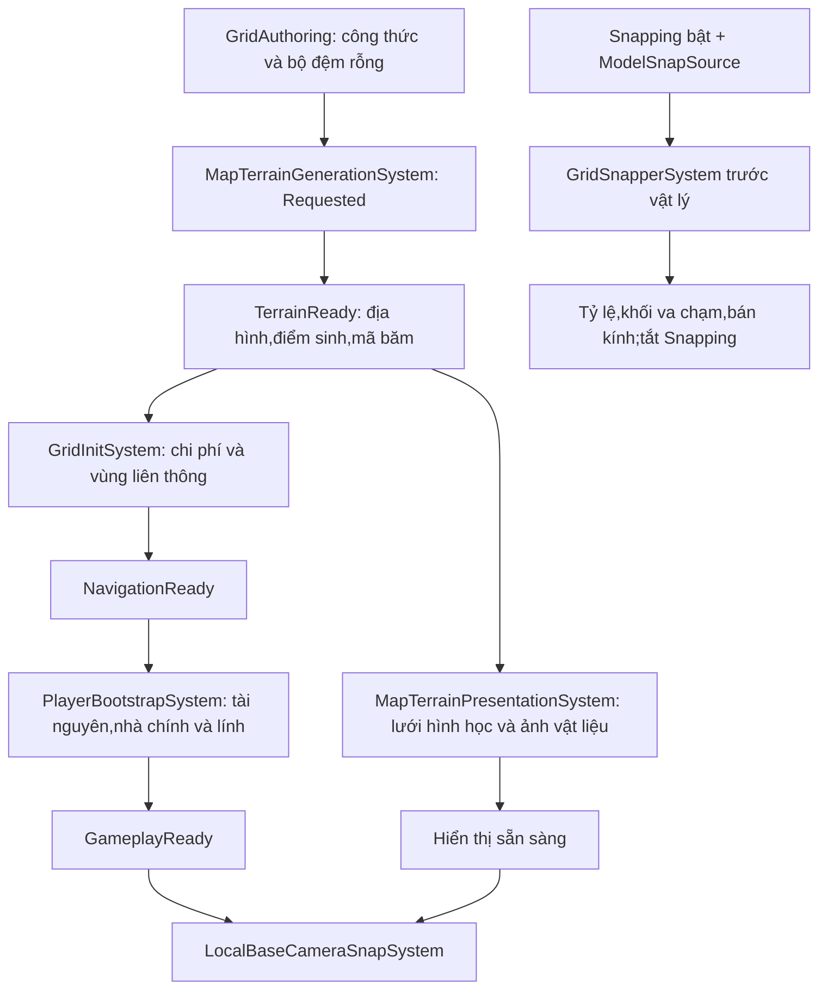

# Luồng xử lý bản đồ và mô hình căn lưới trong ECS

## Trạng thái và thứ tự



địa hình sinh dữ liệu không còn chạy trong bộ chuyển dữ liệu sang ECS. bộ chuyển dữ liệu sang ECS ghi công thức giá trị và bộ đệm; khi chạy ECS sinh địa hình một lần cho mỗi yêu cầu. `MapBuildState` công bố tiến độ để các hệ thống phía sau không đọc dữ liệu chưa sẵn sàng. Lỗi sinh dữ liệu chuyển sang `Failed` kèm thông báo.

| Bước | đầu vào | Xử lý và đầu ra | tệp |
|---|---|---|---|
| Authoring | lưới, MapGenConfig | Ghi GridComponent, MapGenerationRecipe, Requested và bộ đệm rỗng | GridAuthoring.cs |
| Generate | lưới + công thức có seed/version | Gọi thuật toán TerrainGeneration hiện có; xuất GridTerrain, GridSpawnCell và mã băm | MapPipeline.cs |
| điều hướng | TerrainReady | Khởi tạo chi phí/vùng liên thông; đánh dấu lưới.initialized | GridInitSystem.cs |
| khởi tạo | NavigationReady, mẫu đối tượng và cấu hình player/resource | Đặt tài nguyên, nhà chính và lính; xuất PlayerBootstrapState.Ready | PlayerBootstrapSystem.cs |
| Render | địa hình và bộ giao diện | biên dịch hình học, bản dựng ảnh lưới hình học ảnh ảnh sprite/atlas; ghi MapPresentationState.Ready | MapTerrainPresentationSystem.cs |
| Camera | PresentationReady + BootstrapReady + cục bộ người chơi | Tìm MainBaseTag của cục bộ người chơi, đưa camera tới nhà chính; consume CameraSnapPending | LocalBaseCameraSnapSystem.cs |

Các tệp khi chạy nằm dưới `Assets/_Project/Scripts`. Generation/snap thuộc `Runtime/Simulation/MapGeneration`; bộ dựng hình thuộc `Runtime/Presentation/Terrain`, camera thuộc `Runtime/Presentation/Camera`.

khởi tạo lập toàn bộ đặt nhà trước, sau đó ghi Instantiate/Set/Add/Remove/enable/AppendToBuffer vào ECB và Playback một lần. Dữ liệu lúc ghi lệnh được đọc từ mẫu đối tượng; thực thể deferred trong sổ theo dõi được remap khi Playback. Finalizing chờ physics/blockage, chuyển động và dân số trước Ready. Chi tiết [bản vá sự cố dừng đột ngột](BootstrapCrashFix.md).

## Model căn lưới

`Snapping` là enableable ECS thành phần, không phải Unity GameObject tag. `GridSnapperSystem` chỉ xử lý thực thể có request đang bật, `ModelSnapSource` và `LocalTransform`; mẫu đối tượng cũng được xử lý để instance mới thừa hưởng collider/scale đã chuẩn hóa.

- tác nhân: đường kính XZ = `DiameterCells × grid.cellsize`. Giá trị Inspector cũ `radius` được chuyển tên thành `diameterCells`, giữ nguyên số và hiểu là đường kính. bán kính nội bộ né vật cản = `DiameterCells × grid.cellsize / 2`.
- Không có tác nhân: cạnh XZ = `Cells × grid.cellsize`, lấy từ GridScale của thiết lập dữ liệu.
- tỷ lệ tính từ mã nguồn ban đầu, không nhân tiếp tỷ lệ đã căn lưới. Bật lại request không làm mô hình phình thêm.
- Model được fit đều X/Y/Z theo bounds hình học: cạnh XZ dài nhất bằng kích thước đích; không kéo riêng hai trục. Collider và avoidance vẫn dùng footprint logic. Công thức, cách capture và giới hạn kiểm chứng hiện hành nằm ở [GridSnapper_ResourceSpawn](GridSnapper_ResourceSpawn.md). Không nhân đôi diameter và không clamp bán kính tối thiểu 0,75.
- tác nhân giữ vị trí đang di chuyển. Model không phải tác nhân được căn vị trí theo lưới.
- Cập nhật khối va chạm, vùng chiếm chỗ và chặn lối tương ứng; chỉ disable request khi xử lý thành công.

tác nhân có gốc khối va chạm được bộ chuyển dữ liệu sang ECS thêm request tự động. Building dùng GridSnapperAuthoring; mô hình khác có thể thêm ModelSnapperAuthoring. Hỗ trợ gốc box, sphere và capsule trục Y; compound khối va chạm cần đường xử lý riêng và hiện bị từ chối. Box khớp cạnh đường kính tác nhân, không biến thành hình tròn.

Ví dụ yêu cầu căn lưới lại một thực thể đã có mã nguồn:

```csharp
entityManager.SetComponentEnabled<Snapping>(entity, true);
```

khối va chạm blob được bộ nhớ đệm trong hệ thống, chia sẻ giữa instance cùng kích thước/material/filter và giải phóng khi thế giới ECS bị hủy. Không tự giải phóng khối va chạm của từng instance.

## Renderer và camera

TerrainMapRenderer là cầu nối cấu hình cảnh vào ECS; không tự polling/generate bản đồ mỗi khung hình. MapTerrainPresentationSystem quản lý xây/dọn ảnh lưới hình học ảnh ảnh sprite/atlas theo phiên bản. Unity graphics vẫn chạy chính luồng. Thử nghiệm chuyển dữ liệu sang ECS ép phẳng đã xóa theo quyết định người dùng; không còn nhánh synchronous chuyển dữ liệu sang ECS dựng hình request hay fence riêng của nhánh đó.

LocalBaseCameraSnapper chứa thao tác camera; LocalBaseCameraSnapSystem chạy sau bộ dựng hình, chờ nhà chính cục bộ có mặt rồi consume request. Camera không bị khóa vào nhà chính mỗi khung hình.

## Ranh giới chơi nhiều người và Burst

Recipe chỉ chứa giá trị, không chứa ScriptableObject, camera hay lựa chọn cục bộ người chơi. sinh dữ liệu chạy trong local/server thế giới ECS; hiển thị chỉ ở local/client. `MapTerrainSnapshot.Apply` là điểm tiếp nhận terrain/spawn cùng revision/hash cho máy khách trong tương lai. Payload cùng revision/hash được bỏ qua để retransmission không đặt lại điều hướng; thay bản đồ đã NavigationReady/GameplayReady cần đặt lại match trước. Hash kiểm tra gói dữ liệu; không bảo đảm nhiễu float cho kết quả giống nhau trên mọi kiến trúc.

Chưa có lớp truyền dữ liệu, đồng bộ phiên hay dựng lại bản đồ giữa trận. Chưa chuyển toàn bộ TerrainGeneration và graphics API sang Burst: ECS đang điều phối dữ liệu, trạng thái và thứ tự. tài nguyên bộ lập kế hoạch vẫn là bước tốn thời gian lớn; đổi sang ECS tự nó không giảm chi phí thuật toán này.

## Kiểm tra

`MapRuntimePipelineValidation.Run` kiểm tra công thức, seed/hash, sinh dữ liệu một lần, collider/radius, căn lưới lặp và mẫu đối tượng instance. `MainRuntimeBenchmark.Run512` kiểm tra Main thực tế, GameplayReady, bộ dựng hình, request snapping và camera hướng vào nhà chính cục bộ; đo 600 khung hình qua ba chế độ chẩn đoán. Thời gian lô Editor không tương đương FPS GameView hay bản dựng standalone.

Lượt mới nhất sau bản vá khởi tạo ngày 2026-10-12: 512 ×512, 8 người chơi, 1.952 tài nguyên, 5.985 dựng hình thực thể; sổ theo dõi có 2.000 instance duy nhất. Burst biên dịch mặc định, Ready 26,55 giây; sinh dữ liệu 959,99 ms, compile/build địa hình 840,44 ms, tài nguyên bộ lập kế hoạch 20.616,21 ms. Hai lượt (biên dịch đồng bộ và mặc định) đều hoàn thành 600 frame/lượt, renderer/camera đạt; không tái hiện sự cố dừng đột ngột safety handle/JobTempAlloc. [Số đo và cách diễn giải](../Maintenance/VerificationHistory.md).

Lượt trước ECB có Ready 49,63 giây, sinh dữ liệu 994,71 ms và bản dựng địa hình 829,25 ms. Giữ kết quả đó làm lịch sử, không coi chênh Ready là lợi ích riêng của ECB: bộ nhớ đệm Burst, nhập và nạp lại khác nhau. báo cáo mới: `Artifacts/MainRuntimeBenchmark/bootstrap-crash-fix-normal-results.json`; nhật ký: `Artifacts/MainRuntimeBenchmark-bootstrap-crash-fix-normal.log`.
